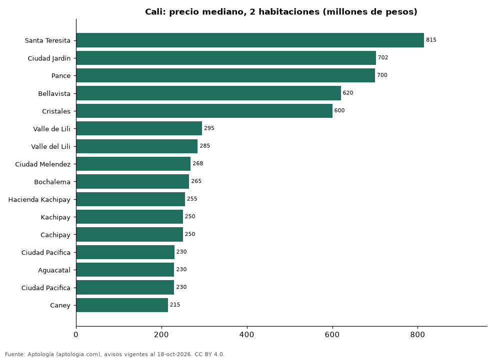

# Dónde cuesta más y menos comprar un apartamento de 2 habitaciones en Cali: ranking de barrios (octubre 2026)

**En Cali, un apartamento de 2 habitaciones cuesta 815 millones de pesos en la mediana en Santa Teresita, el barrio más caro, y 215 millones de pesos en Caney, el más barato: 3,8 veces menos.** Comparamos 16 barrios con al menos 30 avisos de 2 habitaciones.

*Resumen: analizamos 1.339 apartamentos en venta de 2 habitaciones en 16 barrios de Cali.*

**Actualizado:** 18 de octubre de 2026 (datos del 18 de octubre de 2026) · **Próxima actualización:** mensual.

## Resumen

| Indicador | Valor |
|---|---|
| Más caro | Santa Teresita: 815 millones de pesos |
| Más barato | Caney: 215 millones de pesos |
| Diferencia | 3,8 veces |
| Barrios | 16 |

## Precio de un apartamento de 2 habitaciones por barrio

| Barrio | Precio (mediana) | Rango típico (P25–P75) | Área mediana (m²) | Avisos |
|---|---|---|---|---|
| Santa Teresita | 815 millones de pesos | 538 millones de pesos – 1.058 millones de pesos | 102 | 60 |
| Ciudad Jardín | 702 millones de pesos | 650 millones de pesos – 798 millones de pesos | 94 | 39 |
| Pance | 700 millones de pesos | 640 millones de pesos – 828 millones de pesos | 80 | 60 |
| Bellavista | 620 millones de pesos | 488 millones de pesos – 700 millones de pesos | 97 | 69 |
| Cristales | 600 millones de pesos | 555 millones de pesos – 708 millones de pesos | 87 | 31 |
| Valle de Lili | 295 millones de pesos | 222 millones de pesos – 495 millones de pesos | 67 | 43 |
| Valle del Lili | 285 millones de pesos | 240 millones de pesos – 428 millones de pesos | 64 | 262 |
| Ciudad Melendez | 268 millones de pesos | 245 millones de pesos – 299 millones de pesos | 64 | 132 |
| Bochalema | 265 millones de pesos | 234 millones de pesos – 330 millones de pesos | 62 | 268 |
| Hacienda Kachipay | 255 millones de pesos | 238 millones de pesos – 270 millones de pesos | 61 | 42 |
| Kachipay | 250 millones de pesos | 229 millones de pesos – 268 millones de pesos | 61 | 43 |
| Cachipay | 250 millones de pesos | 236 millones de pesos – 280 millones de pesos | 60 | 63 |
| Ciudad Pacífica | 230 millones de pesos | 210 millones de pesos – 277 millones de pesos | 59 | 99 |
| Aguacatal | 230 millones de pesos | 200 millones de pesos – 248 millones de pesos | 57 | 37 |
| Ciudad Pacifica | 230 millones de pesos | 210 millones de pesos – 258 millones de pesos | 59 | 54 |
| Caney | 215 millones de pesos | 190 millones de pesos – 235 millones de pesos | 53 | 37 |

Medianas del precio pedido; solo barrios con 30 avisos o más.

## Preguntas frecuentes

**¿Cuánto cuesta comprar un apartamento de 2 habitaciones en Santa Teresita?**
815 millones de pesos en la mediana (octubre de 2026); la mitad central entre 538 millones de pesos y 1.058 millones de pesos.

**¿Dónde es más barato comprar un apartamento de 2 habitaciones en Cali?**
En Caney: 215 millones de pesos en la mediana.

## Metodología

- **Fuente:** exportes nocturnos de la base de datos de Aptología (aptologia.com) del 18 de octubre de 2026: avisos vigentes de vivienda en portales inmobiliarios de 13 países, recogidos por Aptología y vistos en línea entre el 11 y el 18 de octubre de 2026. Corte: 18 de octubre de 2026.
- **Depuración:** se eliminan duplicados exactos (misma ciudad, zona, tipo, precio, moneda, área, habitaciones y baños) y los precios fuera del percentil 1–99 de cada país, operación, moneda y tipo; el precio por m² usa solo avisos con área declarada entre 12 y 2.000 m² y también se recorta al P1–P99.
- **Qué se mide:** precios pedidos (publicados), no precios de cierre. En arriendo, el canon mensual sin administración, gastos comunes ni condominio.
- **Muestra mínima:** cada cifra publicada se apoya en al menos 30 avisos; las celdas con menos se omiten.
- **Colombia:** Precios en pesos colombianos, sin conversión de moneda.
- **Limitaciones:** la cobertura depende de los portales que recorre Aptología en cada país y es mayor en las ciudades grandes y en los segmentos medio-alto y alto; el área es la que declara el aviso, sin verificar; los nombres de zona vienen de los portales.
- **Privacidad:** solo se publican agregados; no se publica ningún dato personal, enlace a avisos ni nombre de anunciante.
- **Datos abiertos:** [datos.csv](datos.csv), licencia CC BY 4.0.

## Cómo citar

Pinzón Pineda, D. M. (2026). *Dónde cuesta más y menos comprar un apartamento de 2 habitaciones en Cali: ranking de barrios (octubre 2026)*. Aptología (aptologia.com). https://github.com/elbroker/aptologia-datos/tree/main/estudios/venta-apartamentos-de-2-habitaciones-por-barrio-cali-2026. Datos: datos.csv, licencia CC BY 4.0.
