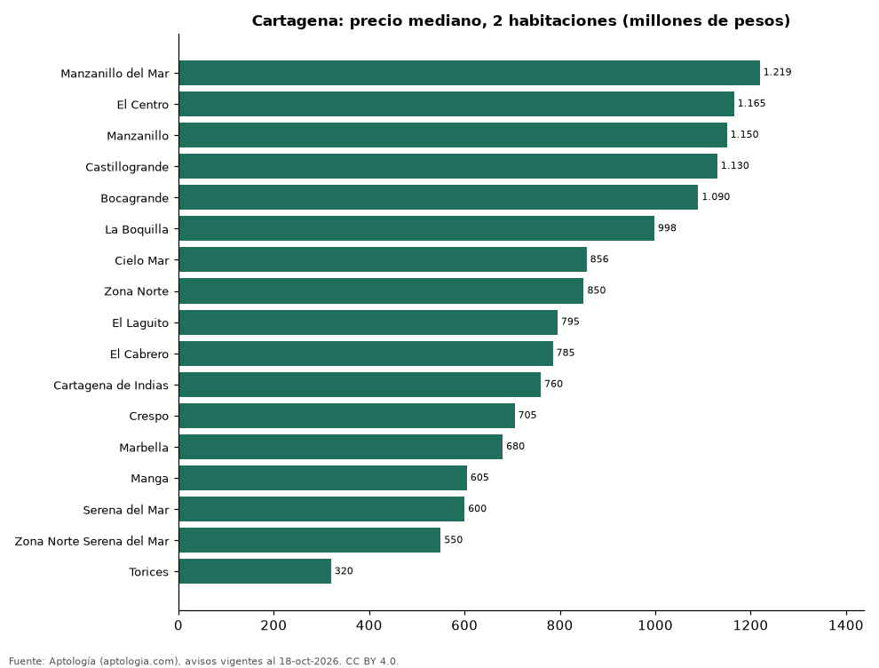

# Dónde cuesta más y menos comprar un apartamento de 2 habitaciones en Cartagena: ranking de barrios (octubre 2026)

**En Cartagena, un apartamento de 2 habitaciones cuesta 1.219 millones de pesos en la mediana en Manzanillo del Mar, el barrio más caro, y 320 millones de pesos en Torices, el más barato: 3,8 veces menos.** Comparamos 17 barrios con al menos 30 avisos de 2 habitaciones.

*Resumen: analizamos 1.672 apartamentos en venta de 2 habitaciones en 17 barrios de Cartagena.*

**Actualizado:** 18 de octubre de 2026 (datos del 18 de octubre de 2026) · **Próxima actualización:** mensual.

## Resumen

| Indicador | Valor |
|---|---|
| Más caro | Manzanillo del Mar: 1.219 millones de pesos |
| Más barato | Torices: 320 millones de pesos |
| Diferencia | 3,8 veces |
| Barrios | 17 |

## Precio de un apartamento de 2 habitaciones por barrio

| Barrio | Precio (mediana) | Rango típico (P25–P75) | Área mediana (m²) | Avisos |
|---|---|---|---|---|
| Manzanillo del Mar | 1.219 millones de pesos | 738 millones de pesos – 1.355 millones de pesos | 105 | 36 |
| El Centro | 1.165 millones de pesos | 912 millones de pesos – 1.675 millones de pesos | 76 | 34 |
| Manzanillo | 1.150 millones de pesos | 804 millones de pesos – 1.380 millones de pesos | 97 | 77 |
| Castillogrande | 1.130 millones de pesos | 912 millones de pesos – 1.300 millones de pesos | 106 | 55 |
| Bocagrande | 1.090 millones de pesos | 700 millones de pesos – 1.350 millones de pesos | 95 | 224 |
| La Boquilla | 998 millones de pesos | 850 millones de pesos – 1.290 millones de pesos | 102 | 201 |
| Cielo Mar | 856 millones de pesos | 750 millones de pesos – 900 millones de pesos | 92 | 65 |
| Zona Norte | 850 millones de pesos | 638 millones de pesos – 1.300 millones de pesos | 98 | 56 |
| El Laguito | 795 millones de pesos | 650 millones de pesos – 880 millones de pesos | 90 | 91 |
| El Cabrero | 785 millones de pesos | 698 millones de pesos – 960 millones de pesos | 94 | 44 |
| Cartagena de Indias | 760 millones de pesos | 520 millones de pesos – 1.100 millones de pesos | 92 | 117 |
| Crespo | 705 millones de pesos | 584 millones de pesos – 850 millones de pesos | 97 | 78 |
| Marbella | 680 millones de pesos | 550 millones de pesos – 860 millones de pesos | 90 | 83 |
| Manga | 605 millones de pesos | 480 millones de pesos – 782 millones de pesos | 90 | 76 |
| Serena del Mar | 600 millones de pesos | 500 millones de pesos – 750 millones de pesos | 76 | 339 |
| Zona Norte Serena del Mar | 550 millones de pesos | 487 millones de pesos – 882 millones de pesos | 75 | 42 |
| Torices | 320 millones de pesos | 297 millones de pesos – 350 millones de pesos | 52 | 54 |

Medianas del precio pedido; solo barrios con 30 avisos o más.

## Preguntas frecuentes

**¿Cuánto cuesta comprar un apartamento de 2 habitaciones en Manzanillo del Mar?**
1.219 millones de pesos en la mediana (octubre de 2026); la mitad central entre 738 millones de pesos y 1.355 millones de pesos.

**¿Dónde es más barato comprar un apartamento de 2 habitaciones en Cartagena?**
En Torices: 320 millones de pesos en la mediana.

## Metodología

- **Fuente:** exportes nocturnos de la base de datos de Aptología (aptologia.com) del 18 de octubre de 2026: avisos vigentes de vivienda en portales inmobiliarios de 13 países, recogidos por Aptología y vistos en línea entre el 11 y el 18 de octubre de 2026. Corte: 18 de octubre de 2026.
- **Depuración:** se eliminan duplicados exactos (misma ciudad, zona, tipo, precio, moneda, área, habitaciones y baños) y los precios fuera del percentil 1–99 de cada país, operación, moneda y tipo; el precio por m² usa solo avisos con área declarada entre 12 y 2.000 m² y también se recorta al P1–P99.
- **Qué se mide:** precios pedidos (publicados), no precios de cierre. En arriendo, el canon mensual sin administración, gastos comunes ni condominio.
- **Muestra mínima:** cada cifra publicada se apoya en al menos 30 avisos; las celdas con menos se omiten.
- **Colombia:** Precios en pesos colombianos, sin conversión de moneda.
- **Limitaciones:** la cobertura depende de los portales que recorre Aptología en cada país y es mayor en las ciudades grandes y en los segmentos medio-alto y alto; el área es la que declara el aviso, sin verificar; los nombres de zona vienen de los portales.
- **Privacidad:** solo se publican agregados; no se publica ningún dato personal, enlace a avisos ni nombre de anunciante.
- **Datos abiertos:** [datos.csv](datos.csv), licencia CC BY 4.0.

## Cómo citar

Pinzón Pineda, D. M. (2026). *Dónde cuesta más y menos comprar un apartamento de 2 habitaciones en Cartagena: ranking de barrios (octubre 2026)*. Aptología (aptologia.com). https://github.com/elbroker/aptologia-datos/tree/main/estudios/venta-apartamentos-de-2-habitaciones-por-barrio-cartagena-2026. Datos: datos.csv, licencia CC BY 4.0.
