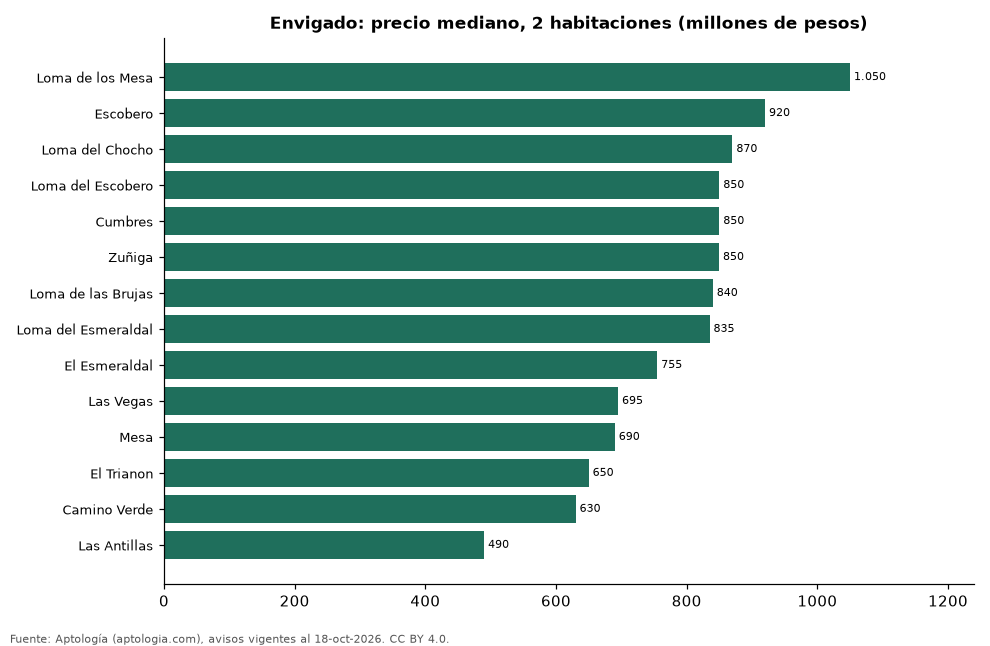

# Dónde cuesta más y menos comprar un apartamento de 2 habitaciones en Envigado: ranking de barrios (octubre 2026)

**En Envigado, un apartamento de 2 habitaciones cuesta 1.050 millones de pesos en la mediana en Loma de los Mesa, el barrio más caro, y 490 millones de pesos en Las Antillas, el más barato: 2,1 veces menos.** Comparamos 14 barrios con al menos 30 avisos de 2 habitaciones.

*Resumen: analizamos 741 apartamentos en venta de 2 habitaciones en 14 barrios de Envigado.*

**Actualizado:** 18 de octubre de 2026 (datos del 18 de octubre de 2026) · **Próxima actualización:** mensual.

## Resumen

| Indicador | Valor |
|---|---|
| Más caro | Loma de los Mesa: 1.050 millones de pesos |
| Más barato | Las Antillas: 490 millones de pesos |
| Diferencia | 2,1 veces |
| Barrios | 14 |

## Precio de un apartamento de 2 habitaciones por barrio

| Barrio | Precio (mediana) | Rango típico (P25–P75) | Área mediana (m²) | Avisos |
|---|---|---|---|---|
| Loma de los Mesa | 1.050 millones de pesos | 900 millones de pesos – 1.138 millones de pesos | 95 | 39 |
| Escobero | 920 millones de pesos | 830 millones de pesos – 1.250 millones de pesos | 84 | 41 |
| Loma del Chocho | 870 millones de pesos | 740 millones de pesos – 950 millones de pesos | 85 | 37 |
| Loma del Escobero | 850 millones de pesos | 780 millones de pesos – 1.080 millones de pesos | 82 | 65 |
| Cumbres | 850 millones de pesos | 692 millones de pesos – 1.022 millones de pesos | 94 | 70 |
| Zuñiga | 850 millones de pesos | 740 millones de pesos – 945 millones de pesos | 103 | 38 |
| Loma de las Brujas | 840 millones de pesos | 750 millones de pesos – 930 millones de pesos | 87 | 89 |
| Loma del Esmeraldal | 835 millones de pesos | 725 millones de pesos – 998 millones de pesos | 86 | 89 |
| El Esmeraldal | 755 millones de pesos | 629 millones de pesos – 888 millones de pesos | 86 | 42 |
| Las Vegas | 695 millones de pesos | 670 millones de pesos – 748 millones de pesos | 67 | 46 |
| Mesa | 690 millones de pesos | 570 millones de pesos – 925 millones de pesos | 78 | 35 |
| El Trianon | 650 millones de pesos | 614 millones de pesos – 672 millones de pesos | 68 | 40 |
| Camino Verde | 630 millones de pesos | 579 millones de pesos – 828 millones de pesos | 75 | 66 |
| Las Antillas | 490 millones de pesos | 469 millones de pesos – 546 millones de pesos | 68 | 44 |

Medianas del precio pedido; solo barrios con 30 avisos o más.

## Preguntas frecuentes

**¿Cuánto cuesta comprar un apartamento de 2 habitaciones en Loma de los Mesa?**
1.050 millones de pesos en la mediana (octubre de 2026); la mitad central entre 900 millones de pesos y 1.138 millones de pesos.

**¿Dónde es más barato comprar un apartamento de 2 habitaciones en Envigado?**
En Las Antillas: 490 millones de pesos en la mediana.

## Metodología

- **Fuente:** exportes nocturnos de la base de datos de Aptología (aptologia.com) del 18 de octubre de 2026: avisos vigentes de vivienda en portales inmobiliarios de 13 países, recogidos por Aptología y vistos en línea entre el 11 y el 18 de octubre de 2026. Corte: 18 de octubre de 2026.
- **Depuración:** se eliminan duplicados exactos (misma ciudad, zona, tipo, precio, moneda, área, habitaciones y baños) y los precios fuera del percentil 1–99 de cada país, operación, moneda y tipo; el precio por m² usa solo avisos con área declarada entre 12 y 2.000 m² y también se recorta al P1–P99.
- **Qué se mide:** precios pedidos (publicados), no precios de cierre. En arriendo, el canon mensual sin administración, gastos comunes ni condominio.
- **Muestra mínima:** cada cifra publicada se apoya en al menos 30 avisos; las celdas con menos se omiten.
- **Colombia:** Precios en pesos colombianos, sin conversión de moneda.
- **Limitaciones:** la cobertura depende de los portales que recorre Aptología en cada país y es mayor en las ciudades grandes y en los segmentos medio-alto y alto; el área es la que declara el aviso, sin verificar; los nombres de zona vienen de los portales.
- **Privacidad:** solo se publican agregados; no se publica ningún dato personal, enlace a avisos ni nombre de anunciante.
- **Datos abiertos:** [datos.csv](datos.csv), licencia CC BY 4.0.

## Cómo citar

Pinzón Pineda, D. M. (2026). *Dónde cuesta más y menos comprar un apartamento de 2 habitaciones en Envigado: ranking de barrios (octubre 2026)*. Aptología (aptologia.com). https://github.com/elbroker/aptologia-datos/tree/main/estudios/venta-apartamentos-de-2-habitaciones-por-barrio-envigado-2026. Datos: datos.csv, licencia CC BY 4.0.
