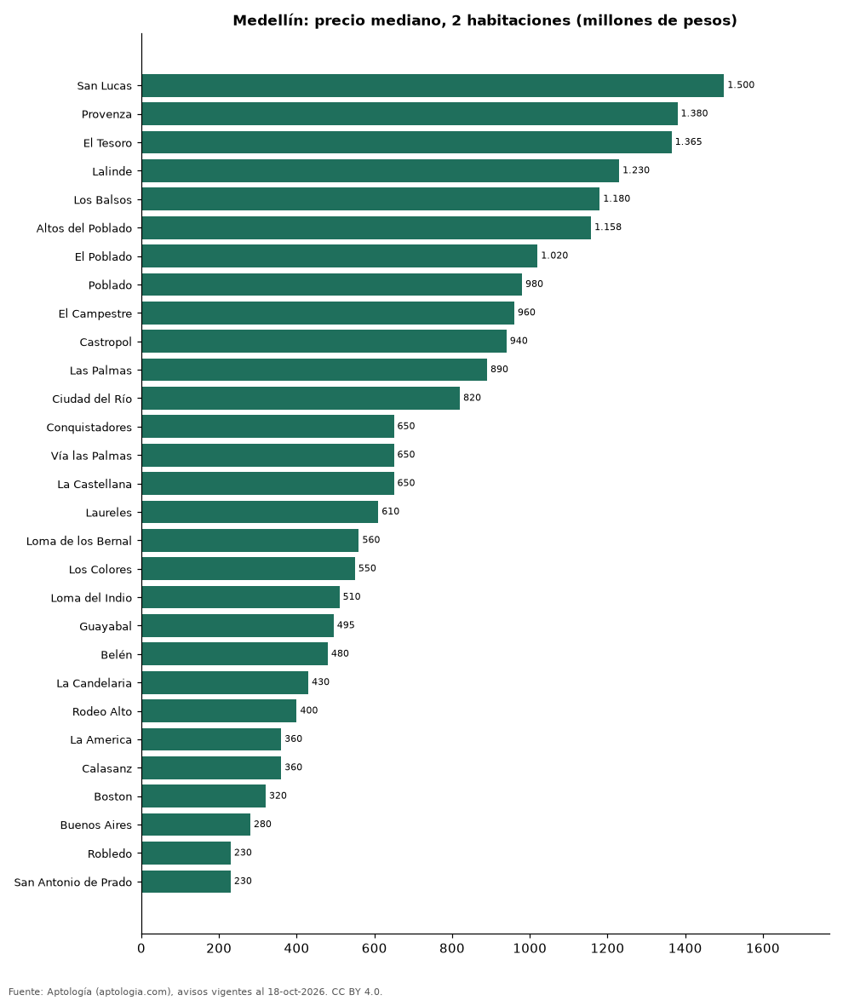

# Dónde cuesta más y menos comprar un apartamento de 2 habitaciones en Medellín: ranking de barrios (octubre 2026)

**En Medellín, un apartamento de 2 habitaciones cuesta 1.500 millones de pesos en la mediana en San Lucas, el barrio más caro, y 230 millones de pesos en San Antonio de Prado, el más barato: 6,5 veces menos.** Comparamos 29 barrios con al menos 30 avisos de 2 habitaciones.

*Resumen: analizamos 3.255 apartamentos en venta de 2 habitaciones en 29 barrios de Medellín.*

**Actualizado:** 18 de octubre de 2026 (datos del 18 de octubre de 2026) · **Próxima actualización:** mensual.

## Resumen

| Indicador | Valor |
|---|---|
| Más caro | San Lucas: 1.500 millones de pesos |
| Más barato | San Antonio de Prado: 230 millones de pesos |
| Diferencia | 6,5 veces |
| Barrios | 29 |

## Precio de un apartamento de 2 habitaciones por barrio

| Barrio | Precio (mediana) | Rango típico (P25–P75) | Área mediana (m²) | Avisos |
|---|---|---|---|---|
| San Lucas | 1.500 millones de pesos | 1.080 millones de pesos – 1.800 millones de pesos | 132 | 52 |
| Provenza | 1.380 millones de pesos | 975 millones de pesos – 1.980 millones de pesos | 135 | 37 |
| El Tesoro | 1.365 millones de pesos | 1.062 millones de pesos – 2.327 millones de pesos | 120 | 54 |
| Lalinde | 1.230 millones de pesos | 1.142 millones de pesos – 1.399 millones de pesos | 95 | 42 |
| Los Balsos | 1.180 millones de pesos | 900 millones de pesos – 1.425 millones de pesos | 94 | 55 |
| Altos del Poblado | 1.158 millones de pesos | 870 millones de pesos – 1.300 millones de pesos | 90 | 88 |
| El Poblado | 1.020 millones de pesos | 777 millones de pesos – 1.350 millones de pesos | 100 | 1.073 |
| Poblado | 980 millones de pesos | 750 millones de pesos – 1.350 millones de pesos | 100 | 189 |
| El Campestre | 960 millones de pesos | 752 millones de pesos – 2.125 millones de pesos | 110 | 38 |
| Castropol | 940 millones de pesos | 755 millones de pesos – 1.327 millones de pesos | 94 | 86 |
| Las Palmas | 890 millones de pesos | 690 millones de pesos – 1.286 millones de pesos | 86 | 128 |
| Ciudad del Río | 820 millones de pesos | 769 millones de pesos – 948 millones de pesos | 78 | 99 |
| Conquistadores | 650 millones de pesos | 515 millones de pesos – 860 millones de pesos | 86 | 45 |
| Vía las Palmas | 650 millones de pesos | 560 millones de pesos – 820 millones de pesos | 70 | 33 |
| La Castellana | 650 millones de pesos | 480 millones de pesos – 1.130 millones de pesos | 81 | 37 |
| Laureles | 610 millones de pesos | 488 millones de pesos – 758 millones de pesos | 79 | 287 |
| Loma de los Bernal | 560 millones de pesos | 480 millones de pesos – 662 millones de pesos | 70 | 52 |
| Los Colores | 550 millones de pesos | 468 millones de pesos – 721 millones de pesos | 74 | 36 |
| Loma del Indio | 510 millones de pesos | 452 millones de pesos – 637 millones de pesos | 64 | 90 |
| Guayabal | 495 millones de pesos | 440 millones de pesos – 645 millones de pesos | 60 | 33 |
| Belén | 480 millones de pesos | 410 millones de pesos – 637 millones de pesos | 67 | 163 |
| La Candelaria | 430 millones de pesos | 275 millones de pesos – 660 millones de pesos | 61 | 35 |
| Rodeo Alto | 400 millones de pesos | 350 millones de pesos – 450 millones de pesos | 57 | 37 |
| La America | 360 millones de pesos | 305 millones de pesos – 410 millones de pesos | 63 | 31 |
| Calasanz | 360 millones de pesos | 310 millones de pesos – 439 millones de pesos | 52 | 144 |
| Boston | 320 millones de pesos | 280 millones de pesos – 395 millones de pesos | 55 | 62 |
| Buenos Aires | 280 millones de pesos | 220 millones de pesos – 398 millones de pesos | 55 | 38 |
| Robledo | 230 millones de pesos | 185 millones de pesos – 380 millones de pesos | 47 | 125 |
| San Antonio de Prado | 230 millones de pesos | 201 millones de pesos – 250 millones de pesos | 46 | 66 |

Medianas del precio pedido; solo barrios con 30 avisos o más.

## Preguntas frecuentes

**¿Cuánto cuesta comprar un apartamento de 2 habitaciones en San Lucas?**
1.500 millones de pesos en la mediana (octubre de 2026); la mitad central entre 1.080 millones de pesos y 1.800 millones de pesos.

**¿Dónde es más barato comprar un apartamento de 2 habitaciones en Medellín?**
En San Antonio de Prado: 230 millones de pesos en la mediana.

## Metodología

- **Fuente:** exportes nocturnos de la base de datos de Aptología (aptologia.com) del 18 de octubre de 2026: avisos vigentes de vivienda en portales inmobiliarios de 13 países, recogidos por Aptología y vistos en línea entre el 11 y el 18 de octubre de 2026. Corte: 18 de octubre de 2026.
- **Depuración:** se eliminan duplicados exactos (misma ciudad, zona, tipo, precio, moneda, área, habitaciones y baños) y los precios fuera del percentil 1–99 de cada país, operación, moneda y tipo; el precio por m² usa solo avisos con área declarada entre 12 y 2.000 m² y también se recorta al P1–P99.
- **Qué se mide:** precios pedidos (publicados), no precios de cierre. En arriendo, el canon mensual sin administración, gastos comunes ni condominio.
- **Muestra mínima:** cada cifra publicada se apoya en al menos 30 avisos; las celdas con menos se omiten.
- **Colombia:** Precios en pesos colombianos, sin conversión de moneda.
- **Limitaciones:** la cobertura depende de los portales que recorre Aptología en cada país y es mayor en las ciudades grandes y en los segmentos medio-alto y alto; el área es la que declara el aviso, sin verificar; los nombres de zona vienen de los portales.
- **Privacidad:** solo se publican agregados; no se publica ningún dato personal, enlace a avisos ni nombre de anunciante.
- **Datos abiertos:** [datos.csv](datos.csv), licencia CC BY 4.0.

## Cómo citar

Pinzón Pineda, D. M. (2026). *Dónde cuesta más y menos comprar un apartamento de 2 habitaciones en Medellín: ranking de barrios (octubre 2026)*. Aptología (aptologia.com). https://github.com/elbroker/aptologia-datos/tree/main/estudios/venta-apartamentos-de-2-habitaciones-por-barrio-medellin-2026. Datos: datos.csv, licencia CC BY 4.0.
