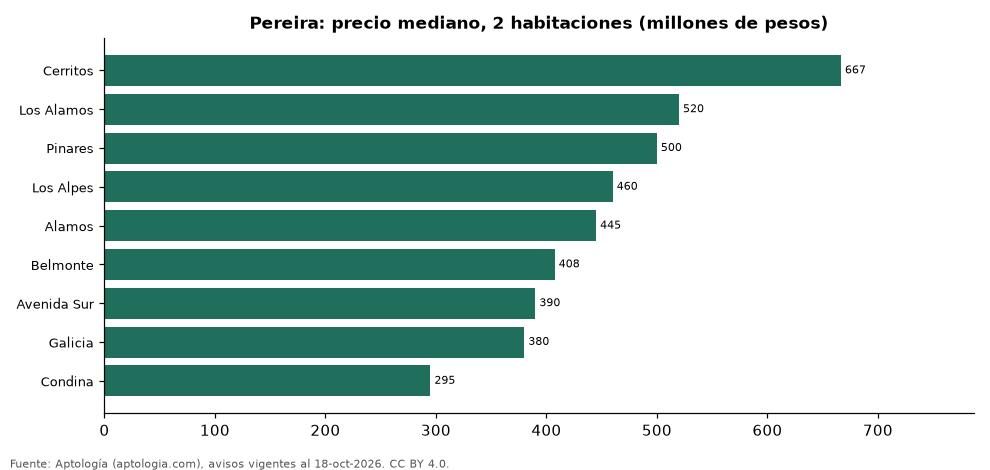

# Dónde cuesta más y menos comprar un apartamento de 2 habitaciones en Pereira: ranking de barrios (octubre 2026)

**En Pereira, un apartamento de 2 habitaciones cuesta 667 millones de pesos en la mediana en Cerritos, el barrio más caro, y 295 millones de pesos en Condina, el más barato: 2,3 veces menos.** Comparamos 9 barrios con al menos 30 avisos de 2 habitaciones.

*Resumen: analizamos 602 apartamentos en venta de 2 habitaciones en 9 barrios de Pereira.*

**Actualizado:** 18 de octubre de 2026 (datos del 18 de octubre de 2026) · **Próxima actualización:** mensual.

## Resumen

| Indicador | Valor |
|---|---|
| Más caro | Cerritos: 667 millones de pesos |
| Más barato | Condina: 295 millones de pesos |
| Diferencia | 2,3 veces |
| Barrios | 9 |

## Precio de un apartamento de 2 habitaciones por barrio

| Barrio | Precio (mediana) | Rango típico (P25–P75) | Área mediana (m²) | Avisos |
|---|---|---|---|---|
| Cerritos | 667 millones de pesos | 535 millones de pesos – 770 millones de pesos | 80 | 145 |
| Los Alamos | 520 millones de pesos | 432 millones de pesos – 610 millones de pesos | 79 | 35 |
| Pinares | 500 millones de pesos | 400 millones de pesos – 600 millones de pesos | 78 | 157 |
| Los Alpes | 460 millones de pesos | 380 millones de pesos – 565 millones de pesos | 74 | 44 |
| Alamos | 445 millones de pesos | 385 millones de pesos – 545 millones de pesos | 75 | 79 |
| Belmonte | 408 millones de pesos | 366 millones de pesos – 430 millones de pesos | 66 | 30 |
| Avenida Sur | 390 millones de pesos | 350 millones de pesos – 500 millones de pesos | 62 | 33 |
| Galicia | 380 millones de pesos | 325 millones de pesos – 700 millones de pesos | 68 | 37 |
| Condina | 295 millones de pesos | 266 millones de pesos – 329 millones de pesos | 56 | 42 |

Medianas del precio pedido; solo barrios con 30 avisos o más.

## Preguntas frecuentes

**¿Cuánto cuesta comprar un apartamento de 2 habitaciones en Cerritos?**
667 millones de pesos en la mediana (octubre de 2026); la mitad central entre 535 millones de pesos y 770 millones de pesos.

**¿Dónde es más barato comprar un apartamento de 2 habitaciones en Pereira?**
En Condina: 295 millones de pesos en la mediana.

## Metodología

- **Fuente:** exportes nocturnos de la base de datos de Aptología (aptologia.com) del 18 de octubre de 2026: avisos vigentes de vivienda en portales inmobiliarios de 13 países, recogidos por Aptología y vistos en línea entre el 11 y el 18 de octubre de 2026. Corte: 18 de octubre de 2026.
- **Depuración:** se eliminan duplicados exactos (misma ciudad, zona, tipo, precio, moneda, área, habitaciones y baños) y los precios fuera del percentil 1–99 de cada país, operación, moneda y tipo; el precio por m² usa solo avisos con área declarada entre 12 y 2.000 m² y también se recorta al P1–P99.
- **Qué se mide:** precios pedidos (publicados), no precios de cierre. En arriendo, el canon mensual sin administración, gastos comunes ni condominio.
- **Muestra mínima:** cada cifra publicada se apoya en al menos 30 avisos; las celdas con menos se omiten.
- **Colombia:** Precios en pesos colombianos, sin conversión de moneda.
- **Limitaciones:** la cobertura depende de los portales que recorre Aptología en cada país y es mayor en las ciudades grandes y en los segmentos medio-alto y alto; el área es la que declara el aviso, sin verificar; los nombres de zona vienen de los portales.
- **Privacidad:** solo se publican agregados; no se publica ningún dato personal, enlace a avisos ni nombre de anunciante.
- **Datos abiertos:** [datos.csv](datos.csv), licencia CC BY 4.0.

## Cómo citar

Pinzón Pineda, D. M. (2026). *Dónde cuesta más y menos comprar un apartamento de 2 habitaciones en Pereira: ranking de barrios (octubre 2026)*. Aptología (aptologia.com). https://github.com/elbroker/aptologia-datos/tree/main/estudios/venta-apartamentos-de-2-habitaciones-por-barrio-pereira-2026. Datos: datos.csv, licencia CC BY 4.0.
