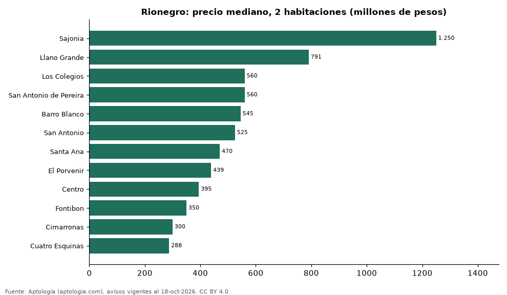

# Dónde cuesta más y menos comprar un apartamento de 2 habitaciones en Rionegro: ranking de barrios (octubre 2026)

**En Rionegro, un apartamento de 2 habitaciones cuesta 1.250 millones de pesos en la mediana en Sajonia, el barrio más caro, y 288 millones de pesos en Cuatro Esquinas, el más barato: 4,3 veces menos.** Comparamos 12 barrios con al menos 30 avisos de 2 habitaciones.

*Resumen: analizamos 1.013 apartamentos en venta de 2 habitaciones en 12 barrios de Rionegro.*

**Actualizado:** 18 de octubre de 2026 (datos del 18 de octubre de 2026) · **Próxima actualización:** mensual.

## Resumen

| Indicador | Valor |
|---|---|
| Más caro | Sajonia: 1.250 millones de pesos |
| Más barato | Cuatro Esquinas: 288 millones de pesos |
| Diferencia | 4,3 veces |
| Barrios | 12 |

## Precio de un apartamento de 2 habitaciones por barrio

| Barrio | Precio (mediana) | Rango típico (P25–P75) | Área mediana (m²) | Avisos |
|---|---|---|---|---|
| Sajonia | 1.250 millones de pesos | 1.150 millones de pesos – 1.358 millones de pesos | 112 | 56 |
| Llano Grande | 791 millones de pesos | 560 millones de pesos – 1.250 millones de pesos | 84 | 89 |
| Los Colegios | 560 millones de pesos | 438 millones de pesos – 602 millones de pesos | 66 | 43 |
| San Antonio de Pereira | 560 millones de pesos | 479 millones de pesos – 640 millones de pesos | 67 | 95 |
| Barro Blanco | 545 millones de pesos | 510 millones de pesos – 578 millones de pesos | 65 | 142 |
| San Antonio | 525 millones de pesos | 468 millones de pesos – 574 millones de pesos | 66 | 40 |
| Santa Ana | 470 millones de pesos | 350 millones de pesos – 570 millones de pesos | 58 | 49 |
| El Porvenir | 439 millones de pesos | 320 millones de pesos – 580 millones de pesos | 59 | 240 |
| Centro | 395 millones de pesos | 320 millones de pesos – 550 millones de pesos | 58 | 53 |
| Fontibon | 350 millones de pesos | 312 millones de pesos – 373 millones de pesos | 57 | 139 |
| Cimarronas | 300 millones de pesos | 280 millones de pesos – 318 millones de pesos | 52 | 31 |
| Cuatro Esquinas | 288 millones de pesos | 263 millones de pesos – 311 millones de pesos | 51 | 36 |

Medianas del precio pedido; solo barrios con 30 avisos o más.

## Preguntas frecuentes

**¿Cuánto cuesta comprar un apartamento de 2 habitaciones en Sajonia?**
1.250 millones de pesos en la mediana (octubre de 2026); la mitad central entre 1.150 millones de pesos y 1.358 millones de pesos.

**¿Dónde es más barato comprar un apartamento de 2 habitaciones en Rionegro?**
En Cuatro Esquinas: 288 millones de pesos en la mediana.

## Metodología

- **Fuente:** exportes nocturnos de la base de datos de Aptología (aptologia.com) del 18 de octubre de 2026: avisos vigentes de vivienda en portales inmobiliarios de 13 países, recogidos por Aptología y vistos en línea entre el 11 y el 18 de octubre de 2026. Corte: 18 de octubre de 2026.
- **Depuración:** se eliminan duplicados exactos (misma ciudad, zona, tipo, precio, moneda, área, habitaciones y baños) y los precios fuera del percentil 1–99 de cada país, operación, moneda y tipo; el precio por m² usa solo avisos con área declarada entre 12 y 2.000 m² y también se recorta al P1–P99.
- **Qué se mide:** precios pedidos (publicados), no precios de cierre. En arriendo, el canon mensual sin administración, gastos comunes ni condominio.
- **Muestra mínima:** cada cifra publicada se apoya en al menos 30 avisos; las celdas con menos se omiten.
- **Colombia:** Precios en pesos colombianos, sin conversión de moneda.
- **Limitaciones:** la cobertura depende de los portales que recorre Aptología en cada país y es mayor en las ciudades grandes y en los segmentos medio-alto y alto; el área es la que declara el aviso, sin verificar; los nombres de zona vienen de los portales.
- **Privacidad:** solo se publican agregados; no se publica ningún dato personal, enlace a avisos ni nombre de anunciante.
- **Datos abiertos:** [datos.csv](datos.csv), licencia CC BY 4.0.

## Cómo citar

Pinzón Pineda, D. M. (2026). *Dónde cuesta más y menos comprar un apartamento de 2 habitaciones en Rionegro: ranking de barrios (octubre 2026)*. Aptología (aptologia.com). https://github.com/elbroker/aptologia-datos/tree/main/estudios/venta-apartamentos-de-2-habitaciones-por-barrio-rionegro-2026. Datos: datos.csv, licencia CC BY 4.0.
