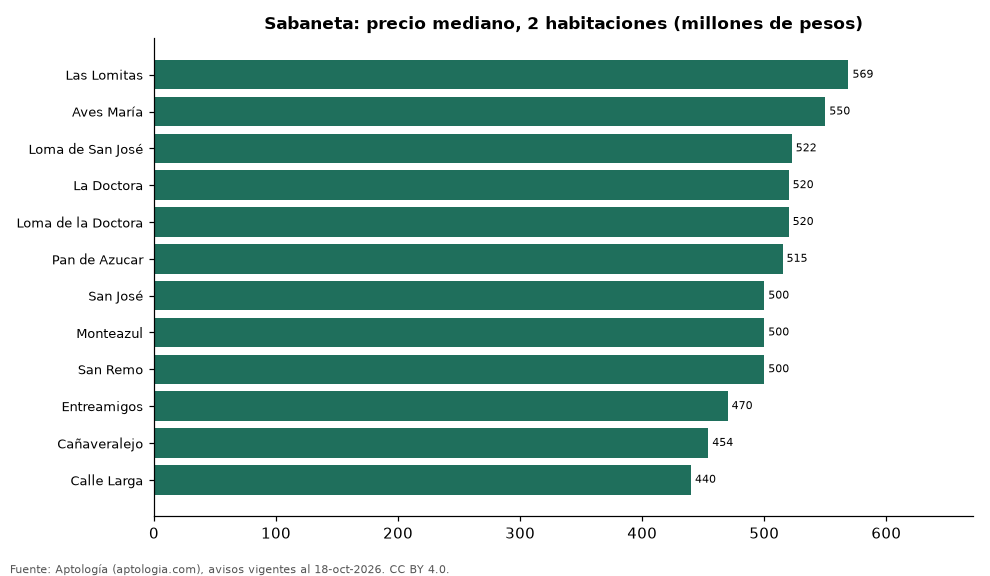

# Dónde cuesta más y menos comprar un apartamento de 2 habitaciones en Sabaneta: ranking de barrios (octubre 2026)

**En Sabaneta, un apartamento de 2 habitaciones cuesta 569 millones de pesos en la mediana en Las Lomitas, el barrio más caro, y 440 millones de pesos en Calle Larga, el más barato: 1,3 veces menos.** Comparamos 12 barrios con al menos 30 avisos de 2 habitaciones.

*Resumen: analizamos 819 apartamentos en venta de 2 habitaciones en 12 barrios de Sabaneta.*

**Actualizado:** 18 de octubre de 2026 (datos del 18 de octubre de 2026) · **Próxima actualización:** mensual.

## Resumen

| Indicador | Valor |
|---|---|
| Más caro | Las Lomitas: 569 millones de pesos |
| Más barato | Calle Larga: 440 millones de pesos |
| Diferencia | 1,3 veces |
| Barrios | 12 |

## Precio de un apartamento de 2 habitaciones por barrio

| Barrio | Precio (mediana) | Rango típico (P25–P75) | Área mediana (m²) | Avisos |
|---|---|---|---|---|
| Las Lomitas | 569 millones de pesos | 445 millones de pesos – 634 millones de pesos | 72 | 132 |
| Aves María | 550 millones de pesos | 450 millones de pesos – 660 millones de pesos | 84 | 63 |
| Loma de San José | 522 millones de pesos | 421 millones de pesos – 588 millones de pesos | 66 | 54 |
| La Doctora | 520 millones de pesos | 450 millones de pesos – 600 millones de pesos | 64 | 103 |
| Loma de la Doctora | 520 millones de pesos | 466 millones de pesos – 600 millones de pesos | 66 | 34 |
| Pan de Azucar | 515 millones de pesos | 370 millones de pesos – 570 millones de pesos | 66 | 107 |
| San José | 500 millones de pesos | 426 millones de pesos – 606 millones de pesos | 66 | 124 |
| Monteazul | 500 millones de pesos | 438 millones de pesos – 560 millones de pesos | 63 | 53 |
| San Remo | 500 millones de pesos | 470 millones de pesos – 520 millones de pesos | 65 | 33 |
| Entreamigos | 470 millones de pesos | 380 millones de pesos – 580 millones de pesos | 67 | 39 |
| Cañaveralejo | 454 millones de pesos | 382 millones de pesos – 498 millones de pesos | 58 | 31 |
| Calle Larga | 440 millones de pesos | 352 millones de pesos – 614 millones de pesos | 60 | 46 |

Medianas del precio pedido; solo barrios con 30 avisos o más.

## Preguntas frecuentes

**¿Cuánto cuesta comprar un apartamento de 2 habitaciones en Las Lomitas?**
569 millones de pesos en la mediana (octubre de 2026); la mitad central entre 445 millones de pesos y 634 millones de pesos.

**¿Dónde es más barato comprar un apartamento de 2 habitaciones en Sabaneta?**
En Calle Larga: 440 millones de pesos en la mediana.

## Metodología

- **Fuente:** exportes nocturnos de la base de datos de Aptología (aptologia.com) del 18 de octubre de 2026: avisos vigentes de vivienda en portales inmobiliarios de 13 países, recogidos por Aptología y vistos en línea entre el 11 y el 18 de octubre de 2026. Corte: 18 de octubre de 2026.
- **Depuración:** se eliminan duplicados exactos (misma ciudad, zona, tipo, precio, moneda, área, habitaciones y baños) y los precios fuera del percentil 1–99 de cada país, operación, moneda y tipo; el precio por m² usa solo avisos con área declarada entre 12 y 2.000 m² y también se recorta al P1–P99.
- **Qué se mide:** precios pedidos (publicados), no precios de cierre. En arriendo, el canon mensual sin administración, gastos comunes ni condominio.
- **Muestra mínima:** cada cifra publicada se apoya en al menos 30 avisos; las celdas con menos se omiten.
- **Colombia:** Precios en pesos colombianos, sin conversión de moneda.
- **Limitaciones:** la cobertura depende de los portales que recorre Aptología en cada país y es mayor en las ciudades grandes y en los segmentos medio-alto y alto; el área es la que declara el aviso, sin verificar; los nombres de zona vienen de los portales.
- **Privacidad:** solo se publican agregados; no se publica ningún dato personal, enlace a avisos ni nombre de anunciante.
- **Datos abiertos:** [datos.csv](datos.csv), licencia CC BY 4.0.

## Cómo citar

Pinzón Pineda, D. M. (2026). *Dónde cuesta más y menos comprar un apartamento de 2 habitaciones en Sabaneta: ranking de barrios (octubre 2026)*. Aptología (aptologia.com). https://github.com/elbroker/aptologia-datos/tree/main/estudios/venta-apartamentos-de-2-habitaciones-por-barrio-sabaneta-2026. Datos: datos.csv, licencia CC BY 4.0.
