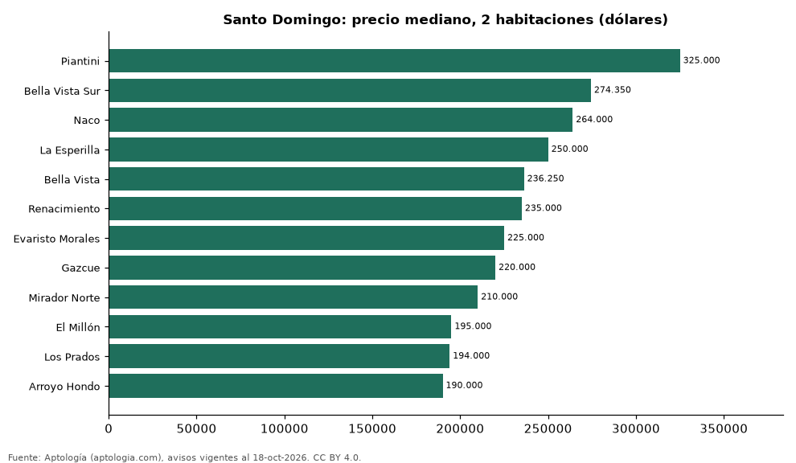

# Dónde cuesta más y menos comprar un apartamento de 2 habitaciones en Santo Domingo: ranking de sectores (octubre 2026)

**En Santo Domingo, un apartamento de 2 habitaciones cuesta USD 325.000 en la mediana en Piantini, el sector más caro, y USD 190.000 en Arroyo Hondo, el más barato: 1,7 veces menos.** Comparamos 12 sectores con al menos 30 avisos de 2 habitaciones.

*Resumen: analizamos 1.231 apartamentos en venta de 2 habitaciones en 12 sectores de Santo Domingo.*

**Actualizado:** 18 de octubre de 2026 (datos del 18 de octubre de 2026) · **Próxima actualización:** mensual.

## Resumen

| Indicador | Valor |
|---|---|
| Más caro | Piantini: USD 325.000 |
| Más barato | Arroyo Hondo: USD 190.000 |
| Diferencia | 1,7 veces |
| Sectores | 12 |

## Precio de un apartamento de 2 habitaciones por sector

| Sector | Precio (mediana) | Rango típico (P25–P75) | Área mediana (m²) | Avisos |
|---|---|---|---|---|
| Piantini | USD 325.000 | USD 280.000 – USD 395.000 | 134 | 177 |
| Bella Vista Sur | USD 274.350 | USD 228.750 – USD 290.764 | 116 | 36 |
| Naco | USD 264.000 | USD 227.488 – USD 302.484 | 114 | 252 |
| La Esperilla | USD 250.000 | USD 210.000 – USD 293.500 | 113 | 79 |
| Bella Vista | USD 236.250 | USD 194.574 – USD 273.323 | 116 | 144 |
| Renacimiento | USD 235.000 | USD 201.612 – USD 263.750 | 113 | 114 |
| Evaristo Morales | USD 225.000 | USD 199.900 – USD 254.000 | 116 | 157 |
| Gazcue | USD 220.000 | USD 185.500 – USD 243.225 | 115 | 34 |
| Mirador Norte | USD 210.000 | USD 185.000 – USD 235.000 | 116 | 37 |
| El Millón | USD 195.000 | USD 176.500 – USD 220.000 | 108 | 87 |
| Los Prados | USD 194.000 | USD 160.000 – USD 217.000 | 114 | 45 |
| Arroyo Hondo | USD 190.000 | USD 150.000 – USD 215.000 | 103 | 69 |

Medianas del precio pedido; solo sectores con 30 avisos o más.

## Preguntas frecuentes

**¿Cuánto cuesta comprar un apartamento de 2 habitaciones en Piantini?**
USD 325.000 en la mediana (octubre de 2026); la mitad central entre USD 280.000 y USD 395.000.

**¿Dónde es más barato comprar un apartamento de 2 habitaciones en Santo Domingo?**
En Arroyo Hondo: USD 190.000 en la mediana.

## Metodología

- **Fuente:** exportes nocturnos de la base de datos de Aptología (aptologia.com) del 18 de octubre de 2026: avisos vigentes de vivienda en portales inmobiliarios de 13 países, recogidos por Aptología y vistos en línea entre el 11 y el 18 de octubre de 2026. Corte: 18 de octubre de 2026.
- **Depuración:** se eliminan duplicados exactos (misma ciudad, zona, tipo, precio, moneda, área, habitaciones y baños) y los precios fuera del percentil 1–99 de cada país, operación, moneda y tipo; el precio por m² usa solo avisos con área declarada entre 12 y 2.000 m² y también se recorta al P1–P99.
- **Qué se mide:** precios pedidos (publicados), no precios de cierre. En arriendo, el canon mensual sin administración, gastos comunes ni condominio.
- **Muestra mínima:** cada cifra publicada se apoya en al menos 30 avisos; las celdas con menos se omiten.
- **Monedas:** nunca se mezclan avisos de monedas distintas sin convertirlos. Conversión a dólares con la tasa de mercado de ExchangeRate-API (open.er-api.com, actualización del 18 Oct 2026): 1 USD = 3.182,80 COP, 1 USD = 18,47 M.N, 1 USD = 5,09 BRL, 1 USD = 3,44 PEN, 1 USD = 982,44 CLP, 1 USD = 1.514,57 ARS, 1 USD = 40,20 UYU, 1 USD = 5.705,37 PYG, 1 USD = 61,27 DOP, 1 USD = 0,89 EUR, 1 USD = 11,72 BOB; la UF chilena a 41.178,64 CLP (mindicador,cl. 18-oct-2026). Los avisos publicados en dólares se usan tal cual.
- **Monedas:** en cada ciudad y operación se usa solo la moneda mayoritaria de los avisos (los avisos en otra moneda se excluyen) y la mediana se convierte a dólares con la tasa citada; nunca se promedian avisos de monedas distintas.
- **Limitaciones:** la cobertura depende de los portales que recorre Aptología en cada país y es mayor en las ciudades grandes y en los segmentos medio-alto y alto; el área es la que declara el aviso, sin verificar; los nombres de zona vienen de los portales.
- **Privacidad:** solo se publican agregados; no se publica ningún dato personal, enlace a avisos ni nombre de anunciante.
- **Datos abiertos:** [datos.csv](datos.csv), licencia CC BY 4.0.

## Cómo citar

Pinzón Pineda, D. M. (2026). *Dónde cuesta más y menos comprar un apartamento de 2 habitaciones en Santo Domingo: ranking de sectores (octubre 2026)*. Aptología (aptologia.com). https://github.com/elbroker/aptologia-datos/tree/main/estudios/venta-apartamentos-de-2-habitaciones-por-sector-santo-domingo-2026. Datos: datos.csv, licencia CC BY 4.0.
