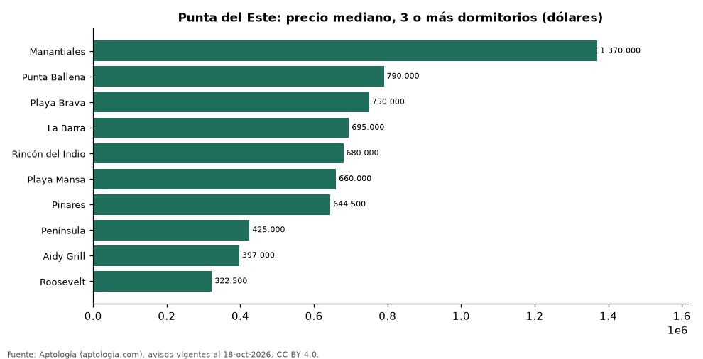

# Dónde cuesta más y menos comprar un apartamento de 3 o más dormitorios en Punta del Este: ranking de barrios (octubre 2026)

**En Punta del Este, un apartamento de 3 o más dormitorios cuesta USD 1.370.000 en la mediana en Manantiales, el barrio más caro, y USD 322.500 en Roosevelt, el más barato: 4,2 veces menos.** Comparamos 10 barrios con al menos 30 avisos de 3 o más dormitorios.

*Resumen: analizamos 2.133 apartamentos en venta de 3 o más dormitorios en 10 barrios de Punta del Este.*

**Actualizado:** 18 de octubre de 2026 (datos del 18 de octubre de 2026) · **Próxima actualización:** mensual.

## Resumen

| Indicador | Valor |
|---|---|
| Más caro | Manantiales: USD 1.370.000 |
| Más barato | Roosevelt: USD 322.500 |
| Diferencia | 4,2 veces |
| Barrios | 10 |

## Precio de un apartamento de 3 o más dormitorios por barrio

| Barrio | Precio (mediana) | Rango típico (P25–P75) | Área mediana (m²) | Avisos |
|---|---|---|---|---|
| Manantiales | USD 1.370.000 | USD 835.000 – USD 1.700.000 | 239 | 65 |
| Punta Ballena | USD 790.000 | USD 595.000 – USD 950.000 | 178 | 37 |
| Playa Brava | USD 750.000 | USD 500.000 – USD 1.100.000 | 180 | 654 |
| La Barra | USD 695.000 | USD 535.000 – USD 990.000 | 140 | 95 |
| Rincón del Indio | USD 680.000 | USD 497.675 – USD 1.330.000 | 220 | 52 |
| Playa Mansa | USD 660.000 | USD 433.700 – USD 990.000 | 159 | 649 |
| Pinares | USD 644.500 | USD 482.500 – USD 861.750 | 168 | 58 |
| Península | USD 425.000 | USD 310.000 – USD 636.097 | 125 | 265 |
| Aidy Grill | USD 397.000 | USD 350.000 – USD 486.750 | 120 | 98 |
| Roosevelt | USD 322.500 | USD 253.750 – USD 420.000 | 119 | 160 |

Medianas del precio pedido; solo barrios con 30 avisos o más.

## Preguntas frecuentes

**¿Cuánto cuesta comprar un apartamento de 3 o más dormitorios en Manantiales?**
USD 1.370.000 en la mediana (octubre de 2026); la mitad central entre USD 835.000 y USD 1.700.000.

**¿Dónde es más barato comprar un apartamento de 3 o más dormitorios en Punta del Este?**
En Roosevelt: USD 322.500 en la mediana.

## Metodología

- **Fuente:** exportes nocturnos de la base de datos de Aptología (aptologia.com) del 18 de octubre de 2026: avisos vigentes de vivienda en portales inmobiliarios de 13 países, recogidos por Aptología y vistos en línea entre el 11 y el 18 de octubre de 2026. Corte: 18 de octubre de 2026.
- **Depuración:** se eliminan duplicados exactos (misma ciudad, zona, tipo, precio, moneda, área, habitaciones y baños) y los precios fuera del percentil 1–99 de cada país, operación, moneda y tipo; el precio por m² usa solo avisos con área declarada entre 12 y 2.000 m² y también se recorta al P1–P99.
- **Qué se mide:** precios pedidos (publicados), no precios de cierre. En arriendo, el canon mensual sin administración, gastos comunes ni condominio.
- **Muestra mínima:** cada cifra publicada se apoya en al menos 30 avisos; las celdas con menos se omiten.
- **Monedas:** nunca se mezclan avisos de monedas distintas sin convertirlos. Conversión a dólares con la tasa de mercado de ExchangeRate-API (open.er-api.com, actualización del 18 Oct 2026): 1 USD = 3.182,80 COP, 1 USD = 18,47 M.N, 1 USD = 5,09 BRL, 1 USD = 3,44 PEN, 1 USD = 982,44 CLP, 1 USD = 1.514,57 ARS, 1 USD = 40,20 UYU, 1 USD = 5.705,37 PYG, 1 USD = 61,27 DOP, 1 USD = 0,89 EUR, 1 USD = 11,72 BOB; la UF chilena a 41.178,64 CLP (mindicador,cl. 18-oct-2026). Los avisos publicados en dólares se usan tal cual.
- **Monedas:** en cada ciudad y operación se usa solo la moneda mayoritaria de los avisos (los avisos en otra moneda se excluyen) y la mediana se convierte a dólares con la tasa citada; nunca se promedian avisos de monedas distintas.
- **Limitaciones:** la cobertura depende de los portales que recorre Aptología en cada país y es mayor en las ciudades grandes y en los segmentos medio-alto y alto; el área es la que declara el aviso, sin verificar; los nombres de zona vienen de los portales.
- **Privacidad:** solo se publican agregados; no se publica ningún dato personal, enlace a avisos ni nombre de anunciante.
- **Datos abiertos:** [datos.csv](datos.csv), licencia CC BY 4.0.

## Cómo citar

Pinzón Pineda, D. M. (2026). *Dónde cuesta más y menos comprar un apartamento de 3 o más dormitorios en Punta del Este: ranking de barrios (octubre 2026)*. Aptología (aptologia.com). https://github.com/elbroker/aptologia-datos/tree/main/estudios/venta-apartamentos-de-3-o-mas-dormitorios-por-barrio-punta-del-este-2026. Datos: datos.csv, licencia CC BY 4.0.
