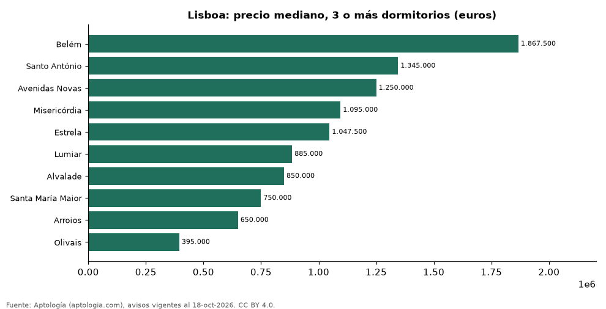

# Dónde cuesta más y menos comprar un apartamento de 3 o más dormitorios en Lisboa: ranking de freguesias (octubre 2026)

**En Lisboa, un apartamento de 3 o más dormitorios cuesta 1.867.500 euros (USD 2.099.225) en la mediana en Belém, la freguesia más cara, y 395.000 euros (USD 444.013) en Olivais, la más barata: 4,7 veces menos.** Comparamos 10 freguesias con al menos 30 avisos de 3 o más dormitorios.

*Resumen: analizamos 467 apartamentos en venta de 3 o más dormitorios en 10 freguesias de Lisboa.*

**Actualizado:** 18 de octubre de 2026 (datos del 18 de octubre de 2026) · **Próxima actualización:** mensual.

## Resumen

| Indicador | Valor |
|---|---|
| Más caro | Belém: 1.867.500 euros (USD 2.099.225) |
| Más barato | Olivais: 395.000 euros (USD 444.013) |
| Diferencia | 4,7 veces |
| Freguesias | 10 |

## Precio de un apartamento de 3 o más dormitorios por freguesia

| Freguesia | Precio (mediana) | Rango típico (P25–P75) | Área mediana (m²) | Avisos |
|---|---|---|---|---|
| Belém | 1.867.500 euros (USD 2.099.225) | 1.205.000 euros (USD 1.354.520) – 2.273.750 euros (USD 2.555.884) | 244 | 34 |
| Santo António | 1.345.000 euros (USD 1.511.892) | 758.500 euros (USD 852.617) – 1.665.000 euros (USD 1.871.598) | 141 | 47 |
| Avenidas Novas | 1.250.000 euros (USD 1.405.104) | 957.500 euros (USD 1.076.310) – 1.647.500 euros (USD 1.851.927) | 154 | 67 |
| Misericórdia | 1.095.000 euros (USD 1.230.871) | 729.000 euros (USD 819.457) – 1.495.000 euros (USD 1.680.504) | 124 | 33 |
| Estrela | 1.047.500 euros (USD 1.177.477) | 744.750 euros (USD 837.161) – 1.568.000 euros (USD 1.762.562) | 134 | 32 |
| Lumiar | 885.000 euros (USD 994.813) | 747.750 euros (USD 840.533) – 1.076.000 euros (USD 1.209.513) | 132 | 106 |
| Alvalade | 850.000 euros (USD 955.471) | 695.000 euros (USD 781.238) – 1.250.000 euros (USD 1.405.104) | 124 | 33 |
| Santa María Maior | 750.000 euros (USD 843.062) | 550.000 euros (USD 618.246) – 1.190.000 euros (USD 1.337.659) | 133 | 33 |
| Arroios | 650.000 euros (USD 730.654) | 559.500 euros (USD 628.924) – 959.000 euros (USD 1.077.996) | 114 | 51 |
| Olivais | 395.000 euros (USD 444.013) | 371.056 euros (USD 417.097) – 521.000 euros (USD 585.647) | 90 | 31 |

Medianas del precio pedido; solo freguesias con 30 avisos o más.

## Preguntas frecuentes

**¿Cuánto cuesta comprar un apartamento de 3 o más dormitorios en Belém?**
1.867.500 euros (USD 2.099.225) en la mediana (octubre de 2026); la mitad central entre 1.205.000 euros (USD 1.354.520) y 2.273.750 euros (USD 2.555.884).

**¿Dónde es más barato comprar un apartamento de 3 o más dormitorios en Lisboa?**
En Olivais: 395.000 euros (USD 444.013) en la mediana.

## Metodología

- **Fuente:** exportes nocturnos de la base de datos de Aptología (aptologia.com) del 18 de octubre de 2026: avisos vigentes de vivienda en portales inmobiliarios de 13 países, recogidos por Aptología y vistos en línea entre el 11 y el 18 de octubre de 2026. Corte: 18 de octubre de 2026.
- **Depuración:** se eliminan duplicados exactos (misma ciudad, zona, tipo, precio, moneda, área, habitaciones y baños) y los precios fuera del percentil 1–99 de cada país, operación, moneda y tipo; el precio por m² usa solo avisos con área declarada entre 12 y 2.000 m² y también se recorta al P1–P99.
- **Qué se mide:** precios pedidos (publicados), no precios de cierre. En arriendo, el canon mensual sin administración, gastos comunes ni condominio.
- **Muestra mínima:** cada cifra publicada se apoya en al menos 30 avisos; las celdas con menos se omiten.
- **Monedas:** nunca se mezclan avisos de monedas distintas sin convertirlos. Conversión a dólares con la tasa de mercado de ExchangeRate-API (open.er-api.com, actualización del 18 Oct 2026): 1 USD = 3.182,80 COP, 1 USD = 18,47 M.N, 1 USD = 5,09 BRL, 1 USD = 3,44 PEN, 1 USD = 982,44 CLP, 1 USD = 1.514,57 ARS, 1 USD = 40,20 UYU, 1 USD = 5.705,37 PYG, 1 USD = 61,27 DOP, 1 USD = 0,89 EUR, 1 USD = 11,72 BOB; la UF chilena a 41.178,64 CLP (mindicador,cl. 18-oct-2026). Los avisos publicados en dólares se usan tal cual.
- **Monedas:** en cada ciudad y operación se usa solo la moneda mayoritaria de los avisos (los avisos en otra moneda se excluyen) y la mediana se convierte a dólares con la tasa citada; nunca se promedian avisos de monedas distintas.
- **Limitaciones:** la cobertura depende de los portales que recorre Aptología en cada país y es mayor en las ciudades grandes y en los segmentos medio-alto y alto; el área es la que declara el aviso, sin verificar; los nombres de zona vienen de los portales.
- **Privacidad:** solo se publican agregados; no se publica ningún dato personal, enlace a avisos ni nombre de anunciante.
- **Datos abiertos:** [datos.csv](datos.csv), licencia CC BY 4.0.

## Cómo citar

Pinzón Pineda, D. M. (2026). *Dónde cuesta más y menos comprar un apartamento de 3 o más dormitorios en Lisboa: ranking de freguesias (octubre 2026)*. Aptología (aptologia.com). https://github.com/elbroker/aptologia-datos/tree/main/estudios/venta-apartamentos-de-3-o-mas-dormitorios-por-freguesia-lisboa-2026. Datos: datos.csv, licencia CC BY 4.0.
