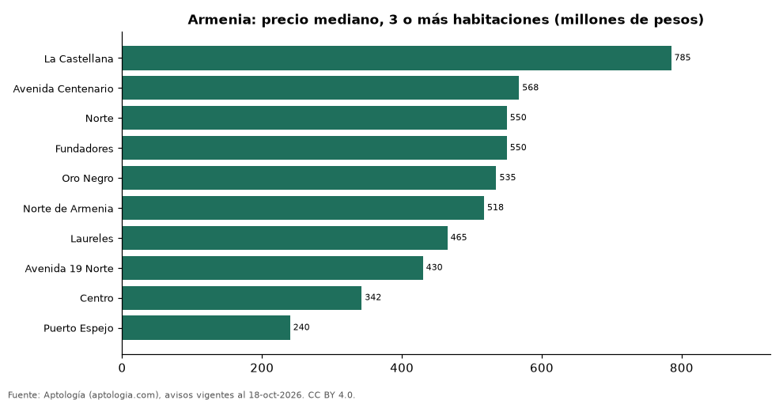

# Dónde cuesta más y menos comprar un apartamento de 3 o más habitaciones en Armenia: ranking de barrios (octubre 2026)

**En Armenia, un apartamento de 3 o más habitaciones cuesta 785 millones de pesos en la mediana en La Castellana, el barrio más caro, y 240 millones de pesos en Puerto Espejo, el más barato: 3,3 veces menos.** Comparamos 10 barrios con al menos 30 avisos de 3 o más habitaciones.

*Resumen: analizamos 601 apartamentos en venta de 3 o más habitaciones en 10 barrios de Armenia.*

**Actualizado:** 18 de octubre de 2026 (datos del 18 de octubre de 2026) · **Próxima actualización:** mensual.

## Resumen

| Indicador | Valor |
|---|---|
| Más caro | La Castellana: 785 millones de pesos |
| Más barato | Puerto Espejo: 240 millones de pesos |
| Diferencia | 3,3 veces |
| Barrios | 10 |

## Precio de un apartamento de 3 o más habitaciones por barrio

| Barrio | Precio (mediana) | Rango típico (P25–P75) | Área mediana (m²) | Avisos |
|---|---|---|---|---|
| La Castellana | 785 millones de pesos | 650 millones de pesos – 865 millones de pesos | 125 | 80 |
| Avenida Centenario | 568 millones de pesos | 459 millones de pesos – 720 millones de pesos | 86 | 150 |
| Norte | 550 millones de pesos | 390 millones de pesos – 690 millones de pesos | 94 | 39 |
| Fundadores | 550 millones de pesos | 478 millones de pesos – 705 millones de pesos | 126 | 30 |
| Oro Negro | 535 millones de pesos | 374 millones de pesos – 572 millones de pesos | 78 | 44 |
| Norte de Armenia | 518 millones de pesos | 334 millones de pesos – 658 millones de pesos | 90 | 40 |
| Laureles | 465 millones de pesos | 396 millones de pesos – 590 millones de pesos | 92 | 34 |
| Avenida 19 Norte | 430 millones de pesos | 300 millones de pesos – 530 millones de pesos | 82 | 41 |
| Centro | 342 millones de pesos | 272 millones de pesos – 420 millones de pesos | 104 | 34 |
| Puerto Espejo | 240 millones de pesos | 210 millones de pesos – 290 millones de pesos | 60 | 109 |

Medianas del precio pedido; solo barrios con 30 avisos o más.

## Preguntas frecuentes

**¿Cuánto cuesta comprar un apartamento de 3 o más habitaciones en La Castellana?**
785 millones de pesos en la mediana (octubre de 2026); la mitad central entre 650 millones de pesos y 865 millones de pesos.

**¿Dónde es más barato comprar un apartamento de 3 o más habitaciones en Armenia?**
En Puerto Espejo: 240 millones de pesos en la mediana.

## Metodología

- **Fuente:** exportes nocturnos de la base de datos de Aptología (aptologia.com) del 18 de octubre de 2026: avisos vigentes de vivienda en portales inmobiliarios de 13 países, recogidos por Aptología y vistos en línea entre el 11 y el 18 de octubre de 2026. Corte: 18 de octubre de 2026.
- **Depuración:** se eliminan duplicados exactos (misma ciudad, zona, tipo, precio, moneda, área, habitaciones y baños) y los precios fuera del percentil 1–99 de cada país, operación, moneda y tipo; el precio por m² usa solo avisos con área declarada entre 12 y 2.000 m² y también se recorta al P1–P99.
- **Qué se mide:** precios pedidos (publicados), no precios de cierre. En arriendo, el canon mensual sin administración, gastos comunes ni condominio.
- **Muestra mínima:** cada cifra publicada se apoya en al menos 30 avisos; las celdas con menos se omiten.
- **Colombia:** Precios en pesos colombianos, sin conversión de moneda.
- **Limitaciones:** la cobertura depende de los portales que recorre Aptología en cada país y es mayor en las ciudades grandes y en los segmentos medio-alto y alto; el área es la que declara el aviso, sin verificar; los nombres de zona vienen de los portales.
- **Privacidad:** solo se publican agregados; no se publica ningún dato personal, enlace a avisos ni nombre de anunciante.
- **Datos abiertos:** [datos.csv](datos.csv), licencia CC BY 4.0.

## Cómo citar

Pinzón Pineda, D. M. (2026). *Dónde cuesta más y menos comprar un apartamento de 3 o más habitaciones en Armenia: ranking de barrios (octubre 2026)*. Aptología (aptologia.com). https://github.com/elbroker/aptologia-datos/tree/main/estudios/venta-apartamentos-de-3-o-mas-habitaciones-por-barrio-armenia-2026. Datos: datos.csv, licencia CC BY 4.0.
