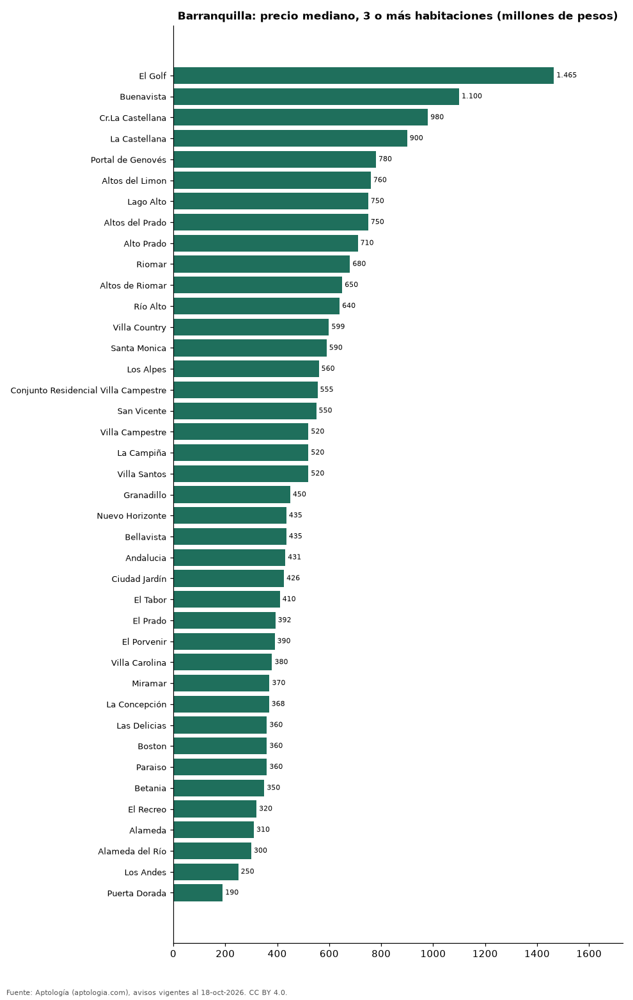

# Dónde cuesta más y menos comprar un apartamento de 3 o más habitaciones en Barranquilla: ranking de barrios (octubre 2026)

**En Barranquilla, un apartamento de 3 o más habitaciones cuesta 1.465 millones de pesos en la mediana en El Golf, el barrio más caro, y 190 millones de pesos en Puerta Dorada, el más barato: 7,7 veces menos.** Comparamos 40 barrios con al menos 30 avisos de 3 o más habitaciones.

*Resumen: analizamos 4.888 apartamentos en venta de 3 o más habitaciones en 40 barrios de Barranquilla.*

**Actualizado:** 18 de octubre de 2026 (datos del 18 de octubre de 2026) · **Próxima actualización:** mensual.

## Resumen

| Indicador | Valor |
|---|---|
| Más caro | El Golf: 1.465 millones de pesos |
| Más barato | Puerta Dorada: 190 millones de pesos |
| Diferencia | 7,7 veces |
| Barrios | 40 |

## Precio de un apartamento de 3 o más habitaciones por barrio

| Barrio | Precio (mediana) | Rango típico (P25–P75) | Área mediana (m²) | Avisos |
|---|---|---|---|---|
| El Golf | 1.465 millones de pesos | 835 millones de pesos – 2.125 millones de pesos | 307 | 142 |
| Buenavista | 1.100 millones de pesos | 750 millones de pesos – 1.450 millones de pesos | 155 | 178 |
| Cr.La Castellana | 980 millones de pesos | 780 millones de pesos – 1.284 millones de pesos | 155 | 39 |
| La Castellana | 900 millones de pesos | 710 millones de pesos – 1.175 millones de pesos | 138 | 51 |
| Portal de Genovés | 780 millones de pesos | 691 millones de pesos – 871 millones de pesos | 125 | 36 |
| Altos del Limon | 760 millones de pesos | 550 millones de pesos – 1.300 millones de pesos | 138 | 84 |
| Lago Alto | 750 millones de pesos | 500 millones de pesos – 1.152 millones de pesos | 154 | 66 |
| Altos del Prado | 750 millones de pesos | 550 millones de pesos – 960 millones de pesos | 202 | 429 |
| Alto Prado | 710 millones de pesos | 550 millones de pesos – 1.000 millones de pesos | 201 | 393 |
| Riomar | 680 millones de pesos | 458 millones de pesos – 952 millones de pesos | 147 | 272 |
| Altos de Riomar | 650 millones de pesos | 430 millones de pesos – 1.000 millones de pesos | 154 | 473 |
| Río Alto | 640 millones de pesos | 550 millones de pesos – 740 millones de pesos | 93 | 77 |
| Villa Country | 599 millones de pesos | 450 millones de pesos – 1.200 millones de pesos | 159 | 125 |
| Santa Monica | 590 millones de pesos | 430 millones de pesos – 742 millones de pesos | 120 | 30 |
| Los Alpes | 560 millones de pesos | 356 millones de pesos – 650 millones de pesos | 124 | 42 |
| Conjunto Residencial Villa Campestre | 555 millones de pesos | 475 millones de pesos – 746 millones de pesos | 106 | 57 |
| San Vicente | 550 millones de pesos | 400 millones de pesos – 725 millones de pesos | 137 | 79 |
| Villa Campestre | 520 millones de pesos | 420 millones de pesos – 748 millones de pesos | 107 | 150 |
| La Campiña | 520 millones de pesos | 372 millones de pesos – 662 millones de pesos | 119 | 40 |
| Villa Santos | 520 millones de pesos | 420 millones de pesos – 660 millones de pesos | 121 | 277 |
| Granadillo | 450 millones de pesos | 375 millones de pesos – 545 millones de pesos | 111 | 41 |
| Nuevo Horizonte | 435 millones de pesos | 374 millones de pesos – 472 millones de pesos | 104 | 44 |
| Bellavista | 435 millones de pesos | 396 millones de pesos – 499 millones de pesos | 92 | 46 |
| Andalucia | 431 millones de pesos | 342 millones de pesos – 650 millones de pesos | 117 | 70 |
| Ciudad Jardín | 426 millones de pesos | 362 millones de pesos – 550 millones de pesos | 100 | 239 |
| El Tabor | 410 millones de pesos | 350 millones de pesos – 460 millones de pesos | 110 | 73 |
| El Prado | 392 millones de pesos | 350 millones de pesos – 530 millones de pesos | 138 | 156 |
| El Porvenir | 390 millones de pesos | 340 millones de pesos – 450 millones de pesos | 108 | 61 |
| Villa Carolina | 380 millones de pesos | 318 millones de pesos – 490 millones de pesos | 78 | 122 |
| Miramar | 370 millones de pesos | 302 millones de pesos – 480 millones de pesos | 82 | 295 |
| La Concepción | 368 millones de pesos | 285 millones de pesos – 420 millones de pesos | 97 | 41 |
| Las Delicias | 360 millones de pesos | 320 millones de pesos – 450 millones de pesos | 97 | 61 |
| Boston | 360 millones de pesos | 320 millones de pesos – 415 millones de pesos | 90 | 117 |
| Paraiso | 360 millones de pesos | 310 millones de pesos – 492 millones de pesos | 85 | 111 |
| Betania | 350 millones de pesos | 340 millones de pesos – 385 millones de pesos | 78 | 43 |
| El Recreo | 320 millones de pesos | 280 millones de pesos – 368 millones de pesos | 93 | 51 |
| Alameda | 310 millones de pesos | 211 millones de pesos – 361 millones de pesos | 63 | 42 |
| Alameda del Río | 300 millones de pesos | 220 millones de pesos – 355 millones de pesos | 63 | 169 |
| Los Andes | 250 millones de pesos | 220 millones de pesos – 320 millones de pesos | 74 | 33 |
| Puerta Dorada | 190 millones de pesos | 170 millones de pesos – 225 millones de pesos | 63 | 33 |

Medianas del precio pedido; solo barrios con 30 avisos o más.

## Preguntas frecuentes

**¿Cuánto cuesta comprar un apartamento de 3 o más habitaciones en El Golf?**
1.465 millones de pesos en la mediana (octubre de 2026); la mitad central entre 835 millones de pesos y 2.125 millones de pesos.

**¿Dónde es más barato comprar un apartamento de 3 o más habitaciones en Barranquilla?**
En Puerta Dorada: 190 millones de pesos en la mediana.

## Metodología

- **Fuente:** exportes nocturnos de la base de datos de Aptología (aptologia.com) del 18 de octubre de 2026: avisos vigentes de vivienda en portales inmobiliarios de 13 países, recogidos por Aptología y vistos en línea entre el 11 y el 18 de octubre de 2026. Corte: 18 de octubre de 2026.
- **Depuración:** se eliminan duplicados exactos (misma ciudad, zona, tipo, precio, moneda, área, habitaciones y baños) y los precios fuera del percentil 1–99 de cada país, operación, moneda y tipo; el precio por m² usa solo avisos con área declarada entre 12 y 2.000 m² y también se recorta al P1–P99.
- **Qué se mide:** precios pedidos (publicados), no precios de cierre. En arriendo, el canon mensual sin administración, gastos comunes ni condominio.
- **Muestra mínima:** cada cifra publicada se apoya en al menos 30 avisos; las celdas con menos se omiten.
- **Colombia:** Precios en pesos colombianos, sin conversión de moneda.
- **Limitaciones:** la cobertura depende de los portales que recorre Aptología en cada país y es mayor en las ciudades grandes y en los segmentos medio-alto y alto; el área es la que declara el aviso, sin verificar; los nombres de zona vienen de los portales.
- **Privacidad:** solo se publican agregados; no se publica ningún dato personal, enlace a avisos ni nombre de anunciante.
- **Datos abiertos:** [datos.csv](datos.csv), licencia CC BY 4.0.

## Cómo citar

Pinzón Pineda, D. M. (2026). *Dónde cuesta más y menos comprar un apartamento de 3 o más habitaciones en Barranquilla: ranking de barrios (octubre 2026)*. Aptología (aptologia.com). https://github.com/elbroker/aptologia-datos/tree/main/estudios/venta-apartamentos-de-3-o-mas-habitaciones-por-barrio-barranquilla-2026. Datos: datos.csv, licencia CC BY 4.0.
