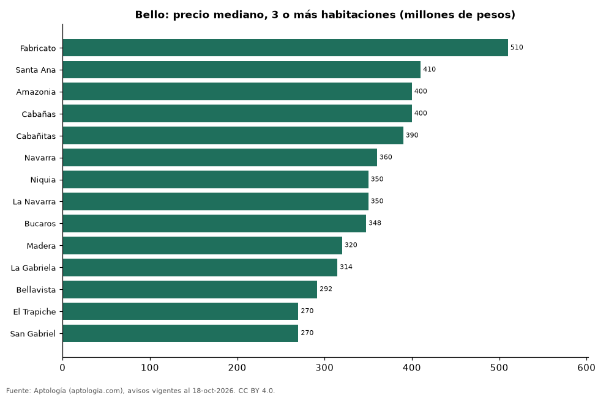

# Dónde cuesta más y menos comprar un apartamento de 3 o más habitaciones en Bello: ranking de barrios (octubre 2026)

**En Bello, un apartamento de 3 o más habitaciones cuesta 510 millones de pesos en la mediana en Fabricato, el barrio más caro, y 270 millones de pesos en San Gabriel, el más barato: 1,9 veces menos.** Comparamos 14 barrios con al menos 30 avisos de 3 o más habitaciones.

*Resumen: analizamos 907 apartamentos en venta de 3 o más habitaciones en 14 barrios de Bello.*

**Actualizado:** 18 de octubre de 2026 (datos del 18 de octubre de 2026) · **Próxima actualización:** mensual.

## Resumen

| Indicador | Valor |
|---|---|
| Más caro | Fabricato: 510 millones de pesos |
| Más barato | San Gabriel: 270 millones de pesos |
| Diferencia | 1,9 veces |
| Barrios | 14 |

## Precio de un apartamento de 3 o más habitaciones por barrio

| Barrio | Precio (mediana) | Rango típico (P25–P75) | Área mediana (m²) | Avisos |
|---|---|---|---|---|
| Fabricato | 510 millones de pesos | 431 millones de pesos – 602 millones de pesos | 72 | 48 |
| Santa Ana | 410 millones de pesos | 323 millones de pesos – 515 millones de pesos | 68 | 131 |
| Amazonia | 400 millones de pesos | 365 millones de pesos – 430 millones de pesos | 62 | 53 |
| Cabañas | 400 millones de pesos | 340 millones de pesos – 478 millones de pesos | 85 | 94 |
| Cabañitas | 390 millones de pesos | 330 millones de pesos – 440 millones de pesos | 88 | 33 |
| Navarra | 360 millones de pesos | 287 millones de pesos – 495 millones de pesos | 64 | 52 |
| Niquia | 350 millones de pesos | 305 millones de pesos – 430 millones de pesos | 67 | 209 |
| La Navarra | 350 millones de pesos | 290 millones de pesos – 425 millones de pesos | 64 | 47 |
| Bucaros | 348 millones de pesos | 281 millones de pesos – 389 millones de pesos | 56 | 38 |
| Madera | 320 millones de pesos | 295 millones de pesos – 350 millones de pesos | 61 | 69 |
| La Gabriela | 314 millones de pesos | 280 millones de pesos – 336 millones de pesos | 63 | 32 |
| Bellavista | 292 millones de pesos | 252 millones de pesos – 358 millones de pesos | 62 | 30 |
| El Trapiche | 270 millones de pesos | 255 millones de pesos – 300 millones de pesos | 61 | 36 |
| San Gabriel | 270 millones de pesos | 257 millones de pesos – 285 millones de pesos | 54 | 35 |

Medianas del precio pedido; solo barrios con 30 avisos o más.

## Preguntas frecuentes

**¿Cuánto cuesta comprar un apartamento de 3 o más habitaciones en Fabricato?**
510 millones de pesos en la mediana (octubre de 2026); la mitad central entre 431 millones de pesos y 602 millones de pesos.

**¿Dónde es más barato comprar un apartamento de 3 o más habitaciones en Bello?**
En San Gabriel: 270 millones de pesos en la mediana.

## Metodología

- **Fuente:** exportes nocturnos de la base de datos de Aptología (aptologia.com) del 18 de octubre de 2026: avisos vigentes de vivienda en portales inmobiliarios de 13 países, recogidos por Aptología y vistos en línea entre el 11 y el 18 de octubre de 2026. Corte: 18 de octubre de 2026.
- **Depuración:** se eliminan duplicados exactos (misma ciudad, zona, tipo, precio, moneda, área, habitaciones y baños) y los precios fuera del percentil 1–99 de cada país, operación, moneda y tipo; el precio por m² usa solo avisos con área declarada entre 12 y 2.000 m² y también se recorta al P1–P99.
- **Qué se mide:** precios pedidos (publicados), no precios de cierre. En arriendo, el canon mensual sin administración, gastos comunes ni condominio.
- **Muestra mínima:** cada cifra publicada se apoya en al menos 30 avisos; las celdas con menos se omiten.
- **Colombia:** Precios en pesos colombianos, sin conversión de moneda.
- **Limitaciones:** la cobertura depende de los portales que recorre Aptología en cada país y es mayor en las ciudades grandes y en los segmentos medio-alto y alto; el área es la que declara el aviso, sin verificar; los nombres de zona vienen de los portales.
- **Privacidad:** solo se publican agregados; no se publica ningún dato personal, enlace a avisos ni nombre de anunciante.
- **Datos abiertos:** [datos.csv](datos.csv), licencia CC BY 4.0.

## Cómo citar

Pinzón Pineda, D. M. (2026). *Dónde cuesta más y menos comprar un apartamento de 3 o más habitaciones en Bello: ranking de barrios (octubre 2026)*. Aptología (aptologia.com). https://github.com/elbroker/aptologia-datos/tree/main/estudios/venta-apartamentos-de-3-o-mas-habitaciones-por-barrio-bello-2026. Datos: datos.csv, licencia CC BY 4.0.
