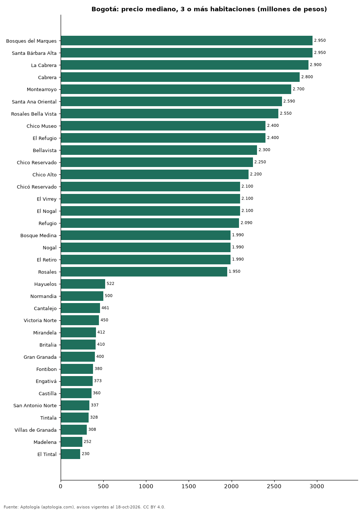

# Dónde cuesta más y menos comprar un apartamento de 3 o más habitaciones en Bogotá: ranking de barrios (octubre 2026)

**En Bogotá, un apartamento de 3 o más habitaciones cuesta 2.950 millones de pesos en la mediana en Bosques del Marques, el barrio más caro, y 230 millones de pesos en El Tintal, el más barato: 12,8 veces menos.** Comparamos 119 barrios con al menos 30 avisos de 3 o más habitaciones.

*Resumen: analizamos 13.697 apartamentos en venta de 3 o más habitaciones en 119 barrios de Bogotá.*

**Actualizado:** 18 de octubre de 2026 (datos del 18 de octubre de 2026) · **Próxima actualización:** mensual.

## Resumen

| Indicador | Valor |
|---|---|
| Más caro | Bosques del Marques: 2.950 millones de pesos |
| Más barato | El Tintal: 230 millones de pesos |
| Diferencia | 12,8 veces |
| Barrios | 119 |

## Precio de un apartamento de 3 o más habitaciones por barrio

| Barrio | Precio (mediana) | Rango típico (P25–P75) | Área mediana (m²) | Avisos |
|---|---|---|---|---|
| Bosques del Marques | 2.950 millones de pesos | 2.318 millones de pesos – 3.340 millones de pesos | 316 | 56 |
| Santa Bárbara Alta | 2.950 millones de pesos | 1.998 millones de pesos – 3.500 millones de pesos | 285 | 116 |
| La Cabrera | 2.900 millones de pesos | 2.000 millones de pesos – 3.425 millones de pesos | 256 | 256 |
| Cabrera | 2.800 millones de pesos | 2.300 millones de pesos – 3.300 millones de pesos | 259 | 147 |
| Montearroyo | 2.700 millones de pesos | 2.384 millones de pesos – 3.200 millones de pesos | 339 | 93 |
| Santa Ana Oriental | 2.590 millones de pesos | 1.950 millones de pesos – 3.000 millones de pesos | 223 | 75 |
| Rosales Bella Vista | 2.550 millones de pesos | 1.780 millones de pesos – 3.150 millones de pesos | 274 | 33 |
| Chico Museo | 2.400 millones de pesos | 1.860 millones de pesos – 3.175 millones de pesos | 230 | 54 |
| El Refugio | 2.400 millones de pesos | 1.750 millones de pesos – 3.000 millones de pesos | 296 | 159 |
| Bellavista | 2.300 millones de pesos | 1.550 millones de pesos – 3.500 millones de pesos | 257 | 33 |
| Chico Reservado | 2.250 millones de pesos | 1.600 millones de pesos – 2.800 millones de pesos | 220 | 219 |
| Chico Alto | 2.200 millones de pesos | 1.600 millones de pesos – 2.950 millones de pesos | 276 | 138 |
| Chicó Reservado | 2.100 millones de pesos | 1.380 millones de pesos – 2.625 millones de pesos | 239 | 48 |
| El Virrey | 2.100 millones de pesos | 1.580 millones de pesos – 2.600 millones de pesos | 204 | 37 |
| El Nogal | 2.100 millones de pesos | 1.680 millones de pesos – 2.945 millones de pesos | 246 | 147 |
| Refugio | 2.090 millones de pesos | 1.545 millones de pesos – 3.000 millones de pesos | 243 | 67 |
| Bosque Medina | 1.990 millones de pesos | 1.750 millones de pesos – 2.400 millones de pesos | 251 | 170 |
| Nogal | 1.990 millones de pesos | 1.350 millones de pesos – 2.612 millones de pesos | 244 | 68 |
| El Retiro | 1.990 millones de pesos | 1.562 millones de pesos – 2.950 millones de pesos | 234 | 40 |
| Rosales | 1.950 millones de pesos | 1.560 millones de pesos – 2.800 millones de pesos | 233 | 337 |
| Reserva de la Sierra | 1.950 millones de pesos | 1.600 millones de pesos – 2.454 millones de pesos | 182 | 36 |
| Chicó Alto | 1.900 millones de pesos | 1.200 millones de pesos – 2.800 millones de pesos | 245 | 49 |
| Los Rosales | 1.900 millones de pesos | 1.500 millones de pesos – 2.800 millones de pesos | 239 | 635 |
| Santa Ana | 1.900 millones de pesos | 1.096 millones de pesos – 2.980 millones de pesos | 197 | 76 |
| Virrey | 1.860 millones de pesos | 1.400 millones de pesos – 2.369 millones de pesos | 171 | 35 |
| Las Rosales | 1.850 millones de pesos | 1.512 millones de pesos – 2.638 millones de pesos | 236 | 78 |
| Colinas de Suba | 1.830 millones de pesos | 1.500 millones de pesos – 2.650 millones de pesos | 254 | 39 |
| Sierras del Moral | 1.800 millones de pesos | 1.700 millones de pesos – 2.100 millones de pesos | 220 | 74 |
| Sotileza | 1.800 millones de pesos | 1.275 millones de pesos – 2.980 millones de pesos | 227 | 55 |
| Bosque de Pinos | 1.770 millones de pesos | 1.300 millones de pesos – 2.235 millones de pesos | 230 | 82 |
| Cerros de Suba | 1.750 millones de pesos | 1.315 millones de pesos – 2.500 millones de pesos | 225 | 147 |
| El Chico | 1.600 millones de pesos | 1.235 millones de pesos – 2.280 millones de pesos | 204 | 138 |
| Los Rosales Emaus | 1.600 millones de pesos | 1.390 millones de pesos – 2.050 millones de pesos | 210 | 45 |
| Cerros de Niza | 1.600 millones de pesos | 1.285 millones de pesos – 1.750 millones de pesos | 231 | 39 |
| Bosques de la Cañada | 1.590 millones de pesos | 1.400 millones de pesos – 2.437 millones de pesos | 183 | 34 |
| Chico | 1.547 millones de pesos | 1.125 millones de pesos – 2.300 millones de pesos | 194 | 385 |
| Norte | 1.500 millones de pesos | 950 millones de pesos – 2.000 millones de pesos | 199 | 125 |
| Santa Bibiana | 1.500 millones de pesos | 1.040 millones de pesos – 1.925 millones de pesos | 182 | 123 |
| La Carolina | 1.495 millones de pesos | 1.180 millones de pesos – 2.200 millones de pesos | 210 | 282 |
| Chico Norte | 1.450 millones de pesos | 995 millones de pesos – 2.100 millones de pesos | 184 | 495 |
| Niza Suba | 1.450 millones de pesos | 1.095 millones de pesos – 1.800 millones de pesos | 223 | 34 |
| Lindaraja | 1.430 millones de pesos | 1.200 millones de pesos – 1.625 millones de pesos | 193 | 39 |
| Antiguo Country | 1.425 millones de pesos | 750 millones de pesos – 1.988 millones de pesos | 162 | 36 |
| Santa Ana Occidental | 1.415 millones de pesos | 850 millones de pesos – 1.850 millones de pesos | 150 | 42 |
| Chicó Navarra | 1.400 millones de pesos | 1.100 millones de pesos – 1.750 millones de pesos | 190 | 132 |
| Los Lagartos | 1.350 millones de pesos | 865 millones de pesos – 1.900 millones de pesos | 185 | 35 |
| Chico Navarra | 1.350 millones de pesos | 1.098 millones de pesos – 1.790 millones de pesos | 175 | 332 |
| Santa Bárbara Oriental | 1.350 millones de pesos | 828 millones de pesos – 1.866 millones de pesos | 148 | 67 |
| Usaquen | 1.320 millones de pesos | 670 millones de pesos – 2.200 millones de pesos | 160 | 133 |
| San Patricio | 1.300 millones de pesos | 985 millones de pesos – 1.585 millones de pesos | 169 | 315 |
| Santa Paula | 1.300 millones de pesos | 915 millones de pesos – 1.825 millones de pesos | 162 | 243 |
| Multicentro | 1.300 millones de pesos | 1.000 millones de pesos – 2.345 millones de pesos | 181 | 55 |
| La Calleja | 1.250 millones de pesos | 940 millones de pesos – 1.550 millones de pesos | 166 | 240 |
| Chico San Patricio | 1.250 millones de pesos | 1.050 millones de pesos – 1.725 millones de pesos | 165 | 47 |
| Santa Bárbara Occidental | 1.250 millones de pesos | 980 millones de pesos – 1.600 millones de pesos | 172 | 237 |
| Recodo del Country | 1.225 millones de pesos | 948 millones de pesos – 1.648 millones de pesos | 156 | 48 |
| Chapinero | 1.220 millones de pesos | 649 millones de pesos – 2.000 millones de pesos | 168 | 190 |
| Santa Bárbara | 1.200 millones de pesos | 895 millones de pesos – 1.555 millones de pesos | 172 | 773 |
| Chico Norte III | 1.172 millones de pesos | 892 millones de pesos – 1.675 millones de pesos | 159 | 66 |
| Salitre | 1.150 millones de pesos | 788 millones de pesos – 1.849 millones de pesos | 101 | 31 |
| San José de Bavaria | 1.150 millones de pesos | 684 millones de pesos – 1.300 millones de pesos | 134 | 30 |
| Ciudad Salitre | 1.150 millones de pesos | 850 millones de pesos – 1.890 millones de pesos | 118 | 113 |
| Lagos de Cordoba | 1.150 millones de pesos | 865 millones de pesos – 1.400 millones de pesos | 130 | 76 |
| Ciudad Salitre Occidental | 1.150 millones de pesos | 712 millones de pesos – 1.725 millones de pesos | 123 | 75 |
| Alejandria | 1.100 millones de pesos | 858 millones de pesos – 1.200 millones de pesos | 130 | 84 |
| Molinos Norte | 1.100 millones de pesos | 932 millones de pesos – 1.400 millones de pesos | 166 | 34 |
| Altos de Bella Suiza | 1.100 millones de pesos | 722 millones de pesos – 1.408 millones de pesos | 152 | 48 |
| Chapinero Alto | 1.070 millones de pesos | 725 millones de pesos – 1.680 millones de pesos | 144 | 99 |
| Santa Bárbara Central | 1.070 millones de pesos | 850 millones de pesos – 1.385 millones de pesos | 164 | 335 |
| Gratamira | 1.050 millones de pesos | 780 millones de pesos – 1.495 millones de pesos | 164 | 87 |
| Bella Suiza | 1.032 millones de pesos | 800 millones de pesos – 1.300 millones de pesos | 143 | 218 |
| Ciudad Salitre Oriental | 950 millones de pesos | 780 millones de pesos – 1.450 millones de pesos | 105 | 57 |
| Rincon del Chico | 915 millones de pesos | 752 millones de pesos – 1.200 millones de pesos | 126 | 98 |
| Pasadena | 900 millones de pesos | 715 millones de pesos – 1.057 millones de pesos | 115 | 128 |
| Colina Campestre | 890 millones de pesos | 680 millones de pesos – 1.200 millones de pesos | 130 | 599 |
| Lisboa | 871 millones de pesos | 650 millones de pesos – 1.440 millones de pesos | 134 | 55 |
| Niza | 850 millones de pesos | 599 millones de pesos – 1.300 millones de pesos | 130 | 77 |
| La Colina Campestre | 805 millones de pesos | 580 millones de pesos – 968 millones de pesos | 116 | 38 |
| Batan | 800 millones de pesos | 680 millones de pesos – 960 millones de pesos | 128 | 43 |
| Nicolas de Federman | 800 millones de pesos | 650 millones de pesos – 1.100 millones de pesos | 124 | 155 |
| La Felicidad | 790 millones de pesos | 575 millones de pesos – 930 millones de pesos | 90 | 85 |
| Ciudad Salitre Occidente | 780 millones de pesos | 635 millones de pesos – 1.110 millones de pesos | 91 | 31 |
| La Castellana | 780 millones de pesos | 700 millones de pesos – 890 millones de pesos | 108 | 41 |
| El Batan | 780 millones de pesos | 651 millones de pesos – 979 millones de pesos | 117 | 53 |
| Belmira | 770 millones de pesos | 652 millones de pesos – 832 millones de pesos | 109 | 55 |
| El Contador | 760 millones de pesos | 620 millones de pesos – 852 millones de pesos | 130 | 52 |
| Puente Largo | 750 millones de pesos | 648 millones de pesos – 944 millones de pesos | 122 | 71 |
| Mazuren Colina | 732 millones de pesos | 644 millones de pesos – 872 millones de pesos | 91 | 32 |
| Pontevedra | 720 millones de pesos | 610 millones de pesos – 850 millones de pesos | 102 | 65 |
| Alhambra | 710 millones de pesos | 595 millones de pesos – 860 millones de pesos | 116 | 40 |
| Quinta Paredes | 700 millones de pesos | 585 millones de pesos – 810 millones de pesos | 100 | 66 |
| Teusaquillo | 680 millones de pesos | 569 millones de pesos – 825 millones de pesos | 119 | 59 |
| La Soledad | 675 millones de pesos | 582 millones de pesos – 1.092 millones de pesos | 122 | 38 |
| Alameda | 655 millones de pesos | 502 millones de pesos – 740 millones de pesos | 94 | 42 |
| Los Andes | 650 millones de pesos | 536 millones de pesos – 912 millones de pesos | 83 | 32 |
| Cedritos | 630 millones de pesos | 506 millones de pesos – 784 millones de pesos | 99 | 566 |
| Mazuren | 630 millones de pesos | 462 millones de pesos – 870 millones de pesos | 87 | 91 |
| Las Nieves | 620 millones de pesos | 430 millones de pesos – 952 millones de pesos | 126 | 32 |
| Cedro Golf | 600 millones de pesos | 440 millones de pesos – 715 millones de pesos | 108 | 65 |
| Barrios Unidos | 580 millones de pesos | 520 millones de pesos – 772 millones de pesos | 96 | 50 |
| Modelia | 574 millones de pesos | 490 millones de pesos – 702 millones de pesos | 82 | 90 |
| Lagos de Torca | 556 millones de pesos | 355 millones de pesos – 672 millones de pesos | 72 | 62 |
| Suba | 550 millones de pesos | 280 millones de pesos – 1.215 millones de pesos | 94 | 79 |
| Santa Teresa | 550 millones de pesos | 450 millones de pesos – 620 millones de pesos | 80 | 39 |
| Hayuelos | 522 millones de pesos | 434 millones de pesos – 591 millones de pesos | 74 | 82 |
| Normandia | 500 millones de pesos | 455 millones de pesos – 636 millones de pesos | 82 | 47 |
| Cantalejo | 461 millones de pesos | 361 millones de pesos – 865 millones de pesos | 72 | 38 |
| Victoria Norte | 450 millones de pesos | 409 millones de pesos – 550 millones de pesos | 77 | 37 |
| Mirandela | 412 millones de pesos | 356 millones de pesos – 496 millones de pesos | 81 | 44 |
| Britalia | 410 millones de pesos | 329 millones de pesos – 505 millones de pesos | 72 | 44 |
| Gran Granada | 400 millones de pesos | 350 millones de pesos – 499 millones de pesos | 71 | 136 |
| Fontibon | 380 millones de pesos | 240 millones de pesos – 550 millones de pesos | 61 | 166 |
| Engativá | 373 millones de pesos | 304 millones de pesos – 530 millones de pesos | 72 | 132 |
| Castilla | 360 millones de pesos | 302 millones de pesos – 430 millones de pesos | 62 | 113 |
| San Antonio Norte | 337 millones de pesos | 278 millones de pesos – 404 millones de pesos | 66 | 52 |
| Tintala | 328 millones de pesos | 217 millones de pesos – 428 millones de pesos | 56 | 30 |
| Villas de Granada | 308 millones de pesos | 260 millones de pesos – 339 millones de pesos | 65 | 30 |
| Madelena | 252 millones de pesos | 230 millones de pesos – 280 millones de pesos | 55 | 54 |
| El Tintal | 230 millones de pesos | 210 millones de pesos – 335 millones de pesos | 53 | 47 |

Medianas del precio pedido; solo barrios con 30 avisos o más.

## Preguntas frecuentes

**¿Cuánto cuesta comprar un apartamento de 3 o más habitaciones en Bosques del Marques?**
2.950 millones de pesos en la mediana (octubre de 2026); la mitad central entre 2.318 millones de pesos y 3.340 millones de pesos.

**¿Dónde es más barato comprar un apartamento de 3 o más habitaciones en Bogotá?**
En El Tintal: 230 millones de pesos en la mediana.

## Metodología

- **Fuente:** exportes nocturnos de la base de datos de Aptología (aptologia.com) del 18 de octubre de 2026: avisos vigentes de vivienda en portales inmobiliarios de 13 países, recogidos por Aptología y vistos en línea entre el 11 y el 18 de octubre de 2026. Corte: 18 de octubre de 2026.
- **Depuración:** se eliminan duplicados exactos (misma ciudad, zona, tipo, precio, moneda, área, habitaciones y baños) y los precios fuera del percentil 1–99 de cada país, operación, moneda y tipo; el precio por m² usa solo avisos con área declarada entre 12 y 2.000 m² y también se recorta al P1–P99.
- **Qué se mide:** precios pedidos (publicados), no precios de cierre. En arriendo, el canon mensual sin administración, gastos comunes ni condominio.
- **Muestra mínima:** cada cifra publicada se apoya en al menos 30 avisos; las celdas con menos se omiten.
- **Colombia:** Precios en pesos colombianos, sin conversión de moneda.
- **Limitaciones:** la cobertura depende de los portales que recorre Aptología en cada país y es mayor en las ciudades grandes y en los segmentos medio-alto y alto; el área es la que declara el aviso, sin verificar; los nombres de zona vienen de los portales.
- **Privacidad:** solo se publican agregados; no se publica ningún dato personal, enlace a avisos ni nombre de anunciante.
- **Datos abiertos:** [datos.csv](datos.csv), licencia CC BY 4.0.

## Cómo citar

Pinzón Pineda, D. M. (2026). *Dónde cuesta más y menos comprar un apartamento de 3 o más habitaciones en Bogotá: ranking de barrios (octubre 2026)*. Aptología (aptologia.com). https://github.com/elbroker/aptologia-datos/tree/main/estudios/venta-apartamentos-de-3-o-mas-habitaciones-por-barrio-bogota-2026. Datos: datos.csv, licencia CC BY 4.0.
