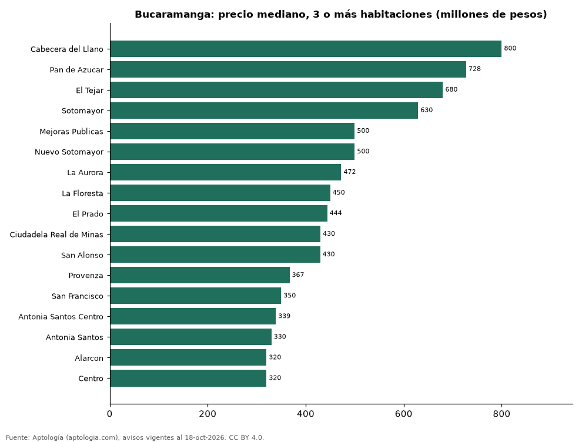

# Dónde cuesta más y menos comprar un apartamento de 3 o más habitaciones en Bucaramanga: ranking de barrios (octubre 2026)

**En Bucaramanga, un apartamento de 3 o más habitaciones cuesta 800 millones de pesos en la mediana en Cabecera del Llano, el barrio más caro, y 320 millones de pesos en Centro, el más barato: 2,5 veces menos.** Comparamos 17 barrios con al menos 30 avisos de 3 o más habitaciones.

*Resumen: analizamos 1.303 apartamentos en venta de 3 o más habitaciones en 17 barrios de Bucaramanga.*

**Actualizado:** 18 de octubre de 2026 (datos del 18 de octubre de 2026) · **Próxima actualización:** mensual.

## Resumen

| Indicador | Valor |
|---|---|
| Más caro | Cabecera del Llano: 800 millones de pesos |
| Más barato | Centro: 320 millones de pesos |
| Diferencia | 2,5 veces |
| Barrios | 17 |

## Precio de un apartamento de 3 o más habitaciones por barrio

| Barrio | Precio (mediana) | Rango típico (P25–P75) | Área mediana (m²) | Avisos |
|---|---|---|---|---|
| Cabecera del Llano | 800 millones de pesos | 630 millones de pesos – 1.200 millones de pesos | 160 | 316 |
| Pan de Azucar | 728 millones de pesos | 624 millones de pesos – 750 millones de pesos | 105 | 30 |
| El Tejar | 680 millones de pesos | 555 millones de pesos – 780 millones de pesos | 100 | 73 |
| Sotomayor | 630 millones de pesos | 482 millones de pesos – 750 millones de pesos | 127 | 198 |
| Mejoras Publicas | 500 millones de pesos | 426 millones de pesos – 615 millones de pesos | 94 | 82 |
| Nuevo Sotomayor | 500 millones de pesos | 400 millones de pesos – 580 millones de pesos | 107 | 51 |
| La Aurora | 472 millones de pesos | 389 millones de pesos – 568 millones de pesos | 95 | 54 |
| La Floresta | 450 millones de pesos | 358 millones de pesos – 532 millones de pesos | 110 | 48 |
| El Prado | 444 millones de pesos | 385 millones de pesos – 500 millones de pesos | 100 | 46 |
| Ciudadela Real de Minas | 430 millones de pesos | 350 millones de pesos – 488 millones de pesos | 100 | 63 |
| San Alonso | 430 millones de pesos | 391 millones de pesos – 512 millones de pesos | 110 | 56 |
| Provenza | 367 millones de pesos | 325 millones de pesos – 430 millones de pesos | 85 | 49 |
| San Francisco | 350 millones de pesos | 286 millones de pesos – 384 millones de pesos | 78 | 66 |
| Antonia Santos Centro | 339 millones de pesos | 320 millones de pesos – 380 millones de pesos | 82 | 61 |
| Antonia Santos | 330 millones de pesos | 310 millones de pesos – 375 millones de pesos | 78 | 37 |
| Alarcon | 320 millones de pesos | 290 millones de pesos – 370 millones de pesos | 78 | 33 |
| Centro | 320 millones de pesos | 255 millones de pesos – 422 millones de pesos | 76 | 40 |

Medianas del precio pedido; solo barrios con 30 avisos o más.

## Preguntas frecuentes

**¿Cuánto cuesta comprar un apartamento de 3 o más habitaciones en Cabecera del Llano?**
800 millones de pesos en la mediana (octubre de 2026); la mitad central entre 630 millones de pesos y 1.200 millones de pesos.

**¿Dónde es más barato comprar un apartamento de 3 o más habitaciones en Bucaramanga?**
En Centro: 320 millones de pesos en la mediana.

## Metodología

- **Fuente:** exportes nocturnos de la base de datos de Aptología (aptologia.com) del 18 de octubre de 2026: avisos vigentes de vivienda en portales inmobiliarios de 13 países, recogidos por Aptología y vistos en línea entre el 11 y el 18 de octubre de 2026. Corte: 18 de octubre de 2026.
- **Depuración:** se eliminan duplicados exactos (misma ciudad, zona, tipo, precio, moneda, área, habitaciones y baños) y los precios fuera del percentil 1–99 de cada país, operación, moneda y tipo; el precio por m² usa solo avisos con área declarada entre 12 y 2.000 m² y también se recorta al P1–P99.
- **Qué se mide:** precios pedidos (publicados), no precios de cierre. En arriendo, el canon mensual sin administración, gastos comunes ni condominio.
- **Muestra mínima:** cada cifra publicada se apoya en al menos 30 avisos; las celdas con menos se omiten.
- **Colombia:** Precios en pesos colombianos, sin conversión de moneda.
- **Limitaciones:** la cobertura depende de los portales que recorre Aptología en cada país y es mayor en las ciudades grandes y en los segmentos medio-alto y alto; el área es la que declara el aviso, sin verificar; los nombres de zona vienen de los portales.
- **Privacidad:** solo se publican agregados; no se publica ningún dato personal, enlace a avisos ni nombre de anunciante.
- **Datos abiertos:** [datos.csv](datos.csv), licencia CC BY 4.0.

## Cómo citar

Pinzón Pineda, D. M. (2026). *Dónde cuesta más y menos comprar un apartamento de 3 o más habitaciones en Bucaramanga: ranking de barrios (octubre 2026)*. Aptología (aptologia.com). https://github.com/elbroker/aptologia-datos/tree/main/estudios/venta-apartamentos-de-3-o-mas-habitaciones-por-barrio-bucaramanga-2026. Datos: datos.csv, licencia CC BY 4.0.
