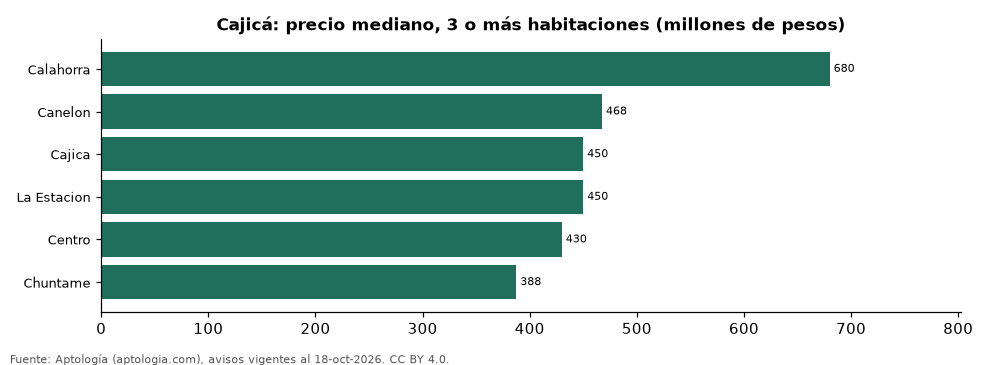

# Dónde cuesta más y menos comprar un apartamento de 3 o más habitaciones en Cajicá: ranking de barrios (octubre 2026)

**En Cajicá, un apartamento de 3 o más habitaciones cuesta 680 millones de pesos en la mediana en Calahorra, el barrio más caro, y 388 millones de pesos en Chuntame, el más barato: 1,8 veces menos.** Comparamos 6 barrios con al menos 30 avisos de 3 o más habitaciones.

*Resumen: analizamos 430 apartamentos en venta de 3 o más habitaciones en 6 barrios de Cajicá.*

**Actualizado:** 18 de octubre de 2026 (datos del 18 de octubre de 2026) · **Próxima actualización:** mensual.

## Resumen

| Indicador | Valor |
|---|---|
| Más caro | Calahorra: 680 millones de pesos |
| Más barato | Chuntame: 388 millones de pesos |
| Diferencia | 1,8 veces |
| Barrios | 6 |

## Precio de un apartamento de 3 o más habitaciones por barrio

| Barrio | Precio (mediana) | Rango típico (P25–P75) | Área mediana (m²) | Avisos |
|---|---|---|---|---|
| Calahorra | 680 millones de pesos | 530 millones de pesos – 791 millones de pesos | 93 | 64 |
| Canelon | 468 millones de pesos | 378 millones de pesos – 512 millones de pesos | 82 | 36 |
| Cajica | 450 millones de pesos | 360 millones de pesos – 554 millones de pesos | 82 | 118 |
| La Estacion | 450 millones de pesos | 339 millones de pesos – 550 millones de pesos | 84 | 65 |
| Centro | 430 millones de pesos | 360 millones de pesos – 520 millones de pesos | 81 | 87 |
| Chuntame | 388 millones de pesos | 330 millones de pesos – 435 millones de pesos | 74 | 60 |

Medianas del precio pedido; solo barrios con 30 avisos o más.

## Preguntas frecuentes

**¿Cuánto cuesta comprar un apartamento de 3 o más habitaciones en Calahorra?**
680 millones de pesos en la mediana (octubre de 2026); la mitad central entre 530 millones de pesos y 791 millones de pesos.

**¿Dónde es más barato comprar un apartamento de 3 o más habitaciones en Cajicá?**
En Chuntame: 388 millones de pesos en la mediana.

## Metodología

- **Fuente:** exportes nocturnos de la base de datos de Aptología (aptologia.com) del 18 de octubre de 2026: avisos vigentes de vivienda en portales inmobiliarios de 13 países, recogidos por Aptología y vistos en línea entre el 11 y el 18 de octubre de 2026. Corte: 18 de octubre de 2026.
- **Depuración:** se eliminan duplicados exactos (misma ciudad, zona, tipo, precio, moneda, área, habitaciones y baños) y los precios fuera del percentil 1–99 de cada país, operación, moneda y tipo; el precio por m² usa solo avisos con área declarada entre 12 y 2.000 m² y también se recorta al P1–P99.
- **Qué se mide:** precios pedidos (publicados), no precios de cierre. En arriendo, el canon mensual sin administración, gastos comunes ni condominio.
- **Muestra mínima:** cada cifra publicada se apoya en al menos 30 avisos; las celdas con menos se omiten.
- **Colombia:** Precios en pesos colombianos, sin conversión de moneda.
- **Limitaciones:** la cobertura depende de los portales que recorre Aptología en cada país y es mayor en las ciudades grandes y en los segmentos medio-alto y alto; el área es la que declara el aviso, sin verificar; los nombres de zona vienen de los portales.
- **Privacidad:** solo se publican agregados; no se publica ningún dato personal, enlace a avisos ni nombre de anunciante.
- **Datos abiertos:** [datos.csv](datos.csv), licencia CC BY 4.0.

## Cómo citar

Pinzón Pineda, D. M. (2026). *Dónde cuesta más y menos comprar un apartamento de 3 o más habitaciones en Cajicá: ranking de barrios (octubre 2026)*. Aptología (aptologia.com). https://github.com/elbroker/aptologia-datos/tree/main/estudios/venta-apartamentos-de-3-o-mas-habitaciones-por-barrio-cajica-2026. Datos: datos.csv, licencia CC BY 4.0.
