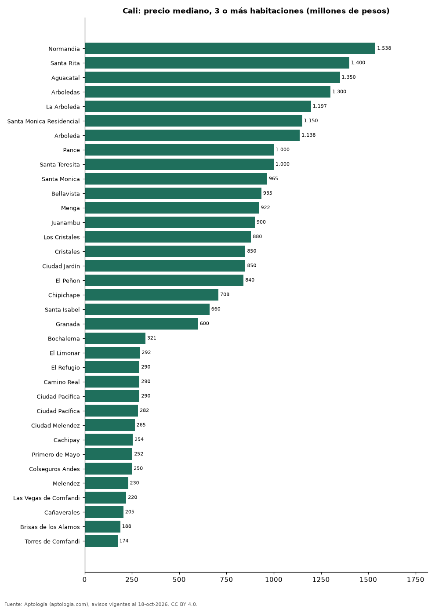

# Dónde cuesta más y menos comprar un apartamento de 3 o más habitaciones en Cali: ranking de barrios (octubre 2026)

**En Cali, un apartamento de 3 o más habitaciones cuesta 1.538 millones de pesos en la mediana en Normandia, el barrio más caro, y 174 millones de pesos en Torres de Comfandi, el más barato: 8,8 veces menos.** Comparamos 52 barrios con al menos 30 avisos de 3 o más habitaciones.

*Resumen: analizamos 4.896 apartamentos en venta de 3 o más habitaciones en 52 barrios de Cali.*

**Actualizado:** 18 de octubre de 2026 (datos del 18 de octubre de 2026) · **Próxima actualización:** mensual.

## Resumen

| Indicador | Valor |
|---|---|
| Más caro | Normandia: 1.538 millones de pesos |
| Más barato | Torres de Comfandi: 174 millones de pesos |
| Diferencia | 8,8 veces |
| Barrios | 52 |

## Precio de un apartamento de 3 o más habitaciones por barrio

| Barrio | Precio (mediana) | Rango típico (P25–P75) | Área mediana (m²) | Avisos |
|---|---|---|---|---|
| Normandia | 1.538 millones de pesos | 1.080 millones de pesos – 1.892 millones de pesos | 240 | 208 |
| Santa Rita | 1.400 millones de pesos | 804 millones de pesos – 1.762 millones de pesos | 229 | 64 |
| Aguacatal | 1.350 millones de pesos | 900 millones de pesos – 1.590 millones de pesos | 214 | 87 |
| Arboledas | 1.300 millones de pesos | 900 millones de pesos – 1.550 millones de pesos | 195 | 53 |
| La Arboleda | 1.197 millones de pesos | 850 millones de pesos – 1.628 millones de pesos | 196 | 54 |
| Santa Monica Residencial | 1.150 millones de pesos | 778 millones de pesos – 2.278 millones de pesos | 164 | 42 |
| Arboleda | 1.138 millones de pesos | 850 millones de pesos – 1.422 millones de pesos | 208 | 30 |
| Pance | 1.000 millones de pesos | 820 millones de pesos – 1.250 millones de pesos | 140 | 391 |
| Santa Teresita | 1.000 millones de pesos | 800 millones de pesos – 1.500 millones de pesos | 204 | 282 |
| Santa Monica | 965 millones de pesos | 750 millones de pesos – 1.800 millones de pesos | 180 | 110 |
| Bellavista | 935 millones de pesos | 737 millones de pesos – 1.535 millones de pesos | 165 | 151 |
| Menga | 922 millones de pesos | 680 millones de pesos – 1.100 millones de pesos | 132 | 72 |
| Juanambu | 900 millones de pesos | 800 millones de pesos – 1.300 millones de pesos | 176 | 62 |
| Los Cristales | 880 millones de pesos | 730 millones de pesos – 1.250 millones de pesos | 125 | 33 |
| Cristales | 850 millones de pesos | 700 millones de pesos – 1.338 millones de pesos | 142 | 155 |
| Ciudad Jardín | 850 millones de pesos | 630 millones de pesos – 1.070 millones de pesos | 142 | 349 |
| El Peñon | 840 millones de pesos | 620 millones de pesos – 962 millones de pesos | 198 | 32 |
| Chipichape | 708 millones de pesos | 562 millones de pesos – 932 millones de pesos | 132 | 38 |
| Santa Isabel | 660 millones de pesos | 619 millones de pesos – 750 millones de pesos | 99 | 66 |
| Granada | 600 millones de pesos | 430 millones de pesos – 800 millones de pesos | 183 | 61 |
| La Flora | 580 millones de pesos | 474 millones de pesos – 666 millones de pesos | 109 | 96 |
| Cuarto de Legua | 570 millones de pesos | 352 millones de pesos – 685 millones de pesos | 115 | 35 |
| Cuarto de Legua - Guadalupe | 570 millones de pesos | 398 millones de pesos – 680 millones de pesos | 115 | 37 |
| Centenario | 565 millones de pesos | 498 millones de pesos – 780 millones de pesos | 152 | 48 |
| Urbanizacion la Flora | 550 millones de pesos | 450 millones de pesos – 668 millones de pesos | 103 | 47 |
| Versalles | 500 millones de pesos | 395 millones de pesos – 678 millones de pesos | 164 | 78 |
| El Ingenio | 490 millones de pesos | 419 millones de pesos – 560 millones de pesos | 107 | 174 |
| Tequendama | 480 millones de pesos | 352 millones de pesos – 622 millones de pesos | 112 | 31 |
| Multicentro | 480 millones de pesos | 412 millones de pesos – 525 millones de pesos | 88 | 35 |
| La Hacienda | 435 millones de pesos | 365 millones de pesos – 560 millones de pesos | 98 | 80 |
| Quintas de Don Simón | 410 millones de pesos | 335 millones de pesos – 540 millones de pesos | 92 | 73 |
| Prados del Norte | 390 millones de pesos | 320 millones de pesos – 450 millones de pesos | 93 | 65 |
| Valle del Lili | 390 millones de pesos | 290 millones de pesos – 490 millones de pesos | 80 | 530 |
| Ciudad Capri | 372 millones de pesos | 308 millones de pesos – 508 millones de pesos | 95 | 46 |
| Valle de Lili | 370 millones de pesos | 280 millones de pesos – 478 millones de pesos | 80 | 120 |
| Caney | 330 millones de pesos | 255 millones de pesos – 398 millones de pesos | 79 | 87 |
| Santa Anita | 325 millones de pesos | 250 millones de pesos – 428 millones de pesos | 83 | 68 |
| Bochalema | 321 millones de pesos | 250 millones de pesos – 396 millones de pesos | 72 | 282 |
| El Limonar | 292 millones de pesos | 244 millones de pesos – 371 millones de pesos | 84 | 56 |
| El Refugio | 290 millones de pesos | 245 millones de pesos – 350 millones de pesos | 74 | 54 |
| Camino Real | 290 millones de pesos | 260 millones de pesos – 420 millones de pesos | 82 | 38 |
| Ciudad Pacifica | 290 millones de pesos | 225 millones de pesos – 452 millones de pesos | 71 | 34 |
| Ciudad Pacífica | 282 millones de pesos | 238 millones de pesos – 323 millones de pesos | 76 | 42 |
| Ciudad Melendez | 265 millones de pesos | 248 millones de pesos – 334 millones de pesos | 65 | 126 |
| Cachipay | 254 millones de pesos | 238 millones de pesos – 271 millones de pesos | 60 | 30 |
| Primero de Mayo | 252 millones de pesos | 215 millones de pesos – 310 millones de pesos | 66 | 42 |
| Colseguros Andes | 250 millones de pesos | 221 millones de pesos – 328 millones de pesos | 66 | 30 |
| Melendez | 230 millones de pesos | 210 millones de pesos – 260 millones de pesos | 66 | 31 |
| Las Vegas de Comfandi | 220 millones de pesos | 179 millones de pesos – 270 millones de pesos | 55 | 30 |
| Cañaverales | 205 millones de pesos | 176 millones de pesos – 249 millones de pesos | 59 | 45 |
| Brisas de los Alamos | 188 millones de pesos | 165 millones de pesos – 251 millones de pesos | 57 | 32 |
| Torres de Comfandi | 174 millones de pesos | 155 millones de pesos – 180 millones de pesos | 55 | 34 |

Medianas del precio pedido; solo barrios con 30 avisos o más.

## Preguntas frecuentes

**¿Cuánto cuesta comprar un apartamento de 3 o más habitaciones en Normandia?**
1.538 millones de pesos en la mediana (octubre de 2026); la mitad central entre 1.080 millones de pesos y 1.892 millones de pesos.

**¿Dónde es más barato comprar un apartamento de 3 o más habitaciones en Cali?**
En Torres de Comfandi: 174 millones de pesos en la mediana.

## Metodología

- **Fuente:** exportes nocturnos de la base de datos de Aptología (aptologia.com) del 18 de octubre de 2026: avisos vigentes de vivienda en portales inmobiliarios de 13 países, recogidos por Aptología y vistos en línea entre el 11 y el 18 de octubre de 2026. Corte: 18 de octubre de 2026.
- **Depuración:** se eliminan duplicados exactos (misma ciudad, zona, tipo, precio, moneda, área, habitaciones y baños) y los precios fuera del percentil 1–99 de cada país, operación, moneda y tipo; el precio por m² usa solo avisos con área declarada entre 12 y 2.000 m² y también se recorta al P1–P99.
- **Qué se mide:** precios pedidos (publicados), no precios de cierre. En arriendo, el canon mensual sin administración, gastos comunes ni condominio.
- **Muestra mínima:** cada cifra publicada se apoya en al menos 30 avisos; las celdas con menos se omiten.
- **Colombia:** Precios en pesos colombianos, sin conversión de moneda.
- **Limitaciones:** la cobertura depende de los portales que recorre Aptología en cada país y es mayor en las ciudades grandes y en los segmentos medio-alto y alto; el área es la que declara el aviso, sin verificar; los nombres de zona vienen de los portales.
- **Privacidad:** solo se publican agregados; no se publica ningún dato personal, enlace a avisos ni nombre de anunciante.
- **Datos abiertos:** [datos.csv](datos.csv), licencia CC BY 4.0.

## Cómo citar

Pinzón Pineda, D. M. (2026). *Dónde cuesta más y menos comprar un apartamento de 3 o más habitaciones en Cali: ranking de barrios (octubre 2026)*. Aptología (aptologia.com). https://github.com/elbroker/aptologia-datos/tree/main/estudios/venta-apartamentos-de-3-o-mas-habitaciones-por-barrio-cali-2026. Datos: datos.csv, licencia CC BY 4.0.
