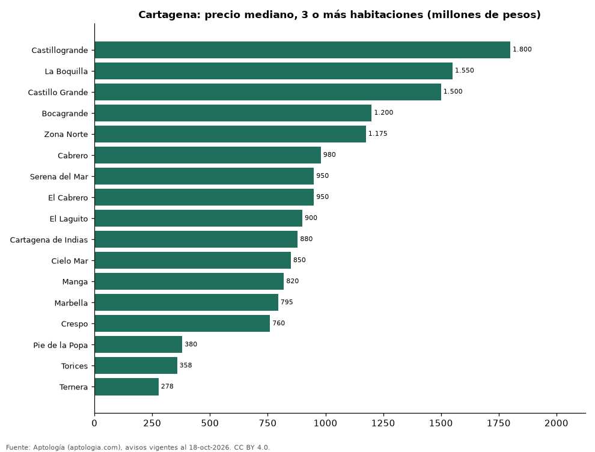

# Dónde cuesta más y menos comprar un apartamento de 3 o más habitaciones en Cartagena: ranking de barrios (octubre 2026)

**En Cartagena, un apartamento de 3 o más habitaciones cuesta 1.800 millones de pesos en la mediana en Castillogrande, el barrio más caro, y 278 millones de pesos en Ternera, el más barato: 6,5 veces menos.** Comparamos 17 barrios con al menos 30 avisos de 3 o más habitaciones.

*Resumen: analizamos 2.003 apartamentos en venta de 3 o más habitaciones en 17 barrios de Cartagena.*

**Actualizado:** 18 de octubre de 2026 (datos del 18 de octubre de 2026) · **Próxima actualización:** mensual.

## Resumen

| Indicador | Valor |
|---|---|
| Más caro | Castillogrande: 1.800 millones de pesos |
| Más barato | Ternera: 278 millones de pesos |
| Diferencia | 6,5 veces |
| Barrios | 17 |

## Precio de un apartamento de 3 o más habitaciones por barrio

| Barrio | Precio (mediana) | Rango típico (P25–P75) | Área mediana (m²) | Avisos |
|---|---|---|---|---|
| Castillogrande | 1.800 millones de pesos | 1.100 millones de pesos – 2.700 millones de pesos | 183 | 217 |
| La Boquilla | 1.550 millones de pesos | 1.100 millones de pesos – 1.800 millones de pesos | 162 | 123 |
| Castillo Grande | 1.500 millones de pesos | 950 millones de pesos – 2.500 millones de pesos | 162 | 33 |
| Bocagrande | 1.200 millones de pesos | 850 millones de pesos – 1.738 millones de pesos | 163 | 411 |
| Zona Norte | 1.175 millones de pesos | 790 millones de pesos – 1.942 millones de pesos | 160 | 38 |
| Cabrero | 980 millones de pesos | 740 millones de pesos – 1.225 millones de pesos | 131 | 31 |
| Serena del Mar | 950 millones de pesos | 710 millones de pesos – 1.375 millones de pesos | 118 | 91 |
| El Cabrero | 950 millones de pesos | 745 millones de pesos – 1.200 millones de pesos | 124 | 63 |
| El Laguito | 900 millones de pesos | 790 millones de pesos – 1.222 millones de pesos | 126 | 86 |
| Cartagena de Indias | 880 millones de pesos | 670 millones de pesos – 1.610 millones de pesos | 138 | 135 |
| Cielo Mar | 850 millones de pesos | 780 millones de pesos – 1.300 millones de pesos | 118 | 65 |
| Manga | 820 millones de pesos | 578 millones de pesos – 1.300 millones de pesos | 125 | 311 |
| Marbella | 795 millones de pesos | 628 millones de pesos – 940 millones de pesos | 120 | 78 |
| Crespo | 760 millones de pesos | 600 millones de pesos – 950 millones de pesos | 120 | 147 |
| Pie de la Popa | 380 millones de pesos | 342 millones de pesos – 458 millones de pesos | 104 | 82 |
| Torices | 358 millones de pesos | 328 millones de pesos – 380 millones de pesos | 57 | 56 |
| Ternera | 278 millones de pesos | 190 millones de pesos – 395 millones de pesos | 66 | 36 |

Medianas del precio pedido; solo barrios con 30 avisos o más.

## Preguntas frecuentes

**¿Cuánto cuesta comprar un apartamento de 3 o más habitaciones en Castillogrande?**
1.800 millones de pesos en la mediana (octubre de 2026); la mitad central entre 1.100 millones de pesos y 2.700 millones de pesos.

**¿Dónde es más barato comprar un apartamento de 3 o más habitaciones en Cartagena?**
En Ternera: 278 millones de pesos en la mediana.

## Metodología

- **Fuente:** exportes nocturnos de la base de datos de Aptología (aptologia.com) del 18 de octubre de 2026: avisos vigentes de vivienda en portales inmobiliarios de 13 países, recogidos por Aptología y vistos en línea entre el 11 y el 18 de octubre de 2026. Corte: 18 de octubre de 2026.
- **Depuración:** se eliminan duplicados exactos (misma ciudad, zona, tipo, precio, moneda, área, habitaciones y baños) y los precios fuera del percentil 1–99 de cada país, operación, moneda y tipo; el precio por m² usa solo avisos con área declarada entre 12 y 2.000 m² y también se recorta al P1–P99.
- **Qué se mide:** precios pedidos (publicados), no precios de cierre. En arriendo, el canon mensual sin administración, gastos comunes ni condominio.
- **Muestra mínima:** cada cifra publicada se apoya en al menos 30 avisos; las celdas con menos se omiten.
- **Colombia:** Precios en pesos colombianos, sin conversión de moneda.
- **Limitaciones:** la cobertura depende de los portales que recorre Aptología en cada país y es mayor en las ciudades grandes y en los segmentos medio-alto y alto; el área es la que declara el aviso, sin verificar; los nombres de zona vienen de los portales.
- **Privacidad:** solo se publican agregados; no se publica ningún dato personal, enlace a avisos ni nombre de anunciante.
- **Datos abiertos:** [datos.csv](datos.csv), licencia CC BY 4.0.

## Cómo citar

Pinzón Pineda, D. M. (2026). *Dónde cuesta más y menos comprar un apartamento de 3 o más habitaciones en Cartagena: ranking de barrios (octubre 2026)*. Aptología (aptologia.com). https://github.com/elbroker/aptologia-datos/tree/main/estudios/venta-apartamentos-de-3-o-mas-habitaciones-por-barrio-cartagena-2026. Datos: datos.csv, licencia CC BY 4.0.
