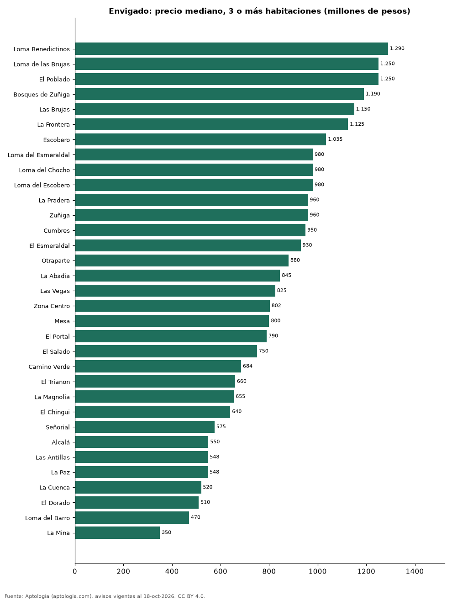

# Dónde cuesta más y menos comprar un apartamento de 3 o más habitaciones en Envigado: ranking de barrios (octubre 2026)

**En Envigado, un apartamento de 3 o más habitaciones cuesta 1.290 millones de pesos en la mediana en Loma Benedictinos, el barrio más caro, y 350 millones de pesos en La Mina, el más barato: 3,7 veces menos.** Comparamos 33 barrios con al menos 30 avisos de 3 o más habitaciones.

*Resumen: analizamos 3.002 apartamentos en venta de 3 o más habitaciones en 33 barrios de Envigado.*

**Actualizado:** 18 de octubre de 2026 (datos del 18 de octubre de 2026) · **Próxima actualización:** mensual.

## Resumen

| Indicador | Valor |
|---|---|
| Más caro | Loma Benedictinos: 1.290 millones de pesos |
| Más barato | La Mina: 350 millones de pesos |
| Diferencia | 3,7 veces |
| Barrios | 33 |

## Precio de un apartamento de 3 o más habitaciones por barrio

| Barrio | Precio (mediana) | Rango típico (P25–P75) | Área mediana (m²) | Avisos |
|---|---|---|---|---|
| Loma Benedictinos | 1.290 millones de pesos | 942 millones de pesos – 1.542 millones de pesos | 154 | 94 |
| Loma de las Brujas | 1.250 millones de pesos | 950 millones de pesos – 1.628 millones de pesos | 137 | 290 |
| El Poblado | 1.250 millones de pesos | 892 millones de pesos – 1.745 millones de pesos | 145 | 30 |
| Bosques de Zuñiga | 1.190 millones de pesos | 890 millones de pesos – 1.431 millones de pesos | 137 | 42 |
| Las Brujas | 1.150 millones de pesos | 870 millones de pesos – 1.410 millones de pesos | 129 | 61 |
| La Frontera | 1.125 millones de pesos | 780 millones de pesos – 1.262 millones de pesos | 140 | 40 |
| Escobero | 1.035 millones de pesos | 780 millones de pesos – 1.322 millones de pesos | 112 | 96 |
| Loma del Esmeraldal | 980 millones de pesos | 800 millones de pesos – 1.298 millones de pesos | 110 | 158 |
| Loma del Chocho | 980 millones de pesos | 890 millones de pesos – 1.100 millones de pesos | 120 | 105 |
| Loma del Escobero | 980 millones de pesos | 728 millones de pesos – 1.285 millones de pesos | 114 | 116 |
| La Pradera | 960 millones de pesos | 670 millones de pesos – 1.278 millones de pesos | 105 | 37 |
| Zuñiga | 960 millones de pesos | 808 millones de pesos – 1.296 millones de pesos | 134 | 156 |
| Cumbres | 950 millones de pesos | 785 millones de pesos – 1.188 millones de pesos | 105 | 215 |
| El Esmeraldal | 930 millones de pesos | 770 millones de pesos – 1.200 millones de pesos | 107 | 89 |
| Otraparte | 880 millones de pesos | 742 millones de pesos – 1.108 millones de pesos | 116 | 98 |
| La Abadia | 845 millones de pesos | 760 millones de pesos – 950 millones de pesos | 95 | 49 |
| Las Vegas | 825 millones de pesos | 736 millones de pesos – 918 millones de pesos | 80 | 82 |
| Zona Centro | 802 millones de pesos | 646 millones de pesos – 1.195 millones de pesos | 111 | 70 |
| Mesa | 800 millones de pesos | 588 millones de pesos – 961 millones de pesos | 112 | 100 |
| El Portal | 790 millones de pesos | 720 millones de pesos – 900 millones de pesos | 114 | 94 |
| El Salado | 750 millones de pesos | 567 millones de pesos – 845 millones de pesos | 83 | 33 |
| Camino Verde | 684 millones de pesos | 590 millones de pesos – 880 millones de pesos | 84 | 268 |
| El Trianon | 660 millones de pesos | 500 millones de pesos – 795 millones de pesos | 84 | 71 |
| La Magnolia | 655 millones de pesos | 550 millones de pesos – 850 millones de pesos | 110 | 41 |
| El Chingui | 640 millones de pesos | 586 millones de pesos – 720 millones de pesos | 82 | 94 |
| Señorial | 575 millones de pesos | 475 millones de pesos – 718 millones de pesos | 80 | 75 |
| Alcalá | 550 millones de pesos | 465 millones de pesos – 608 millones de pesos | 100 | 30 |
| Las Antillas | 548 millones de pesos | 482 millones de pesos – 665 millones de pesos | 72 | 79 |
| La Paz | 548 millones de pesos | 450 millones de pesos – 650 millones de pesos | 83 | 52 |
| La Cuenca | 520 millones de pesos | 478 millones de pesos – 732 millones de pesos | 70 | 80 |
| El Dorado | 510 millones de pesos | 445 millones de pesos – 650 millones de pesos | 89 | 51 |
| Loma del Barro | 470 millones de pesos | 390 millones de pesos – 620 millones de pesos | 70 | 61 |
| La Mina | 350 millones de pesos | 300 millones de pesos – 430 millones de pesos | 60 | 45 |

Medianas del precio pedido; solo barrios con 30 avisos o más.

## Preguntas frecuentes

**¿Cuánto cuesta comprar un apartamento de 3 o más habitaciones en Loma Benedictinos?**
1.290 millones de pesos en la mediana (octubre de 2026); la mitad central entre 942 millones de pesos y 1.542 millones de pesos.

**¿Dónde es más barato comprar un apartamento de 3 o más habitaciones en Envigado?**
En La Mina: 350 millones de pesos en la mediana.

## Metodología

- **Fuente:** exportes nocturnos de la base de datos de Aptología (aptologia.com) del 18 de octubre de 2026: avisos vigentes de vivienda en portales inmobiliarios de 13 países, recogidos por Aptología y vistos en línea entre el 11 y el 18 de octubre de 2026. Corte: 18 de octubre de 2026.
- **Depuración:** se eliminan duplicados exactos (misma ciudad, zona, tipo, precio, moneda, área, habitaciones y baños) y los precios fuera del percentil 1–99 de cada país, operación, moneda y tipo; el precio por m² usa solo avisos con área declarada entre 12 y 2.000 m² y también se recorta al P1–P99.
- **Qué se mide:** precios pedidos (publicados), no precios de cierre. En arriendo, el canon mensual sin administración, gastos comunes ni condominio.
- **Muestra mínima:** cada cifra publicada se apoya en al menos 30 avisos; las celdas con menos se omiten.
- **Colombia:** Precios en pesos colombianos, sin conversión de moneda.
- **Limitaciones:** la cobertura depende de los portales que recorre Aptología en cada país y es mayor en las ciudades grandes y en los segmentos medio-alto y alto; el área es la que declara el aviso, sin verificar; los nombres de zona vienen de los portales.
- **Privacidad:** solo se publican agregados; no se publica ningún dato personal, enlace a avisos ni nombre de anunciante.
- **Datos abiertos:** [datos.csv](datos.csv), licencia CC BY 4.0.

## Cómo citar

Pinzón Pineda, D. M. (2026). *Dónde cuesta más y menos comprar un apartamento de 3 o más habitaciones en Envigado: ranking de barrios (octubre 2026)*. Aptología (aptologia.com). https://github.com/elbroker/aptologia-datos/tree/main/estudios/venta-apartamentos-de-3-o-mas-habitaciones-por-barrio-envigado-2026. Datos: datos.csv, licencia CC BY 4.0.
