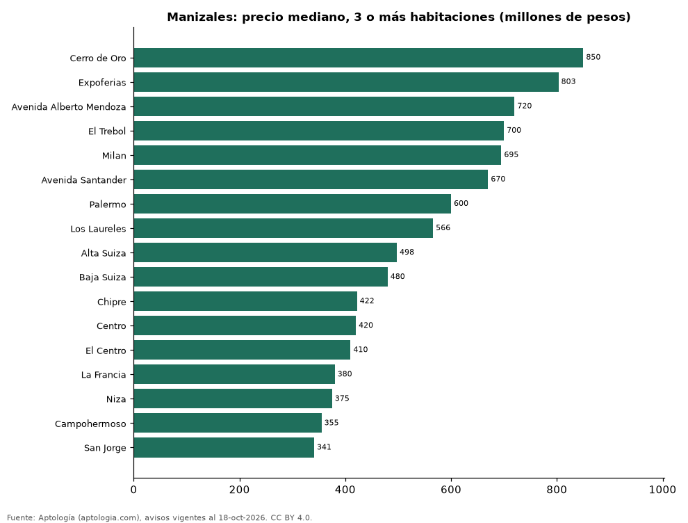

# Dónde cuesta más y menos comprar un apartamento de 3 o más habitaciones en Manizales: ranking de barrios (octubre 2026)

**En Manizales, un apartamento de 3 o más habitaciones cuesta 850 millones de pesos en la mediana en Cerro de Oro, el barrio más caro, y 341 millones de pesos en San Jorge, el más barato: 2,5 veces menos.** Comparamos 17 barrios con al menos 30 avisos de 3 o más habitaciones.

*Resumen: analizamos 1.141 apartamentos en venta de 3 o más habitaciones en 17 barrios de Manizales.*

**Actualizado:** 18 de octubre de 2026 (datos del 18 de octubre de 2026) · **Próxima actualización:** mensual.

## Resumen

| Indicador | Valor |
|---|---|
| Más caro | Cerro de Oro: 850 millones de pesos |
| Más barato | San Jorge: 341 millones de pesos |
| Diferencia | 2,5 veces |
| Barrios | 17 |

## Precio de un apartamento de 3 o más habitaciones por barrio

| Barrio | Precio (mediana) | Rango típico (P25–P75) | Área mediana (m²) | Avisos |
|---|---|---|---|---|
| Cerro de Oro | 850 millones de pesos | 580 millones de pesos – 1.004 millones de pesos | 100 | 69 |
| Expoferias | 803 millones de pesos | 750 millones de pesos – 845 millones de pesos | 100 | 31 |
| Avenida Alberto Mendoza | 720 millones de pesos | 610 millones de pesos – 886 millones de pesos | 96 | 37 |
| El Trebol | 700 millones de pesos | 600 millones de pesos – 810 millones de pesos | 98 | 67 |
| Milan | 695 millones de pesos | 550 millones de pesos – 778 millones de pesos | 105 | 115 |
| Avenida Santander | 670 millones de pesos | 579 millones de pesos – 790 millones de pesos | 114 | 64 |
| Palermo | 600 millones de pesos | 500 millones de pesos – 750 millones de pesos | 132 | 248 |
| Los Laureles | 566 millones de pesos | 460 millones de pesos – 780 millones de pesos | 95 | 45 |
| Alta Suiza | 498 millones de pesos | 416 millones de pesos – 574 millones de pesos | 82 | 46 |
| Baja Suiza | 480 millones de pesos | 435 millones de pesos – 538 millones de pesos | 74 | 59 |
| Chipre | 422 millones de pesos | 350 millones de pesos – 500 millones de pesos | 78 | 73 |
| Centro | 420 millones de pesos | 360 millones de pesos – 590 millones de pesos | 117 | 41 |
| El Centro | 410 millones de pesos | 350 millones de pesos – 550 millones de pesos | 113 | 50 |
| La Francia | 380 millones de pesos | 320 millones de pesos – 450 millones de pesos | 63 | 87 |
| Niza | 375 millones de pesos | 338 millones de pesos – 410 millones de pesos | 65 | 40 |
| Campohermoso | 355 millones de pesos | 288 millones de pesos – 450 millones de pesos | 74 | 36 |
| San Jorge | 341 millones de pesos | 295 millones de pesos – 430 millones de pesos | 64 | 33 |

Medianas del precio pedido; solo barrios con 30 avisos o más.

## Preguntas frecuentes

**¿Cuánto cuesta comprar un apartamento de 3 o más habitaciones en Cerro de Oro?**
850 millones de pesos en la mediana (octubre de 2026); la mitad central entre 580 millones de pesos y 1.004 millones de pesos.

**¿Dónde es más barato comprar un apartamento de 3 o más habitaciones en Manizales?**
En San Jorge: 341 millones de pesos en la mediana.

## Metodología

- **Fuente:** exportes nocturnos de la base de datos de Aptología (aptologia.com) del 18 de octubre de 2026: avisos vigentes de vivienda en portales inmobiliarios de 13 países, recogidos por Aptología y vistos en línea entre el 11 y el 18 de octubre de 2026. Corte: 18 de octubre de 2026.
- **Depuración:** se eliminan duplicados exactos (misma ciudad, zona, tipo, precio, moneda, área, habitaciones y baños) y los precios fuera del percentil 1–99 de cada país, operación, moneda y tipo; el precio por m² usa solo avisos con área declarada entre 12 y 2.000 m² y también se recorta al P1–P99.
- **Qué se mide:** precios pedidos (publicados), no precios de cierre. En arriendo, el canon mensual sin administración, gastos comunes ni condominio.
- **Muestra mínima:** cada cifra publicada se apoya en al menos 30 avisos; las celdas con menos se omiten.
- **Colombia:** Precios en pesos colombianos, sin conversión de moneda.
- **Limitaciones:** la cobertura depende de los portales que recorre Aptología en cada país y es mayor en las ciudades grandes y en los segmentos medio-alto y alto; el área es la que declara el aviso, sin verificar; los nombres de zona vienen de los portales.
- **Privacidad:** solo se publican agregados; no se publica ningún dato personal, enlace a avisos ni nombre de anunciante.
- **Datos abiertos:** [datos.csv](datos.csv), licencia CC BY 4.0.

## Cómo citar

Pinzón Pineda, D. M. (2026). *Dónde cuesta más y menos comprar un apartamento de 3 o más habitaciones en Manizales: ranking de barrios (octubre 2026)*. Aptología (aptologia.com). https://github.com/elbroker/aptologia-datos/tree/main/estudios/venta-apartamentos-de-3-o-mas-habitaciones-por-barrio-manizales-2026. Datos: datos.csv, licencia CC BY 4.0.
