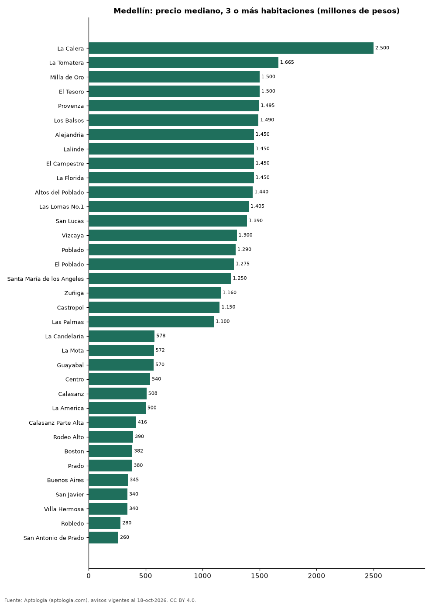

# Dónde cuesta más y menos comprar un apartamento de 3 o más habitaciones en Medellín: ranking de barrios (octubre 2026)

**En Medellín, un apartamento de 3 o más habitaciones cuesta 2.500 millones de pesos en la mediana en La Calera, el barrio más caro, y 260 millones de pesos en San Antonio de Prado, el más barato: 9,6 veces menos.** Comparamos 60 barrios con al menos 30 avisos de 3 o más habitaciones.

*Resumen: analizamos 12.081 apartamentos en venta de 3 o más habitaciones en 60 barrios de Medellín.*

**Actualizado:** 18 de octubre de 2026 (datos del 18 de octubre de 2026) · **Próxima actualización:** mensual.

## Resumen

| Indicador | Valor |
|---|---|
| Más caro | La Calera: 2.500 millones de pesos |
| Más barato | San Antonio de Prado: 260 millones de pesos |
| Diferencia | 9,6 veces |
| Barrios | 60 |

## Precio de un apartamento de 3 o más habitaciones por barrio

| Barrio | Precio (mediana) | Rango típico (P25–P75) | Área mediana (m²) | Avisos |
|---|---|---|---|---|
| La Calera | 2.500 millones de pesos | 2.075 millones de pesos – 3.082 millones de pesos | 244 | 72 |
| La Tomatera | 1.665 millones de pesos | 1.290 millones de pesos – 1.875 millones de pesos | 194 | 36 |
| Milla de Oro | 1.500 millones de pesos | 1.200 millones de pesos – 1.850 millones de pesos | 172 | 76 |
| El Tesoro | 1.500 millones de pesos | 1.198 millones de pesos – 2.262 millones de pesos | 200 | 192 |
| Provenza | 1.495 millones de pesos | 1.150 millones de pesos – 1.950 millones de pesos | 166 | 62 |
| Los Balsos | 1.490 millones de pesos | 1.150 millones de pesos – 2.250 millones de pesos | 181 | 287 |
| Alejandria | 1.450 millones de pesos | 1.100 millones de pesos – 1.795 millones de pesos | 193 | 61 |
| Lalinde | 1.450 millones de pesos | 1.275 millones de pesos – 1.700 millones de pesos | 144 | 39 |
| El Campestre | 1.450 millones de pesos | 1.190 millones de pesos – 2.170 millones de pesos | 183 | 93 |
| La Florida | 1.450 millones de pesos | 1.100 millones de pesos – 1.750 millones de pesos | 188 | 45 |
| Altos del Poblado | 1.440 millones de pesos | 1.050 millones de pesos – 1.675 millones de pesos | 139 | 93 |
| Las Lomas No.1 | 1.405 millones de pesos | 950 millones de pesos – 1.800 millones de pesos | 165 | 34 |
| San Lucas | 1.390 millones de pesos | 950 millones de pesos – 2.150 millones de pesos | 182 | 143 |
| Vizcaya | 1.300 millones de pesos | 958 millones de pesos – 1.620 millones de pesos | 153 | 39 |
| Poblado | 1.290 millones de pesos | 900 millones de pesos – 1.750 millones de pesos | 160 | 545 |
| El Poblado | 1.275 millones de pesos | 945 millones de pesos – 1.700 millones de pesos | 167 | 3.596 |
| Santa María de los Angeles | 1.250 millones de pesos | 900 millones de pesos – 1.520 millones de pesos | 150 | 153 |
| Zuñiga | 1.160 millones de pesos | 950 millones de pesos – 1.300 millones de pesos | 138 | 32 |
| Castropol | 1.150 millones de pesos | 900 millones de pesos – 1.450 millones de pesos | 136 | 334 |
| Las Palmas | 1.100 millones de pesos | 750 millones de pesos – 1.675 millones de pesos | 110 | 203 |
| Patio Bonito | 1.000 millones de pesos | 850 millones de pesos – 1.202 millones de pesos | 153 | 96 |
| La Frontera | 980 millones de pesos | 880 millones de pesos – 1.181 millones de pesos | 125 | 74 |
| Ciudad del Río | 950 millones de pesos | 780 millones de pesos – 1.100 millones de pesos | 92 | 117 |
| La Aguacatala | 940 millones de pesos | 720 millones de pesos – 1.300 millones de pesos | 152 | 30 |
| Santa Teresita | 892 millones de pesos | 720 millones de pesos – 1.112 millones de pesos | 146 | 40 |
| Laureles | 870 millones de pesos | 720 millones de pesos – 1.100 millones de pesos | 134 | 1.846 |
| Envigado | 868 millones de pesos | 675 millones de pesos – 1.312 millones de pesos | 118 | 30 |
| Conquistadores | 860 millones de pesos | 730 millones de pesos – 1.050 millones de pesos | 128 | 237 |
| Belén Rosales | 850 millones de pesos | 616 millones de pesos – 1.100 millones de pesos | 128 | 55 |
| Estadio | 820 millones de pesos | 684 millones de pesos – 892 millones de pesos | 143 | 84 |
| Vía las Palmas | 798 millones de pesos | 610 millones de pesos – 1.295 millones de pesos | 90 | 55 |
| La Castellana | 750 millones de pesos | 650 millones de pesos – 950 millones de pesos | 112 | 154 |
| Belén la Palma | 750 millones de pesos | 650 millones de pesos – 973 millones de pesos | 108 | 59 |
| Loma de los Bernal | 680 millones de pesos | 555 millones de pesos – 850 millones de pesos | 88 | 257 |
| Simón Bolívar | 680 millones de pesos | 516 millones de pesos – 785 millones de pesos | 115 | 87 |
| Belén Loma de los Bernal | 680 millones de pesos | 550 millones de pesos – 848 millones de pesos | 84 | 62 |
| Florida Nueva | 660 millones de pesos | 558 millones de pesos – 790 millones de pesos | 135 | 55 |
| Los Colores | 660 millones de pesos | 530 millones de pesos – 780 millones de pesos | 83 | 167 |
| San Diego | 655 millones de pesos | 568 millones de pesos – 750 millones de pesos | 80 | 68 |
| Loma del Indio | 630 millones de pesos | 470 millones de pesos – 750 millones de pesos | 80 | 123 |
| San Joaquin | 615 millones de pesos | 550 millones de pesos – 780 millones de pesos | 114 | 61 |
| San German | 598 millones de pesos | 558 millones de pesos – 650 millones de pesos | 73 | 51 |
| Belén | 595 millones de pesos | 445 millones de pesos – 750 millones de pesos | 92 | 557 |
| La Floresta | 585 millones de pesos | 450 millones de pesos – 718 millones de pesos | 100 | 38 |
| Villa Nueva | 580 millones de pesos | 390 millones de pesos – 785 millones de pesos | 165 | 31 |
| La Candelaria | 578 millones de pesos | 430 millones de pesos – 715 millones de pesos | 139 | 144 |
| La Mota | 572 millones de pesos | 494 millones de pesos – 664 millones de pesos | 87 | 36 |
| Guayabal | 570 millones de pesos | 455 millones de pesos – 665 millones de pesos | 82 | 79 |
| Centro | 540 millones de pesos | 358 millones de pesos – 675 millones de pesos | 136 | 60 |
| Calasanz | 508 millones de pesos | 400 millones de pesos – 629 millones de pesos | 79 | 338 |
| La America | 500 millones de pesos | 430 millones de pesos – 650 millones de pesos | 90 | 143 |
| Calasanz Parte Alta | 416 millones de pesos | 380 millones de pesos – 565 millones de pesos | 62 | 42 |
| Rodeo Alto | 390 millones de pesos | 328 millones de pesos – 432 millones de pesos | 60 | 107 |
| Boston | 382 millones de pesos | 310 millones de pesos – 450 millones de pesos | 80 | 86 |
| Prado | 380 millones de pesos | 335 millones de pesos – 462 millones de pesos | 122 | 39 |
| Buenos Aires | 345 millones de pesos | 285 millones de pesos – 405 millones de pesos | 76 | 64 |
| San Javier | 340 millones de pesos | 320 millones de pesos – 392 millones de pesos | 71 | 35 |
| Villa Hermosa | 340 millones de pesos | 310 millones de pesos – 400 millones de pesos | 89 | 33 |
| Robledo | 280 millones de pesos | 238 millones de pesos – 378 millones de pesos | 55 | 243 |
| San Antonio de Prado | 260 millones de pesos | 239 millones de pesos – 290 millones de pesos | 53 | 63 |

Medianas del precio pedido; solo barrios con 30 avisos o más.

## Preguntas frecuentes

**¿Cuánto cuesta comprar un apartamento de 3 o más habitaciones en La Calera?**
2.500 millones de pesos en la mediana (octubre de 2026); la mitad central entre 2.075 millones de pesos y 3.082 millones de pesos.

**¿Dónde es más barato comprar un apartamento de 3 o más habitaciones en Medellín?**
En San Antonio de Prado: 260 millones de pesos en la mediana.

## Metodología

- **Fuente:** exportes nocturnos de la base de datos de Aptología (aptologia.com) del 18 de octubre de 2026: avisos vigentes de vivienda en portales inmobiliarios de 13 países, recogidos por Aptología y vistos en línea entre el 11 y el 18 de octubre de 2026. Corte: 18 de octubre de 2026.
- **Depuración:** se eliminan duplicados exactos (misma ciudad, zona, tipo, precio, moneda, área, habitaciones y baños) y los precios fuera del percentil 1–99 de cada país, operación, moneda y tipo; el precio por m² usa solo avisos con área declarada entre 12 y 2.000 m² y también se recorta al P1–P99.
- **Qué se mide:** precios pedidos (publicados), no precios de cierre. En arriendo, el canon mensual sin administración, gastos comunes ni condominio.
- **Muestra mínima:** cada cifra publicada se apoya en al menos 30 avisos; las celdas con menos se omiten.
- **Colombia:** Precios en pesos colombianos, sin conversión de moneda.
- **Limitaciones:** la cobertura depende de los portales que recorre Aptología en cada país y es mayor en las ciudades grandes y en los segmentos medio-alto y alto; el área es la que declara el aviso, sin verificar; los nombres de zona vienen de los portales.
- **Privacidad:** solo se publican agregados; no se publica ningún dato personal, enlace a avisos ni nombre de anunciante.
- **Datos abiertos:** [datos.csv](datos.csv), licencia CC BY 4.0.

## Cómo citar

Pinzón Pineda, D. M. (2026). *Dónde cuesta más y menos comprar un apartamento de 3 o más habitaciones en Medellín: ranking de barrios (octubre 2026)*. Aptología (aptologia.com). https://github.com/elbroker/aptologia-datos/tree/main/estudios/venta-apartamentos-de-3-o-mas-habitaciones-por-barrio-medellin-2026. Datos: datos.csv, licencia CC BY 4.0.
