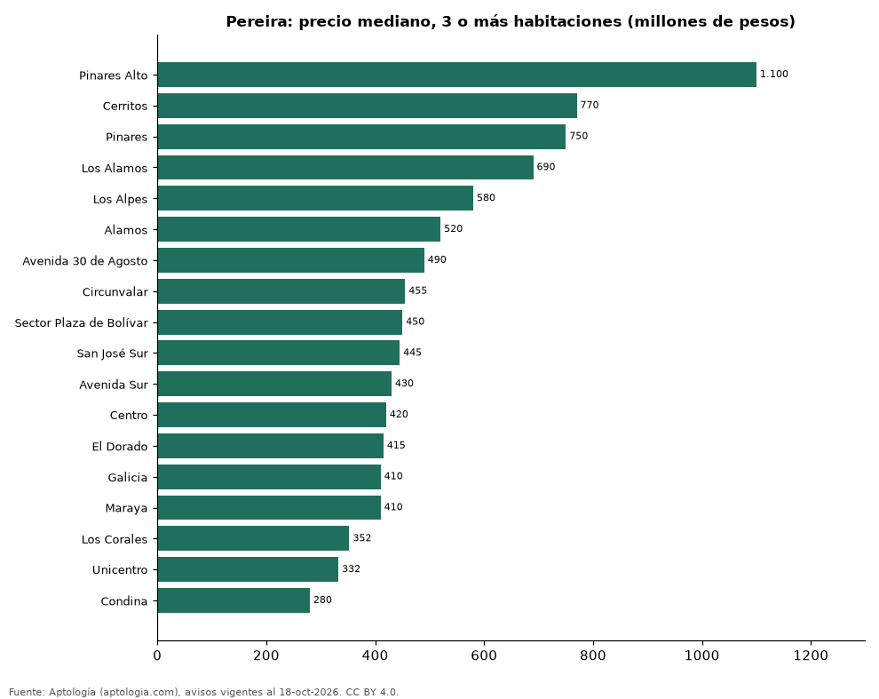

# Dónde cuesta más y menos comprar un apartamento de 3 o más habitaciones en Pereira: ranking de barrios (octubre 2026)

**En Pereira, un apartamento de 3 o más habitaciones cuesta 1.100 millones de pesos en la mediana en Pinares Alto, el barrio más caro, y 280 millones de pesos en Condina, el más barato: 3,9 veces menos.** Comparamos 18 barrios con al menos 30 avisos de 3 o más habitaciones.

*Resumen: analizamos 1.985 apartamentos en venta de 3 o más habitaciones en 18 barrios de Pereira.*

**Actualizado:** 18 de octubre de 2026 (datos del 18 de octubre de 2026) · **Próxima actualización:** mensual.

## Resumen

| Indicador | Valor |
|---|---|
| Más caro | Pinares Alto: 1.100 millones de pesos |
| Más barato | Condina: 280 millones de pesos |
| Diferencia | 3,9 veces |
| Barrios | 18 |

## Precio de un apartamento de 3 o más habitaciones por barrio

| Barrio | Precio (mediana) | Rango típico (P25–P75) | Área mediana (m²) | Avisos |
|---|---|---|---|---|
| Pinares Alto | 1.100 millones de pesos | 910 millones de pesos – 1.500 millones de pesos | 143 | 45 |
| Cerritos | 770 millones de pesos | 535 millones de pesos – 950 millones de pesos | 102 | 223 |
| Pinares | 750 millones de pesos | 550 millones de pesos – 1.100 millones de pesos | 136 | 493 |
| Los Alamos | 690 millones de pesos | 530 millones de pesos – 815 millones de pesos | 110 | 99 |
| Los Alpes | 580 millones de pesos | 480 millones de pesos – 730 millones de pesos | 120 | 83 |
| Alamos | 520 millones de pesos | 390 millones de pesos – 680 millones de pesos | 105 | 189 |
| Avenida 30 de Agosto | 490 millones de pesos | 350 millones de pesos – 594 millones de pesos | 91 | 46 |
| Circunvalar | 455 millones de pesos | 380 millones de pesos – 550 millones de pesos | 108 | 85 |
| Sector Plaza de Bolívar | 450 millones de pesos | 348 millones de pesos – 522 millones de pesos | 122 | 52 |
| San José Sur | 445 millones de pesos | 320 millones de pesos – 620 millones de pesos | 100 | 40 |
| Avenida Sur | 430 millones de pesos | 332 millones de pesos – 602 millones de pesos | 80 | 50 |
| Centro | 420 millones de pesos | 319 millones de pesos – 530 millones de pesos | 118 | 180 |
| El Dorado | 415 millones de pesos | 300 millones de pesos – 550 millones de pesos | 74 | 33 |
| Galicia | 410 millones de pesos | 345 millones de pesos – 500 millones de pesos | 71 | 125 |
| Maraya | 410 millones de pesos | 362 millones de pesos – 470 millones de pesos | 76 | 43 |
| Los Corales | 352 millones de pesos | 286 millones de pesos – 434 millones de pesos | 74 | 30 |
| Unicentro | 332 millones de pesos | 305 millones de pesos – 362 millones de pesos | 72 | 32 |
| Condina | 280 millones de pesos | 260 millones de pesos – 300 millones de pesos | 56 | 137 |

Medianas del precio pedido; solo barrios con 30 avisos o más.

## Preguntas frecuentes

**¿Cuánto cuesta comprar un apartamento de 3 o más habitaciones en Pinares Alto?**
1.100 millones de pesos en la mediana (octubre de 2026); la mitad central entre 910 millones de pesos y 1.500 millones de pesos.

**¿Dónde es más barato comprar un apartamento de 3 o más habitaciones en Pereira?**
En Condina: 280 millones de pesos en la mediana.

## Metodología

- **Fuente:** exportes nocturnos de la base de datos de Aptología (aptologia.com) del 18 de octubre de 2026: avisos vigentes de vivienda en portales inmobiliarios de 13 países, recogidos por Aptología y vistos en línea entre el 11 y el 18 de octubre de 2026. Corte: 18 de octubre de 2026.
- **Depuración:** se eliminan duplicados exactos (misma ciudad, zona, tipo, precio, moneda, área, habitaciones y baños) y los precios fuera del percentil 1–99 de cada país, operación, moneda y tipo; el precio por m² usa solo avisos con área declarada entre 12 y 2.000 m² y también se recorta al P1–P99.
- **Qué se mide:** precios pedidos (publicados), no precios de cierre. En arriendo, el canon mensual sin administración, gastos comunes ni condominio.
- **Muestra mínima:** cada cifra publicada se apoya en al menos 30 avisos; las celdas con menos se omiten.
- **Colombia:** Precios en pesos colombianos, sin conversión de moneda.
- **Limitaciones:** la cobertura depende de los portales que recorre Aptología en cada país y es mayor en las ciudades grandes y en los segmentos medio-alto y alto; el área es la que declara el aviso, sin verificar; los nombres de zona vienen de los portales.
- **Privacidad:** solo se publican agregados; no se publica ningún dato personal, enlace a avisos ni nombre de anunciante.
- **Datos abiertos:** [datos.csv](datos.csv), licencia CC BY 4.0.

## Cómo citar

Pinzón Pineda, D. M. (2026). *Dónde cuesta más y menos comprar un apartamento de 3 o más habitaciones en Pereira: ranking de barrios (octubre 2026)*. Aptología (aptologia.com). https://github.com/elbroker/aptologia-datos/tree/main/estudios/venta-apartamentos-de-3-o-mas-habitaciones-por-barrio-pereira-2026. Datos: datos.csv, licencia CC BY 4.0.
