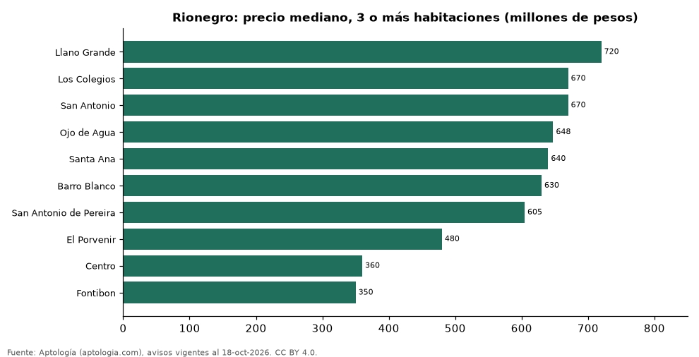

# Dónde cuesta más y menos comprar un apartamento de 3 o más habitaciones en Rionegro: ranking de barrios (octubre 2026)

**En Rionegro, un apartamento de 3 o más habitaciones cuesta 720 millones de pesos en la mediana en Llano Grande, el barrio más caro, y 350 millones de pesos en Fontibon, el más barato: 2,1 veces menos.** Comparamos 10 barrios con al menos 30 avisos de 3 o más habitaciones.

*Resumen: analizamos 725 apartamentos en venta de 3 o más habitaciones en 10 barrios de Rionegro.*

**Actualizado:** 18 de octubre de 2026 (datos del 18 de octubre de 2026) · **Próxima actualización:** mensual.

## Resumen

| Indicador | Valor |
|---|---|
| Más caro | Llano Grande: 720 millones de pesos |
| Más barato | Fontibon: 350 millones de pesos |
| Diferencia | 2,1 veces |
| Barrios | 10 |

## Precio de un apartamento de 3 o más habitaciones por barrio

| Barrio | Precio (mediana) | Rango típico (P25–P75) | Área mediana (m²) | Avisos |
|---|---|---|---|---|
| Llano Grande | 720 millones de pesos | 620 millones de pesos – 1.800 millones de pesos | 86 | 53 |
| Los Colegios | 670 millones de pesos | 540 millones de pesos – 780 millones de pesos | 80 | 57 |
| San Antonio | 670 millones de pesos | 552 millones de pesos – 700 millones de pesos | 80 | 31 |
| Ojo de Agua | 648 millones de pesos | 555 millones de pesos – 780 millones de pesos | 77 | 38 |
| Santa Ana | 640 millones de pesos | 555 millones de pesos – 775 millones de pesos | 89 | 43 |
| Barro Blanco | 630 millones de pesos | 580 millones de pesos – 700 millones de pesos | 76 | 77 |
| San Antonio de Pereira | 605 millones de pesos | 507 millones de pesos – 700 millones de pesos | 80 | 94 |
| El Porvenir | 480 millones de pesos | 340 millones de pesos – 646 millones de pesos | 69 | 163 |
| Centro | 360 millones de pesos | 304 millones de pesos – 642 millones de pesos | 70 | 48 |
| Fontibon | 350 millones de pesos | 330 millones de pesos – 380 millones de pesos | 57 | 121 |

Medianas del precio pedido; solo barrios con 30 avisos o más.

## Preguntas frecuentes

**¿Cuánto cuesta comprar un apartamento de 3 o más habitaciones en Llano Grande?**
720 millones de pesos en la mediana (octubre de 2026); la mitad central entre 620 millones de pesos y 1.800 millones de pesos.

**¿Dónde es más barato comprar un apartamento de 3 o más habitaciones en Rionegro?**
En Fontibon: 350 millones de pesos en la mediana.

## Metodología

- **Fuente:** exportes nocturnos de la base de datos de Aptología (aptologia.com) del 18 de octubre de 2026: avisos vigentes de vivienda en portales inmobiliarios de 13 países, recogidos por Aptología y vistos en línea entre el 11 y el 18 de octubre de 2026. Corte: 18 de octubre de 2026.
- **Depuración:** se eliminan duplicados exactos (misma ciudad, zona, tipo, precio, moneda, área, habitaciones y baños) y los precios fuera del percentil 1–99 de cada país, operación, moneda y tipo; el precio por m² usa solo avisos con área declarada entre 12 y 2.000 m² y también se recorta al P1–P99.
- **Qué se mide:** precios pedidos (publicados), no precios de cierre. En arriendo, el canon mensual sin administración, gastos comunes ni condominio.
- **Muestra mínima:** cada cifra publicada se apoya en al menos 30 avisos; las celdas con menos se omiten.
- **Colombia:** Precios en pesos colombianos, sin conversión de moneda.
- **Limitaciones:** la cobertura depende de los portales que recorre Aptología en cada país y es mayor en las ciudades grandes y en los segmentos medio-alto y alto; el área es la que declara el aviso, sin verificar; los nombres de zona vienen de los portales.
- **Privacidad:** solo se publican agregados; no se publica ningún dato personal, enlace a avisos ni nombre de anunciante.
- **Datos abiertos:** [datos.csv](datos.csv), licencia CC BY 4.0.

## Cómo citar

Pinzón Pineda, D. M. (2026). *Dónde cuesta más y menos comprar un apartamento de 3 o más habitaciones en Rionegro: ranking de barrios (octubre 2026)*. Aptología (aptologia.com). https://github.com/elbroker/aptologia-datos/tree/main/estudios/venta-apartamentos-de-3-o-mas-habitaciones-por-barrio-rionegro-2026. Datos: datos.csv, licencia CC BY 4.0.
