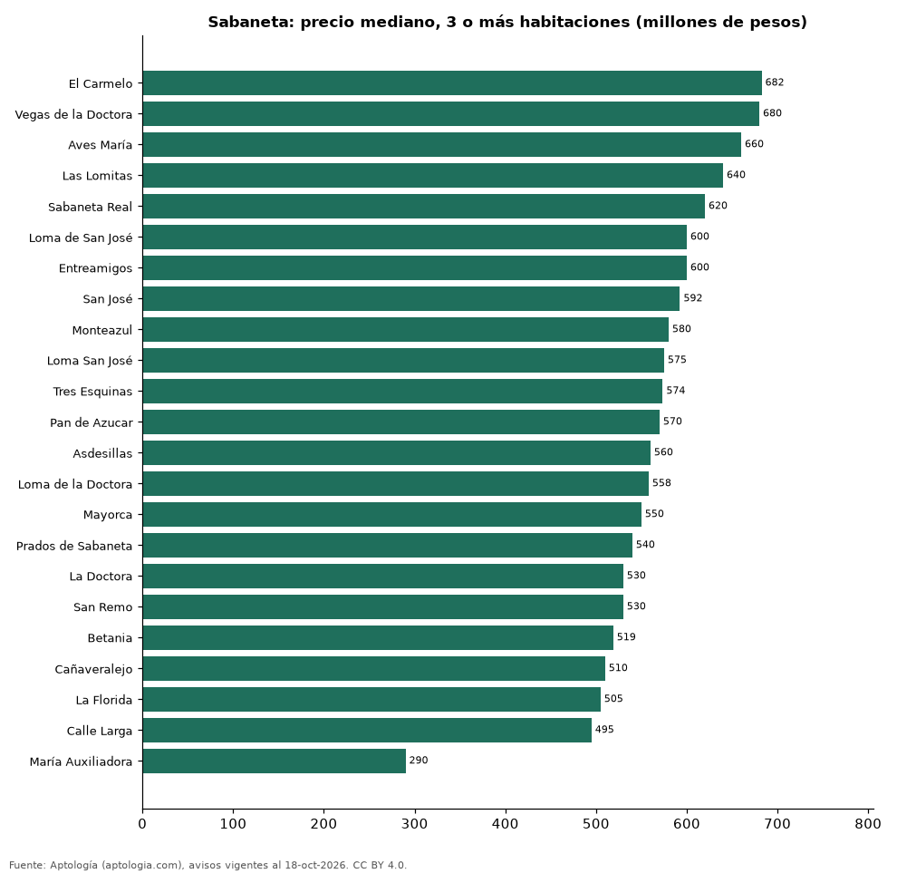

# Dónde cuesta más y menos comprar un apartamento de 3 o más habitaciones en Sabaneta: ranking de barrios (octubre 2026)

**En Sabaneta, un apartamento de 3 o más habitaciones cuesta 682 millones de pesos en la mediana en El Carmelo, el barrio más caro, y 290 millones de pesos en María Auxiliadora, el más barato: 2,4 veces menos.** Comparamos 23 barrios con al menos 30 avisos de 3 o más habitaciones.

*Resumen: analizamos 2.134 apartamentos en venta de 3 o más habitaciones en 23 barrios de Sabaneta.*

**Actualizado:** 18 de octubre de 2026 (datos del 18 de octubre de 2026) · **Próxima actualización:** mensual.

## Resumen

| Indicador | Valor |
|---|---|
| Más caro | El Carmelo: 682 millones de pesos |
| Más barato | María Auxiliadora: 290 millones de pesos |
| Diferencia | 2,4 veces |
| Barrios | 23 |

## Precio de un apartamento de 3 o más habitaciones por barrio

| Barrio | Precio (mediana) | Rango típico (P25–P75) | Área mediana (m²) | Avisos |
|---|---|---|---|---|
| El Carmelo | 682 millones de pesos | 548 millones de pesos – 737 millones de pesos | 88 | 34 |
| Vegas de la Doctora | 680 millones de pesos | 566 millones de pesos – 811 millones de pesos | 106 | 50 |
| Aves María | 660 millones de pesos | 550 millones de pesos – 850 millones de pesos | 100 | 245 |
| Las Lomitas | 640 millones de pesos | 520 millones de pesos – 750 millones de pesos | 84 | 371 |
| Sabaneta Real | 620 millones de pesos | 502 millones de pesos – 719 millones de pesos | 86 | 54 |
| Loma de San José | 600 millones de pesos | 518 millones de pesos – 695 millones de pesos | 84 | 75 |
| Entreamigos | 600 millones de pesos | 489 millones de pesos – 718 millones de pesos | 81 | 86 |
| San José | 592 millones de pesos | 454 millones de pesos – 670 millones de pesos | 84 | 212 |
| Monteazul | 580 millones de pesos | 499 millones de pesos – 664 millones de pesos | 77 | 63 |
| Loma San José | 575 millones de pesos | 525 millones de pesos – 650 millones de pesos | 80 | 46 |
| Tres Esquinas | 574 millones de pesos | 471 millones de pesos – 664 millones de pesos | 74 | 58 |
| Pan de Azucar | 570 millones de pesos | 502 millones de pesos – 650 millones de pesos | 75 | 74 |
| Asdesillas | 560 millones de pesos | 520 millones de pesos – 650 millones de pesos | 76 | 56 |
| Loma de la Doctora | 558 millones de pesos | 490 millones de pesos – 639 millones de pesos | 78 | 63 |
| Mayorca | 550 millones de pesos | 450 millones de pesos – 695 millones de pesos | 84 | 43 |
| Prados de Sabaneta | 540 millones de pesos | 470 millones de pesos – 600 millones de pesos | 76 | 39 |
| La Doctora | 530 millones de pesos | 460 millones de pesos – 620 millones de pesos | 75 | 193 |
| San Remo | 530 millones de pesos | 485 millones de pesos – 660 millones de pesos | 76 | 53 |
| Betania | 519 millones de pesos | 368 millones de pesos – 750 millones de pesos | 92 | 35 |
| Cañaveralejo | 510 millones de pesos | 468 millones de pesos – 586 millones de pesos | 74 | 67 |
| La Florida | 505 millones de pesos | 459 millones de pesos – 559 millones de pesos | 75 | 42 |
| Calle Larga | 495 millones de pesos | 399 millones de pesos – 670 millones de pesos | 76 | 76 |
| María Auxiliadora | 290 millones de pesos | 265 millones de pesos – 370 millones de pesos | 55 | 99 |

Medianas del precio pedido; solo barrios con 30 avisos o más.

## Preguntas frecuentes

**¿Cuánto cuesta comprar un apartamento de 3 o más habitaciones en El Carmelo?**
682 millones de pesos en la mediana (octubre de 2026); la mitad central entre 548 millones de pesos y 737 millones de pesos.

**¿Dónde es más barato comprar un apartamento de 3 o más habitaciones en Sabaneta?**
En María Auxiliadora: 290 millones de pesos en la mediana.

## Metodología

- **Fuente:** exportes nocturnos de la base de datos de Aptología (aptologia.com) del 18 de octubre de 2026: avisos vigentes de vivienda en portales inmobiliarios de 13 países, recogidos por Aptología y vistos en línea entre el 11 y el 18 de octubre de 2026. Corte: 18 de octubre de 2026.
- **Depuración:** se eliminan duplicados exactos (misma ciudad, zona, tipo, precio, moneda, área, habitaciones y baños) y los precios fuera del percentil 1–99 de cada país, operación, moneda y tipo; el precio por m² usa solo avisos con área declarada entre 12 y 2.000 m² y también se recorta al P1–P99.
- **Qué se mide:** precios pedidos (publicados), no precios de cierre. En arriendo, el canon mensual sin administración, gastos comunes ni condominio.
- **Muestra mínima:** cada cifra publicada se apoya en al menos 30 avisos; las celdas con menos se omiten.
- **Colombia:** Precios en pesos colombianos, sin conversión de moneda.
- **Limitaciones:** la cobertura depende de los portales que recorre Aptología en cada país y es mayor en las ciudades grandes y en los segmentos medio-alto y alto; el área es la que declara el aviso, sin verificar; los nombres de zona vienen de los portales.
- **Privacidad:** solo se publican agregados; no se publica ningún dato personal, enlace a avisos ni nombre de anunciante.
- **Datos abiertos:** [datos.csv](datos.csv), licencia CC BY 4.0.

## Cómo citar

Pinzón Pineda, D. M. (2026). *Dónde cuesta más y menos comprar un apartamento de 3 o más habitaciones en Sabaneta: ranking de barrios (octubre 2026)*. Aptología (aptologia.com). https://github.com/elbroker/aptologia-datos/tree/main/estudios/venta-apartamentos-de-3-o-mas-habitaciones-por-barrio-sabaneta-2026. Datos: datos.csv, licencia CC BY 4.0.
