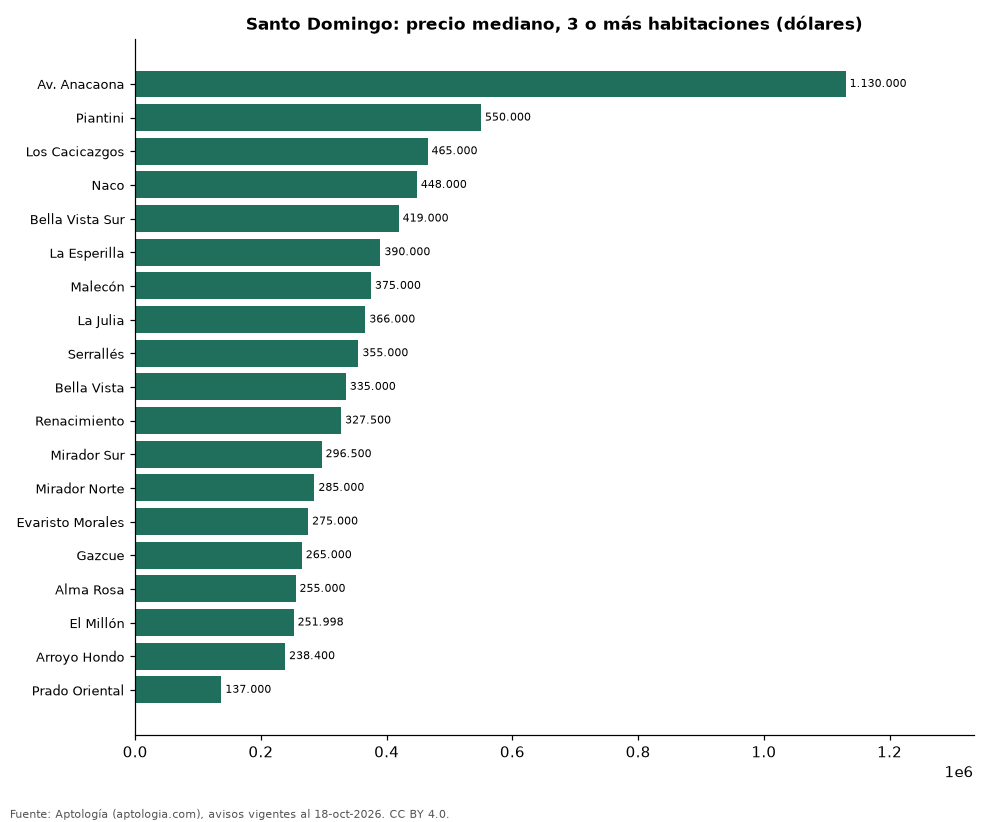

# Dónde cuesta más y menos comprar un apartamento de 3 o más habitaciones en Santo Domingo: ranking de sectores (octubre 2026)

**En Santo Domingo, un apartamento de 3 o más habitaciones cuesta USD 1.130.000 en la mediana en Av. Anacaona, el sector más caro, y USD 137.000 en Prado Oriental, el más barato: 8,2 veces menos.** Comparamos 19 sectores con al menos 30 avisos de 3 o más habitaciones.

*Resumen: analizamos 2.081 apartamentos en venta de 3 o más habitaciones en 19 sectores de Santo Domingo.*

**Actualizado:** 18 de octubre de 2026 (datos del 18 de octubre de 2026) · **Próxima actualización:** mensual.

## Resumen

| Indicador | Valor |
|---|---|
| Más caro | Av. Anacaona: USD 1.130.000 |
| Más barato | Prado Oriental: USD 137.000 |
| Diferencia | 8,2 veces |
| Sectores | 19 |

## Precio de un apartamento de 3 o más habitaciones por sector

| Sector | Precio (mediana) | Rango típico (P25–P75) | Área mediana (m²) | Avisos |
|---|---|---|---|---|
| Av. Anacaona | USD 1.130.000 | USD 694.500 – USD 1.700.000 | 414 | 75 |
| Piantini | USD 550.000 | USD 395.000 – USD 813.500 | 245 | 263 |
| Los Cacicazgos | USD 465.000 | USD 400.000 – USD 687.500 | 233 | 103 |
| Naco | USD 448.000 | USD 360.000 – USD 656.094 | 232 | 370 |
| Bella Vista Sur | USD 419.000 | USD 330.000 – USD 598.750 | 240 | 60 |
| La Esperilla | USD 390.000 | USD 310.000 – USD 550.000 | 232 | 109 |
| Malecón | USD 375.000 | USD 345.000 – USD 490.000 | 352 | 37 |
| La Julia | USD 366.000 | USD 303.500 – USD 487.250 | 210 | 34 |
| Serrallés | USD 355.000 | USD 285.000 – USD 420.000 | 193 | 45 |
| Bella Vista | USD 335.000 | USD 270.000 – USD 425.000 | 200 | 213 |
| Renacimiento | USD 327.500 | USD 270.000 – USD 385.750 | 202 | 174 |
| Mirador Sur | USD 296.500 | USD 260.000 – USD 400.000 | 170 | 74 |
| Mirador Norte | USD 285.000 | USD 248.750 – USD 315.000 | 178 | 56 |
| Evaristo Morales | USD 275.000 | USD 235.500 – USD 305.000 | 175 | 130 |
| Gazcue | USD 265.000 | USD 231.000 – USD 278.500 | 168 | 39 |
| Alma Rosa | USD 255.000 | USD 210.617 – USD 340.000 | 167 | 73 |
| El Millón | USD 251.998 | USD 215.000 – USD 290.000 | 160 | 127 |
| Arroyo Hondo | USD 238.400 | USD 171.250 – USD 375.000 | 157 | 56 |
| Prado Oriental | USD 137.000 | USD 121.950 – USD 158.062 | 125 | 43 |

Medianas del precio pedido; solo sectores con 30 avisos o más.

## Preguntas frecuentes

**¿Cuánto cuesta comprar un apartamento de 3 o más habitaciones en Av. Anacaona?**
USD 1.130.000 en la mediana (octubre de 2026); la mitad central entre USD 694.500 y USD 1.700.000.

**¿Dónde es más barato comprar un apartamento de 3 o más habitaciones en Santo Domingo?**
En Prado Oriental: USD 137.000 en la mediana.

## Metodología

- **Fuente:** exportes nocturnos de la base de datos de Aptología (aptologia.com) del 18 de octubre de 2026: avisos vigentes de vivienda en portales inmobiliarios de 13 países, recogidos por Aptología y vistos en línea entre el 11 y el 18 de octubre de 2026. Corte: 18 de octubre de 2026.
- **Depuración:** se eliminan duplicados exactos (misma ciudad, zona, tipo, precio, moneda, área, habitaciones y baños) y los precios fuera del percentil 1–99 de cada país, operación, moneda y tipo; el precio por m² usa solo avisos con área declarada entre 12 y 2.000 m² y también se recorta al P1–P99.
- **Qué se mide:** precios pedidos (publicados), no precios de cierre. En arriendo, el canon mensual sin administración, gastos comunes ni condominio.
- **Muestra mínima:** cada cifra publicada se apoya en al menos 30 avisos; las celdas con menos se omiten.
- **Monedas:** nunca se mezclan avisos de monedas distintas sin convertirlos. Conversión a dólares con la tasa de mercado de ExchangeRate-API (open.er-api.com, actualización del 18 Oct 2026): 1 USD = 3.182,80 COP, 1 USD = 18,47 M.N, 1 USD = 5,09 BRL, 1 USD = 3,44 PEN, 1 USD = 982,44 CLP, 1 USD = 1.514,57 ARS, 1 USD = 40,20 UYU, 1 USD = 5.705,37 PYG, 1 USD = 61,27 DOP, 1 USD = 0,89 EUR, 1 USD = 11,72 BOB; la UF chilena a 41.178,64 CLP (mindicador,cl. 18-oct-2026). Los avisos publicados en dólares se usan tal cual.
- **Monedas:** en cada ciudad y operación se usa solo la moneda mayoritaria de los avisos (los avisos en otra moneda se excluyen) y la mediana se convierte a dólares con la tasa citada; nunca se promedian avisos de monedas distintas.
- **Limitaciones:** la cobertura depende de los portales que recorre Aptología en cada país y es mayor en las ciudades grandes y en los segmentos medio-alto y alto; el área es la que declara el aviso, sin verificar; los nombres de zona vienen de los portales.
- **Privacidad:** solo se publican agregados; no se publica ningún dato personal, enlace a avisos ni nombre de anunciante.
- **Datos abiertos:** [datos.csv](datos.csv), licencia CC BY 4.0.

## Cómo citar

Pinzón Pineda, D. M. (2026). *Dónde cuesta más y menos comprar un apartamento de 3 o más habitaciones en Santo Domingo: ranking de sectores (octubre 2026)*. Aptología (aptologia.com). https://github.com/elbroker/aptologia-datos/tree/main/estudios/venta-apartamentos-de-3-o-mas-habitaciones-por-sector-santo-domingo-2026. Datos: datos.csv, licencia CC BY 4.0.
