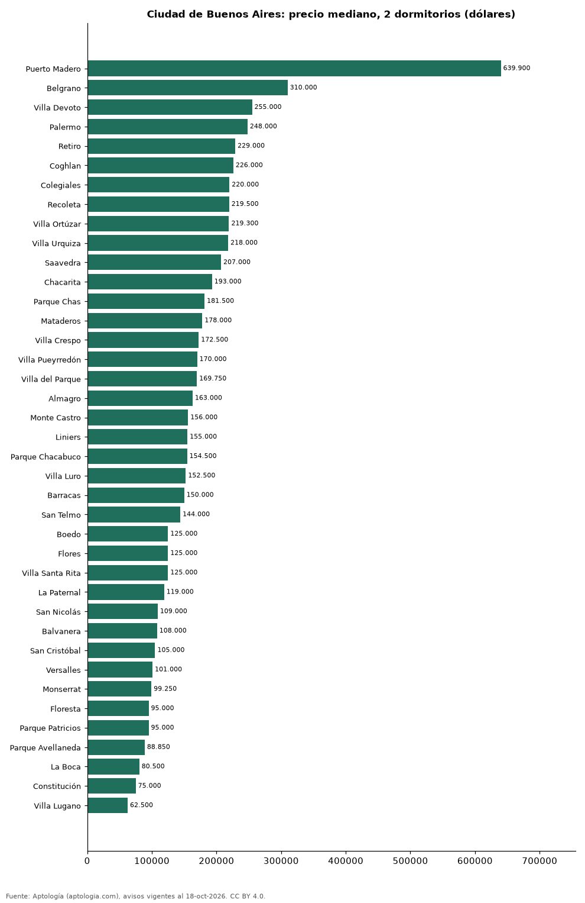

# Dónde cuesta más y menos comprar un departamento de 2 dormitorios en Ciudad de Buenos Aires: ranking de barrios (octubre 2026)

**En Ciudad de Buenos Aires, un departamento de 2 dormitorios cuesta USD 639.900 en la mediana en Puerto Madero, el barrio más caro, y USD 62.500 en Villa Lugano, el más barato: 10,2 veces menos.** Comparamos 39 barrios con al menos 30 avisos de 2 dormitorios.

*Resumen: analizamos 2.169 departamentos en venta de 2 dormitorios en 39 barrios de Ciudad de Buenos Aires.*

**Actualizado:** 18 de octubre de 2026 (datos del 18 de octubre de 2026) · **Próxima actualización:** mensual.

## Resumen

| Indicador | Valor |
|---|---|
| Más caro | Puerto Madero: USD 639.900 |
| Más barato | Villa Lugano: USD 62.500 |
| Diferencia | 10,2 veces |
| Barrios | 39 |

## Precio de un departamento de 2 dormitorios por barrio

| Barrio | Precio (mediana) | Rango típico (P25–P75) | Área mediana (m²) | Avisos |
|---|---|---|---|---|
| Puerto Madero | USD 639.900 | USD 495.000 – USD 850.000 | 114 | 41 |
| Belgrano | USD 310.000 | USD 189.000 – USD 470.000 | 76 | 173 |
| Villa Devoto | USD 255.000 | USD 202.500 – USD 354.200 | 74 | 47 |
| Palermo | USD 248.000 | USD 180.000 – USD 380.000 | 72 | 265 |
| Retiro | USD 229.000 | USD 162.000 – USD 298.508 | 81 | 39 |
| Coghlan | USD 226.000 | USD 170.000 – USD 295.750 | 66 | 44 |
| Colegiales | USD 220.000 | USD 155.000 – USD 302.500 | 70 | 35 |
| Recoleta | USD 219.500 | USD 159.750 – USD 270.000 | 78 | 76 |
| Villa Ortúzar | USD 219.300 | USD 186.875 – USD 247.500 | 65 | 44 |
| Villa Urquiza | USD 218.000 | USD 179.000 – USD 242.000 | 65 | 37 |
| Saavedra | USD 207.000 | USD 163.000 – USD 250.000 | 62 | 33 |
| Chacarita | USD 193.000 | USD 133.500 – USD 224.775 | 63 | 46 |
| Parque Chas | USD 181.500 | USD 162.750 – USD 210.500 | 64 | 44 |
| Mataderos | USD 178.000 | USD 130.000 – USD 217.500 | 68 | 43 |
| Villa Crespo | USD 172.500 | USD 148.000 – USD 190.625 | 61 | 36 |
| Villa Pueyrredón | USD 170.000 | USD 143.750 – USD 202.307 | 65 | 44 |
| Villa del Parque | USD 169.750 | USD 143.500 – USD 230.750 | 64 | 46 |
| Almagro | USD 163.000 | USD 135.000 – USD 193.750 | 67 | 34 |
| Monte Castro | USD 156.000 | USD 130.450 – USD 174.950 | 62 | 43 |
| Liniers | USD 155.000 | USD 109.000 – USD 184.000 | 65 | 45 |
| Parque Chacabuco | USD 154.500 | USD 112.750 – USD 221.650 | 65 | 44 |
| Villa Luro | USD 152.500 | USD 120.000 – USD 216.450 | 60 | 46 |
| Barracas | USD 150.000 | USD 121.413 – USD 177.500 | 63 | 41 |
| San Telmo | USD 144.000 | USD 101.750 – USD 189.000 | 64 | 48 |
| Boedo | USD 125.000 | USD 92.500 – USD 177.500 | 58 | 43 |
| Flores | USD 125.000 | USD 99.500 – USD 176.000 | 61 | 49 |
| Villa Santa Rita | USD 125.000 | USD 95.000 – USD 157.500 | 62 | 47 |
| La Paternal | USD 119.000 | USD 105.000 – USD 167.450 | 58 | 47 |
| San Nicolás | USD 109.000 | USD 89.250 – USD 127.500 | 63 | 51 |
| Balvanera | USD 108.000 | USD 88.750 – USD 139.225 | 64 | 132 |
| San Cristóbal | USD 105.000 | USD 89.475 – USD 137.500 | 60 | 44 |
| Versalles | USD 101.000 | USD 84.800 – USD 176.200 | 59 | 44 |
| Monserrat | USD 99.250 | USD 88.750 – USD 129.250 | 64 | 48 |
| Floresta | USD 95.000 | USD 85.000 – USD 119.000 | 59 | 49 |
| Parque Patricios | USD 95.000 | USD 79.000 – USD 122.500 | 58 | 39 |
| Parque Avellaneda | USD 88.850 | USD 72.000 – USD 106.225 | 57 | 48 |
| La Boca | USD 80.500 | USD 72.000 – USD 89.000 | 56 | 42 |
| Constitución | USD 75.000 | USD 67.475 – USD 88.250 | 62 | 48 |
| Villa Lugano | USD 62.500 | USD 49.675 – USD 148.032 | 56 | 44 |

Medianas del precio pedido; solo barrios con 30 avisos o más.

## Preguntas frecuentes

**¿Cuánto cuesta comprar un departamento de 2 dormitorios en Puerto Madero?**
USD 639.900 en la mediana (octubre de 2026); la mitad central entre USD 495.000 y USD 850.000.

**¿Dónde es más barato comprar un departamento de 2 dormitorios en Ciudad de Buenos Aires?**
En Villa Lugano: USD 62.500 en la mediana.

## Metodología

- **Fuente:** exportes nocturnos de la base de datos de Aptología (aptologia.com) del 18 de octubre de 2026: avisos vigentes de vivienda en portales inmobiliarios de 13 países, recogidos por Aptología y vistos en línea entre el 11 y el 18 de octubre de 2026. Corte: 18 de octubre de 2026.
- **Depuración:** se eliminan duplicados exactos (misma ciudad, zona, tipo, precio, moneda, área, habitaciones y baños) y los precios fuera del percentil 1–99 de cada país, operación, moneda y tipo; el precio por m² usa solo avisos con área declarada entre 12 y 2.000 m² y también se recorta al P1–P99.
- **Qué se mide:** precios pedidos (publicados), no precios de cierre. En arriendo, el canon mensual sin administración, gastos comunes ni condominio.
- **Muestra mínima:** cada cifra publicada se apoya en al menos 30 avisos; las celdas con menos se omiten.
- **Monedas:** nunca se mezclan avisos de monedas distintas sin convertirlos. Conversión a dólares con la tasa de mercado de ExchangeRate-API (open.er-api.com, actualización del 18 Oct 2026): 1 USD = 3.182,80 COP, 1 USD = 18,47 M.N, 1 USD = 5,09 BRL, 1 USD = 3,44 PEN, 1 USD = 982,44 CLP, 1 USD = 1.514,57 ARS, 1 USD = 40,20 UYU, 1 USD = 5.705,37 PYG, 1 USD = 61,27 DOP, 1 USD = 0,89 EUR, 1 USD = 11,72 BOB; la UF chilena a 41.178,64 CLP (mindicador,cl. 18-oct-2026). Los avisos publicados en dólares se usan tal cual.
- **Monedas:** en cada ciudad y operación se usa solo la moneda mayoritaria de los avisos (los avisos en otra moneda se excluyen) y la mediana se convierte a dólares con la tasa citada; nunca se promedian avisos de monedas distintas.
- **Limitaciones:** la cobertura depende de los portales que recorre Aptología en cada país y es mayor en las ciudades grandes y en los segmentos medio-alto y alto; el área es la que declara el aviso, sin verificar; los nombres de zona vienen de los portales.
- **Privacidad:** solo se publican agregados; no se publica ningún dato personal, enlace a avisos ni nombre de anunciante.
- **Datos abiertos:** [datos.csv](datos.csv), licencia CC BY 4.0.

## Cómo citar

Pinzón Pineda, D. M. (2026). *Dónde cuesta más y menos comprar un departamento de 2 dormitorios en Ciudad de Buenos Aires: ranking de barrios (octubre 2026)*. Aptología (aptologia.com). https://github.com/elbroker/aptologia-datos/tree/main/estudios/venta-departamentos-de-2-dormitorios-por-barrio-ciudad-de-buenos-aires-2026. Datos: datos.csv, licencia CC BY 4.0.
