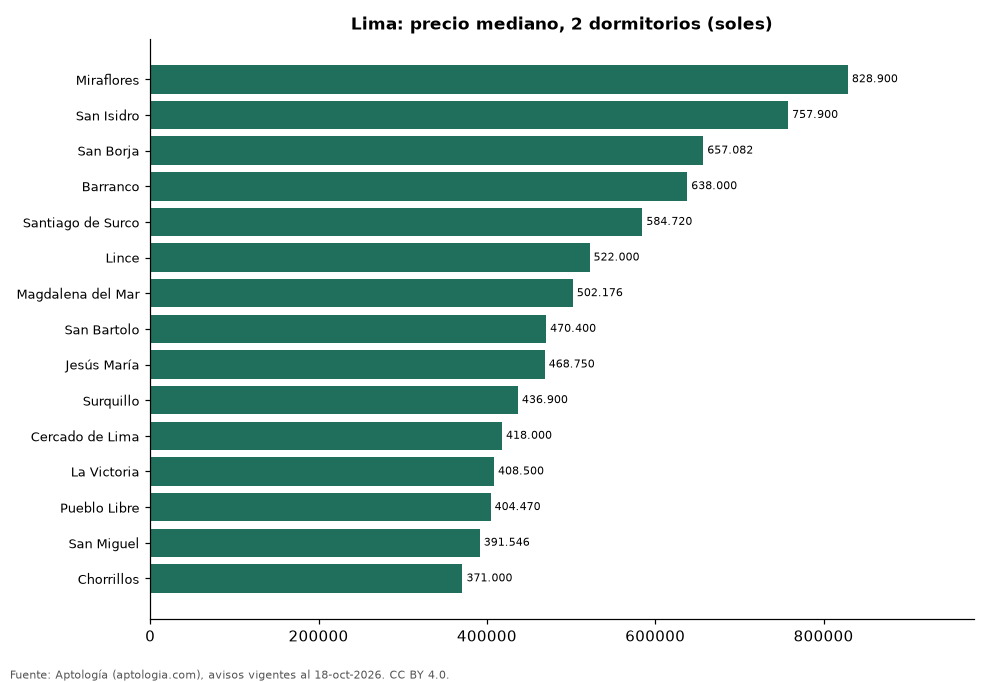

# Dónde cuesta más y menos comprar un departamento de 2 dormitorios en Lima: ranking de distritos (octubre 2026)

**En Lima, un departamento de 2 dormitorios cuesta 828.900 soles (USD 241.273) en la mediana en Miraflores, el distrito más caro, y 371.000 soles (USD 107.989) en Chorrillos, el más barato: 2,2 veces menos.** Comparamos 15 distritos con al menos 30 avisos de 2 dormitorios.

*Resumen: analizamos 2.003 departamentos en venta de 2 dormitorios en 15 distritos de Lima.*

**Actualizado:** 18 de octubre de 2026 (datos del 18 de octubre de 2026) · **Próxima actualización:** mensual.

## Resumen

| Indicador | Valor |
|---|---|
| Más caro | Miraflores: 828.900 soles (USD 241.273) |
| Más barato | Chorrillos: 371.000 soles (USD 107.989) |
| Diferencia | 2,2 veces |
| Distritos | 15 |

## Precio de un departamento de 2 dormitorios por distrito

| Distrito | Precio (mediana) | Rango típico (P25–P75) | Área mediana (m²) | Avisos |
|---|---|---|---|---|
| Miraflores | 828.900 soles (USD 241.273) | 669.992 soles (USD 195.019) – 1.034.095 soles (USD 301.001) | 90 | 462 |
| San Isidro | 757.900 soles (USD 220.607) | 582.500 soles (USD 169.552) – 1.091.450 soles (USD 317.695) | 86 | 211 |
| San Borja | 657.082 soles (USD 191.261) | 509.250 soles (USD 148.231) – 754.325 soles (USD 219.566) | 75 | 50 |
| Barranco | 638.000 soles (USD 185.707) | 555.000 soles (USD 161.547) – 742.450 soles (USD 216.110) | 67 | 67 |
| Santiago de Surco | 584.720 soles (USD 170.198) | 464.106 soles (USD 135.090) – 795.000 soles (USD 231.406) | 80 | 229 |
| Lince | 522.000 soles (USD 151.942) | 443.000 soles (USD 128.947) – 624.000 soles (USD 181.632) | 66 | 89 |
| Magdalena del Mar | 502.176 soles (USD 146.172) | 409.074 soles (USD 119.072) – 599.000 soles (USD 174.355) | 60 | 110 |
| San Bartolo | 470.400 soles (USD 136.922) | 383.992 soles (USD 111.771) – 606.600 soles (USD 176.567) | 88 | 36 |
| Jesús María | 468.750 soles (USD 136.442) | 407.489 soles (USD 118.610) – 537.000 soles (USD 156.308) | 61 | 97 |
| Surquillo | 436.900 soles (USD 127.171) | 386.710 soles (USD 112.562) – 491.638 soles (USD 143.104) | 60 | 142 |
| Cercado de Lima | 418.000 soles (USD 121.670) | 345.400 soles (USD 100.538) – 474.444 soles (USD 138.099) | 60 | 137 |
| La Victoria | 408.500 soles (USD 118.905) | 370.888 soles (USD 107.957) – 438.000 soles (USD 127.491) | 55 | 68 |
| Pueblo Libre | 404.470 soles (USD 117.732) | 361.352 soles (USD 105.181) – 449.938 soles (USD 130.966) | 60 | 72 |
| San Miguel | 391.546 soles (USD 113.970) | 342.665 soles (USD 99.742) – 463.685 soles (USD 134.968) | 62 | 146 |
| Chorrillos | 371.000 soles (USD 107.989) | 314.000 soles (USD 91.398) – 442.500 soles (USD 128.801) | 57 | 87 |

Medianas del precio pedido; solo distritos con 30 avisos o más.

## Preguntas frecuentes

**¿Cuánto cuesta comprar un departamento de 2 dormitorios en Miraflores?**
828.900 soles (USD 241.273) en la mediana (octubre de 2026); la mitad central entre 669.992 soles (USD 195.019) y 1.034.095 soles (USD 301.001).

**¿Dónde es más barato comprar un departamento de 2 dormitorios en Lima?**
En Chorrillos: 371.000 soles (USD 107.989) en la mediana.

## Metodología

- **Fuente:** exportes nocturnos de la base de datos de Aptología (aptologia.com) del 18 de octubre de 2026: avisos vigentes de vivienda en portales inmobiliarios de 13 países, recogidos por Aptología y vistos en línea entre el 11 y el 18 de octubre de 2026. Corte: 18 de octubre de 2026.
- **Depuración:** se eliminan duplicados exactos (misma ciudad, zona, tipo, precio, moneda, área, habitaciones y baños) y los precios fuera del percentil 1–99 de cada país, operación, moneda y tipo; el precio por m² usa solo avisos con área declarada entre 12 y 2.000 m² y también se recorta al P1–P99.
- **Qué se mide:** precios pedidos (publicados), no precios de cierre. En arriendo, el canon mensual sin administración, gastos comunes ni condominio.
- **Muestra mínima:** cada cifra publicada se apoya en al menos 30 avisos; las celdas con menos se omiten.
- **Monedas:** nunca se mezclan avisos de monedas distintas sin convertirlos. Conversión a dólares con la tasa de mercado de ExchangeRate-API (open.er-api.com, actualización del 18 Oct 2026): 1 USD = 3.182,80 COP, 1 USD = 18,47 M.N, 1 USD = 5,09 BRL, 1 USD = 3,44 PEN, 1 USD = 982,44 CLP, 1 USD = 1.514,57 ARS, 1 USD = 40,20 UYU, 1 USD = 5.705,37 PYG, 1 USD = 61,27 DOP, 1 USD = 0,89 EUR, 1 USD = 11,72 BOB; la UF chilena a 41.178,64 CLP (mindicador,cl. 18-oct-2026). Los avisos publicados en dólares se usan tal cual.
- **Monedas:** en cada ciudad y operación se usa solo la moneda mayoritaria de los avisos (los avisos en otra moneda se excluyen) y la mediana se convierte a dólares con la tasa citada; nunca se promedian avisos de monedas distintas.
- **Limitaciones:** la cobertura depende de los portales que recorre Aptología en cada país y es mayor en las ciudades grandes y en los segmentos medio-alto y alto; el área es la que declara el aviso, sin verificar; los nombres de zona vienen de los portales.
- **Privacidad:** solo se publican agregados; no se publica ningún dato personal, enlace a avisos ni nombre de anunciante.
- **Datos abiertos:** [datos.csv](datos.csv), licencia CC BY 4.0.

## Cómo citar

Pinzón Pineda, D. M. (2026). *Dónde cuesta más y menos comprar un departamento de 2 dormitorios en Lima: ranking de distritos (octubre 2026)*. Aptología (aptologia.com). https://github.com/elbroker/aptologia-datos/tree/main/estudios/venta-departamentos-de-2-dormitorios-por-distrito-lima-2026. Datos: datos.csv, licencia CC BY 4.0.
