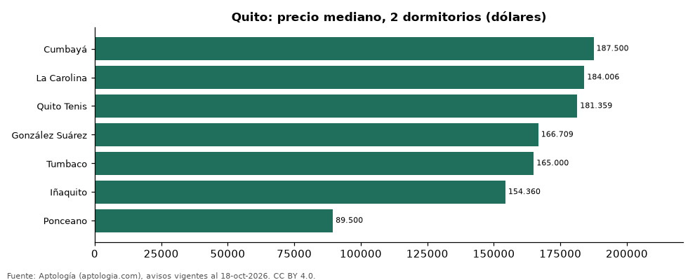

# Dónde cuesta más y menos comprar un departamento de 2 dormitorios en Quito: ranking de sectores (octubre 2026)

**En Quito, un departamento de 2 dormitorios cuesta USD 187.500 en la mediana en Cumbayá, el sector más caro, y USD 89.500 en Ponceano, el más barato: 2,1 veces menos.** Comparamos 7 sectores con al menos 30 avisos de 2 dormitorios.

*Resumen: analizamos 425 departamentos en venta de 2 dormitorios en 7 sectores de Quito.*

**Actualizado:** 18 de octubre de 2026 (datos del 18 de octubre de 2026) · **Próxima actualización:** mensual.

## Resumen

| Indicador | Valor |
|---|---|
| Más caro | Cumbayá: USD 187.500 |
| Más barato | Ponceano: USD 89.500 |
| Diferencia | 2,1 veces |
| Sectores | 7 |

## Precio de un departamento de 2 dormitorios por sector

| Sector | Precio (mediana) | Rango típico (P25–P75) | Área mediana (m²) | Avisos |
|---|---|---|---|---|
| Cumbayá | USD 187.500 | USD 168.250 – USD 221.233 | 120 | 122 |
| La Carolina | USD 184.006 | USD 143.000 – USD 225.500 | 90 | 80 |
| Quito Tenis | USD 181.359 | USD 156.450 – USD 207.000 | 112 | 35 |
| González Suárez | USD 166.709 | USD 140.668 – USD 212.693 | 101 | 34 |
| Tumbaco | USD 165.000 | USD 110.000 – USD 205.000 | 111 | 41 |
| Iñaquito | USD 154.360 | USD 129.000 – USD 199.250 | 97 | 80 |
| Ponceano | USD 89.500 | USD 69.990 – USD 118.000 | 88 | 33 |

Medianas del precio pedido; solo sectores con 30 avisos o más.

## Preguntas frecuentes

**¿Cuánto cuesta comprar un departamento de 2 dormitorios en Cumbayá?**
USD 187.500 en la mediana (octubre de 2026); la mitad central entre USD 168.250 y USD 221.233.

**¿Dónde es más barato comprar un departamento de 2 dormitorios en Quito?**
En Ponceano: USD 89.500 en la mediana.

## Metodología

- **Fuente:** exportes nocturnos de la base de datos de Aptología (aptologia.com) del 18 de octubre de 2026: avisos vigentes de vivienda en portales inmobiliarios de 13 países, recogidos por Aptología y vistos en línea entre el 11 y el 18 de octubre de 2026. Corte: 18 de octubre de 2026.
- **Depuración:** se eliminan duplicados exactos (misma ciudad, zona, tipo, precio, moneda, área, habitaciones y baños) y los precios fuera del percentil 1–99 de cada país, operación, moneda y tipo; el precio por m² usa solo avisos con área declarada entre 12 y 2.000 m² y también se recorta al P1–P99.
- **Qué se mide:** precios pedidos (publicados), no precios de cierre. En arriendo, el canon mensual sin administración, gastos comunes ni condominio.
- **Muestra mínima:** cada cifra publicada se apoya en al menos 30 avisos; las celdas con menos se omiten.
- **Monedas:** nunca se mezclan avisos de monedas distintas sin convertirlos. Conversión a dólares con la tasa de mercado de ExchangeRate-API (open.er-api.com, actualización del 18 Oct 2026): 1 USD = 3.182,80 COP, 1 USD = 18,47 M.N, 1 USD = 5,09 BRL, 1 USD = 3,44 PEN, 1 USD = 982,44 CLP, 1 USD = 1.514,57 ARS, 1 USD = 40,20 UYU, 1 USD = 5.705,37 PYG, 1 USD = 61,27 DOP, 1 USD = 0,89 EUR, 1 USD = 11,72 BOB; la UF chilena a 41.178,64 CLP (mindicador,cl. 18-oct-2026). Los avisos publicados en dólares se usan tal cual.
- **Monedas:** en cada ciudad y operación se usa solo la moneda mayoritaria de los avisos (los avisos en otra moneda se excluyen) y la mediana se convierte a dólares con la tasa citada; nunca se promedian avisos de monedas distintas.
- **Limitaciones:** la cobertura depende de los portales que recorre Aptología en cada país y es mayor en las ciudades grandes y en los segmentos medio-alto y alto; el área es la que declara el aviso, sin verificar; los nombres de zona vienen de los portales.
- **Privacidad:** solo se publican agregados; no se publica ningún dato personal, enlace a avisos ni nombre de anunciante.
- **Datos abiertos:** [datos.csv](datos.csv), licencia CC BY 4.0.

## Cómo citar

Pinzón Pineda, D. M. (2026). *Dónde cuesta más y menos comprar un departamento de 2 dormitorios en Quito: ranking de sectores (octubre 2026)*. Aptología (aptologia.com). https://github.com/elbroker/aptologia-datos/tree/main/estudios/venta-departamentos-de-2-dormitorios-por-sector-quito-2026. Datos: datos.csv, licencia CC BY 4.0.
