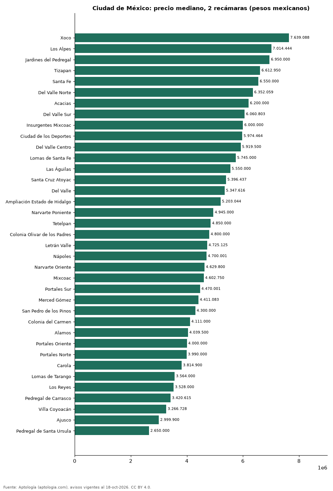

# Dónde cuesta más y menos comprar un departamento de 2 recámaras en Ciudad de México: ranking de colonias (octubre 2026)

**En Ciudad de México, un departamento de 2 recámaras cuesta 7.639.088 pesos mexicanos (USD 413.696) en la mediana en Xoco, la colonia más cara, y 2.650.000 pesos mexicanos (USD 143.511) en Pedregal de Santa Ursula, la más barata: 2,9 veces menos.** Comparamos 37 colonias con al menos 30 avisos de 2 recámaras.

*Resumen: analizamos 3.446 departamentos en venta de 2 recámaras en 37 colonias de Ciudad de México.*

**Actualizado:** 18 de octubre de 2026 (datos del 18 de octubre de 2026) · **Próxima actualización:** mensual.

## Resumen

| Indicador | Valor |
|---|---|
| Más caro | Xoco: 7.639.088 pesos mexicanos (USD 413.696) |
| Más barato | Pedregal de Santa Ursula: 2.650.000 pesos mexicanos (USD 143.511) |
| Diferencia | 2,9 veces |
| Colonias | 37 |

## Precio de un departamento de 2 recámaras por colonia

| Colonia | Precio (mediana) | Rango típico (P25–P75) | Área mediana (m²) | Avisos |
|---|---|---|---|---|
| Xoco | 7.639.088 pesos mexicanos (USD 413.696) | 5.324.000 pesos mexicanos (USD 288.322) – 10.750.000 pesos mexicanos (USD 582.168) | 94 | 79 |
| Los Alpes | 7.014.444 pesos mexicanos (USD 379.869) | 5.827.521 pesos mexicanos (USD 315.590) – 8.253.337 pesos mexicanos (USD 446.961) | 101 | 288 |
| Jardines del Pedregal | 6.950.000 pesos mexicanos (USD 376.379) | 5.917.500 pesos mexicanos (USD 320.463) – 8.450.000 pesos mexicanos (USD 457.611) | 120 | 34 |
| Tizapan | 6.612.950 pesos mexicanos (USD 358.126) | 5.000.000 pesos mexicanos (USD 270.776) – 7.990.000 pesos mexicanos (USD 432.700) | 119 | 38 |
| Santa Fe | 6.550.000 pesos mexicanos (USD 354.716) | 4.969.394 pesos mexicanos (USD 269.119) – 8.767.500 pesos mexicanos (USD 474.806) | 110 | 190 |
| Del Valle Norte | 6.352.059 pesos mexicanos (USD 343.997) | 5.117.500 pesos mexicanos (USD 277.139) – 7.575.000 pesos mexicanos (USD 410.226) | 102 | 36 |
| Acacias | 6.200.000 pesos mexicanos (USD 335.762) | 5.410.001 pesos mexicanos (USD 292.980) – 6.643.500 pesos mexicanos (USD 359.780) | 77 | 57 |
| Del Valle Sur | 6.060.803 pesos mexicanos (USD 328.224) | 4.825.000 pesos mexicanos (USD 261.299) – 6.638.350 pesos mexicanos (USD 359.501) | 87 | 59 |
| Insurgentes Mixcoac | 6.000.000 pesos mexicanos (USD 324.931) | 4.447.500 pesos mexicanos (USD 240.855) – 7.377.450 pesos mexicanos (USD 399.527) | 96 | 31 |
| Ciudad de los Deportes | 5.974.464 pesos mexicanos (USD 323.548) | 5.327.950 pesos mexicanos (USD 288.536) – 6.438.426 pesos mexicanos (USD 348.674) | 81 | 41 |
| Del Valle Centro | 5.919.500 pesos mexicanos (USD 320.572) | 4.598.438 pesos mexicanos (USD 249.029) – 7.210.225 pesos mexicanos (USD 390.471) | 90 | 232 |
| Lomas de Santa Fe | 5.745.000 pesos mexicanos (USD 311.122) | 4.837.500 pesos mexicanos (USD 261.976) – 7.262.938 pesos mexicanos (USD 393.326) | 95 | 52 |
| Las Águilas | 5.550.000 pesos mexicanos (USD 300.561) | 3.641.400 pesos mexicanos (USD 197.201) – 6.100.000 pesos mexicanos (USD 330.347) | 85 | 49 |
| Santa Cruz Atoyac | 5.396.437 pesos mexicanos (USD 292.245) | 4.597.500 pesos mexicanos (USD 248.978) – 6.200.000 pesos mexicanos (USD 335.762) | 76 | 76 |
| Del Valle | 5.347.616 pesos mexicanos (USD 289.601) | 4.718.750 pesos mexicanos (USD 255.545) – 7.731.223 pesos mexicanos (USD 418.686) | 84 | 32 |
| Ampliación Estado de Hidalgo | 5.203.044 pesos mexicanos (USD 281.772) | 3.756.175 pesos mexicanos (USD 203.416) – 6.320.338 pesos mexicanos (USD 342.279) | 88 | 174 |
| Narvarte Poniente | 4.945.000 pesos mexicanos (USD 267.797) | 3.904.000 pesos mexicanos (USD 211.422) – 6.494.200 pesos mexicanos (USD 351.695) | 82 | 155 |
| Tetelpan | 4.850.000 pesos mexicanos (USD 262.653) | 3.500.000 pesos mexicanos (USD 189.543) – 6.077.200 pesos mexicanos (USD 329.112) | 102 | 129 |
| Colonia Olivar de los Padres | 4.800.000 pesos mexicanos (USD 259.945) | 4.207.961 pesos mexicanos (USD 227.883) – 5.600.000 pesos mexicanos (USD 303.269) | 94 | 105 |
| Letrán Valle | 4.725.125 pesos mexicanos (USD 255.890) | 4.259.000 pesos mexicanos (USD 230.647) – 6.124.100 pesos mexicanos (USD 331.652) | 89 | 33 |
| Nápoles | 4.700.001 pesos mexicanos (USD 254.529) | 3.860.245 pesos mexicanos (USD 209.052) – 5.800.164 pesos mexicanos (USD 314.109) | 84 | 610 |
| Narvarte Oriente | 4.629.800 pesos mexicanos (USD 250.728) | 3.729.400 pesos mexicanos (USD 201.966) – 5.631.500 pesos mexicanos (USD 304.975) | 75 | 45 |
| Mixcoac | 4.602.750 pesos mexicanos (USD 249.263) | 3.791.703 pesos mexicanos (USD 205.340) – 5.665.000 pesos mexicanos (USD 306.789) | 80 | 31 |
| Portales Sur | 4.470.001 pesos mexicanos (USD 242.074) | 3.898.000 pesos mexicanos (USD 211.097) – 5.339.900 pesos mexicanos (USD 289.183) | 74 | 97 |
| Merced Gómez | 4.411.083 pesos mexicanos (USD 238.883) | 3.635.100 pesos mexicanos (USD 196.860) – 5.032.462 pesos mexicanos (USD 272.534) | 68 | 42 |
| San Pedro de los Pinos | 4.300.000 pesos mexicanos (USD 232.867) | 3.497.500 pesos mexicanos (USD 189.408) – 5.338.682 pesos mexicanos (USD 289.117) | 76 | 127 |
| Colonia del Carmen | 4.111.000 pesos mexicanos (USD 222.632) | 3.291.499 pesos mexicanos (USD 178.252) – 5.598.598 pesos mexicanos (USD 303.193) | 75 | 46 |
| Alamos | 4.039.500 pesos mexicanos (USD 218.760) | 3.255.000 pesos mexicanos (USD 176.275) – 6.041.263 pesos mexicanos (USD 327.166) | 86 | 50 |
| Portales Oriente | 4.000.000 pesos mexicanos (USD 216.621) | 3.447.572 pesos mexicanos (USD 186.704) – 4.362.700 pesos mexicanos (USD 236.263) | 71 | 63 |
| Portales Norte | 3.990.000 pesos mexicanos (USD 216.079) | 3.476.250 pesos mexicanos (USD 188.257) – 4.500.000 pesos mexicanos (USD 243.698) | 71 | 110 |
| Carola | 3.814.900 pesos mexicanos (USD 206.597) | 2.850.000 pesos mexicanos (USD 154.342) – 4.391.274 pesos mexicanos (USD 237.810) | 66 | 31 |
| Lomas de Tarango | 3.564.000 pesos mexicanos (USD 193.009) | 3.179.523 pesos mexicanos (USD 172.188) – 4.090.000 pesos mexicanos (USD 221.495) | 77 | 33 |
| Los Reyes | 3.528.000 pesos mexicanos (USD 191.060) | 3.074.500 pesos mexicanos (USD 166.500) – 4.504.474 pesos mexicanos (USD 243.941) | 75 | 43 |
| Pedregal de Carrasco | 3.420.615 pesos mexicanos (USD 185.244) | 2.805.000 pesos mexicanos (USD 151.905) – 5.287.500 pesos mexicanos (USD 286.346) | 79 | 40 |
| Villa Coyoacán | 3.266.728 pesos mexicanos (USD 176.910) | 2.962.208 pesos mexicanos (USD 160.419) – 3.957.500 pesos mexicanos (USD 214.319) | 75 | 110 |
| Ajusco | 2.999.900 pesos mexicanos (USD 162.460) | 2.640.000 pesos mexicanos (USD 142.970) – 3.339.000 pesos mexicanos (USD 180.824) | 65 | 33 |
| Pedregal de Santa Ursula | 2.650.000 pesos mexicanos (USD 143.511) | 2.279.375 pesos mexicanos (USD 123.440) – 3.000.000 pesos mexicanos (USD 162.466) | 60 | 45 |

Medianas del precio pedido; solo colonias con 30 avisos o más.

## Preguntas frecuentes

**¿Cuánto cuesta comprar un departamento de 2 recámaras en Xoco?**
7.639.088 pesos mexicanos (USD 413.696) en la mediana (octubre de 2026); la mitad central entre 5.324.000 pesos mexicanos (USD 288.322) y 10.750.000 pesos mexicanos (USD 582.168).

**¿Dónde es más barato comprar un departamento de 2 recámaras en Ciudad de México?**
En Pedregal de Santa Ursula: 2.650.000 pesos mexicanos (USD 143.511) en la mediana.

## Metodología

- **Fuente:** exportes nocturnos de la base de datos de Aptología (aptologia.com) del 18 de octubre de 2026: avisos vigentes de vivienda en portales inmobiliarios de 13 países, recogidos por Aptología y vistos en línea entre el 11 y el 18 de octubre de 2026. Corte: 18 de octubre de 2026.
- **Depuración:** se eliminan duplicados exactos (misma ciudad, zona, tipo, precio, moneda, área, habitaciones y baños) y los precios fuera del percentil 1–99 de cada país, operación, moneda y tipo; el precio por m² usa solo avisos con área declarada entre 12 y 2.000 m² y también se recorta al P1–P99.
- **Qué se mide:** precios pedidos (publicados), no precios de cierre. En arriendo, el canon mensual sin administración, gastos comunes ni condominio.
- **Muestra mínima:** cada cifra publicada se apoya en al menos 30 avisos; las celdas con menos se omiten.
- **Monedas:** nunca se mezclan avisos de monedas distintas sin convertirlos. Conversión a dólares con la tasa de mercado de ExchangeRate-API (open.er-api.com, actualización del 18 Oct 2026): 1 USD = 3.182,80 COP, 1 USD = 18,47 M.N, 1 USD = 5,09 BRL, 1 USD = 3,44 PEN, 1 USD = 982,44 CLP, 1 USD = 1.514,57 ARS, 1 USD = 40,20 UYU, 1 USD = 5.705,37 PYG, 1 USD = 61,27 DOP, 1 USD = 0,89 EUR, 1 USD = 11,72 BOB; la UF chilena a 41.178,64 CLP (mindicador,cl. 18-oct-2026). Los avisos publicados en dólares se usan tal cual.
- **Monedas:** en cada ciudad y operación se usa solo la moneda mayoritaria de los avisos (los avisos en otra moneda se excluyen) y la mediana se convierte a dólares con la tasa citada; nunca se promedian avisos de monedas distintas.
- **Limitaciones:** la cobertura depende de los portales que recorre Aptología en cada país y es mayor en las ciudades grandes y en los segmentos medio-alto y alto; el área es la que declara el aviso, sin verificar; los nombres de zona vienen de los portales.
- **Privacidad:** solo se publican agregados; no se publica ningún dato personal, enlace a avisos ni nombre de anunciante.
- **Datos abiertos:** [datos.csv](datos.csv), licencia CC BY 4.0.

## Cómo citar

Pinzón Pineda, D. M. (2026). *Dónde cuesta más y menos comprar un departamento de 2 recámaras en Ciudad de México: ranking de colonias (octubre 2026)*. Aptología (aptologia.com). https://github.com/elbroker/aptologia-datos/tree/main/estudios/venta-departamentos-de-2-recamaras-por-colonia-ciudad-de-mexico-2026. Datos: datos.csv, licencia CC BY 4.0.
