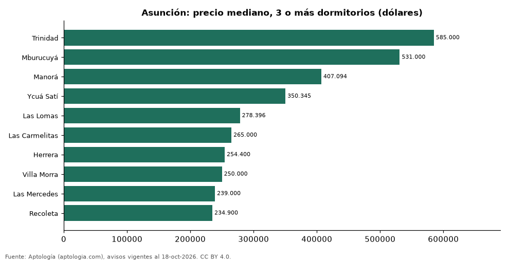

# Dónde cuesta más y menos comprar un departamento de 3 o más dormitorios en Asunción: ranking de barrios (octubre 2026)

**En Asunción, un departamento de 3 o más dormitorios cuesta USD 585.000 en la mediana en Trinidad, el barrio más caro, y USD 234.900 en Recoleta, el más barato: 2,5 veces menos.** Comparamos 10 barrios con al menos 30 avisos de 3 o más dormitorios.

*Resumen: analizamos 672 departamentos en venta de 3 o más dormitorios en 10 barrios de Asunción.*

**Actualizado:** 18 de octubre de 2026 (datos del 18 de octubre de 2026) · **Próxima actualización:** mensual.

## Resumen

| Indicador | Valor |
|---|---|
| Más caro | Trinidad: USD 585.000 |
| Más barato | Recoleta: USD 234.900 |
| Diferencia | 2,5 veces |
| Barrios | 10 |

## Precio de un departamento de 3 o más dormitorios por barrio

| Barrio | Precio (mediana) | Rango típico (P25–P75) | Área mediana (m²) | Avisos |
|---|---|---|---|---|
| Trinidad | USD 585.000 | USD 256.750 – USD 1.057.294 | 324 | 50 |
| Mburucuyá | USD 531.000 | USD 280.832 – USD 994.800 | 191 | 101 |
| Manorá | USD 407.094 | USD 258.088 – USD 930.186 | 180 | 40 |
| Ycuá Satí | USD 350.345 | USD 230.000 – USD 500.467 | 163 | 73 |
| Las Lomas | USD 278.396 | USD 249.499 – USD 492.684 | 150 | 100 |
| Las Carmelitas | USD 265.000 | USD 250.000 – USD 436.074 | 148 | 53 |
| Herrera | USD 254.400 | USD 220.000 – USD 315.000 | 190 | 34 |
| Villa Morra | USD 250.000 | USD 187.500 – USD 355.806 | 150 | 86 |
| Las Mercedes | USD 239.000 | USD 183.750 – USD 293.310 | 147 | 84 |
| Recoleta | USD 234.900 | USD 199.450 – USD 255.712 | 149 | 51 |

Medianas del precio pedido; solo barrios con 30 avisos o más.

## Preguntas frecuentes

**¿Cuánto cuesta comprar un departamento de 3 o más dormitorios en Trinidad?**
USD 585.000 en la mediana (octubre de 2026); la mitad central entre USD 256.750 y USD 1.057.294.

**¿Dónde es más barato comprar un departamento de 3 o más dormitorios en Asunción?**
En Recoleta: USD 234.900 en la mediana.

## Metodología

- **Fuente:** exportes nocturnos de la base de datos de Aptología (aptologia.com) del 18 de octubre de 2026: avisos vigentes de vivienda en portales inmobiliarios de 13 países, recogidos por Aptología y vistos en línea entre el 11 y el 18 de octubre de 2026. Corte: 18 de octubre de 2026.
- **Depuración:** se eliminan duplicados exactos (misma ciudad, zona, tipo, precio, moneda, área, habitaciones y baños) y los precios fuera del percentil 1–99 de cada país, operación, moneda y tipo; el precio por m² usa solo avisos con área declarada entre 12 y 2.000 m² y también se recorta al P1–P99.
- **Qué se mide:** precios pedidos (publicados), no precios de cierre. En arriendo, el canon mensual sin administración, gastos comunes ni condominio.
- **Muestra mínima:** cada cifra publicada se apoya en al menos 30 avisos; las celdas con menos se omiten.
- **Monedas:** nunca se mezclan avisos de monedas distintas sin convertirlos. Conversión a dólares con la tasa de mercado de ExchangeRate-API (open.er-api.com, actualización del 18 Oct 2026): 1 USD = 3.182,80 COP, 1 USD = 18,47 M.N, 1 USD = 5,09 BRL, 1 USD = 3,44 PEN, 1 USD = 982,44 CLP, 1 USD = 1.514,57 ARS, 1 USD = 40,20 UYU, 1 USD = 5.705,37 PYG, 1 USD = 61,27 DOP, 1 USD = 0,89 EUR, 1 USD = 11,72 BOB; la UF chilena a 41.178,64 CLP (mindicador,cl. 18-oct-2026). Los avisos publicados en dólares se usan tal cual.
- **Monedas:** en cada ciudad y operación se usa solo la moneda mayoritaria de los avisos (los avisos en otra moneda se excluyen) y la mediana se convierte a dólares con la tasa citada; nunca se promedian avisos de monedas distintas.
- **Limitaciones:** la cobertura depende de los portales que recorre Aptología en cada país y es mayor en las ciudades grandes y en los segmentos medio-alto y alto; el área es la que declara el aviso, sin verificar; los nombres de zona vienen de los portales.
- **Privacidad:** solo se publican agregados; no se publica ningún dato personal, enlace a avisos ni nombre de anunciante.
- **Datos abiertos:** [datos.csv](datos.csv), licencia CC BY 4.0.

## Cómo citar

Pinzón Pineda, D. M. (2026). *Dónde cuesta más y menos comprar un departamento de 3 o más dormitorios en Asunción: ranking de barrios (octubre 2026)*. Aptología (aptologia.com). https://github.com/elbroker/aptologia-datos/tree/main/estudios/venta-departamentos-de-3-o-mas-dormitorios-por-barrio-asuncion-2026. Datos: datos.csv, licencia CC BY 4.0.
