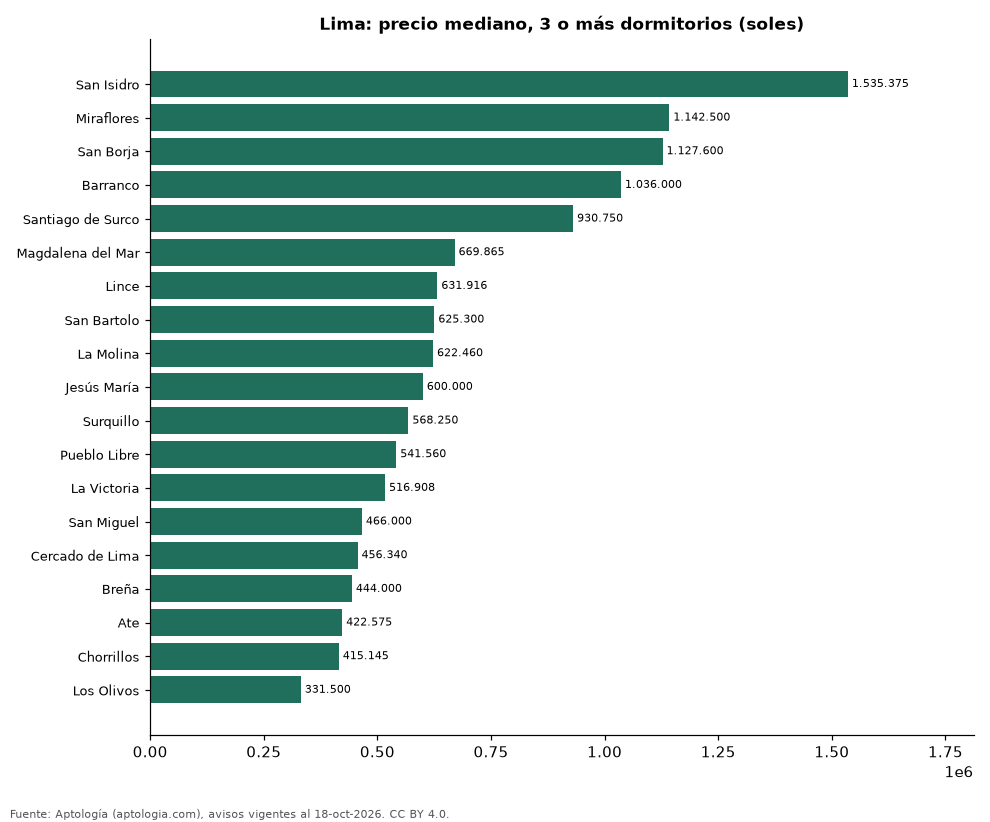

# Dónde cuesta más y menos comprar un departamento de 3 o más dormitorios en Lima: ranking de distritos (octubre 2026)

**En Lima, un departamento de 3 o más dormitorios cuesta 1.535.375 soles (USD 446.911) en la mediana en San Isidro, el distrito más caro, y 331.500 soles (USD 96.492) en Los Olivos, el más barato: 4,6 veces menos.** Comparamos 19 distritos con al menos 30 avisos de 3 o más dormitorios.

*Resumen: analizamos 3.162 departamentos en venta de 3 o más dormitorios en 19 distritos de Lima.*

**Actualizado:** 18 de octubre de 2026 (datos del 18 de octubre de 2026) · **Próxima actualización:** mensual.

## Resumen

| Indicador | Valor |
|---|---|
| Más caro | San Isidro: 1.535.375 soles (USD 446.911) |
| Más barato | Los Olivos: 331.500 soles (USD 96.492) |
| Diferencia | 4,6 veces |
| Distritos | 19 |

## Precio de un departamento de 3 o más dormitorios por distrito

| Distrito | Precio (mediana) | Rango típico (P25–P75) | Área mediana (m²) | Avisos |
|---|---|---|---|---|
| San Isidro | 1.535.375 soles (USD 446.911) | 1.056.708 soles (USD 307.583) – 2.320.527 soles (USD 675.451) | 184 | 372 |
| Miraflores | 1.142.500 soles (USD 332.555) | 868.750 soles (USD 252.873) – 1.672.694 soles (USD 486.882) | 138 | 532 |
| San Borja | 1.127.600 soles (USD 328.218) | 806.020 soles (USD 234.613) – 1.443.000 soles (USD 420.023) | 148 | 205 |
| Barranco | 1.036.000 soles (USD 301.555) | 645.806 soles (USD 187.979) – 1.803.750 soles (USD 525.029) | 105 | 47 |
| Santiago de Surco | 930.750 soles (USD 270.919) | 703.000 soles (USD 204.627) – 1.311.750 soles (USD 381.819) | 138 | 747 |
| Magdalena del Mar | 669.865 soles (USD 194.982) | 543.393 soles (USD 158.169) – 819.000 soles (USD 238.392) | 90 | 151 |
| Lince | 631.916 soles (USD 183.936) | 518.946 soles (USD 151.053) – 864.044 soles (USD 251.503) | 86 | 75 |
| San Bartolo | 625.300 soles (USD 182.010) | 483.250 soles (USD 140.663) – 916.755 soles (USD 266.846) | 116 | 32 |
| La Molina | 622.460 soles (USD 181.183) | 522.100 soles (USD 151.971) – 1.014.250 soles (USD 295.224) | 122 | 56 |
| Jesús María | 600.000 soles (USD 174.646) | 520.000 soles (USD 151.360) – 777.000 soles (USD 226.166) | 82 | 121 |
| Surquillo | 568.250 soles (USD 165.404) | 499.289 soles (USD 145.331) – 668.534 soles (USD 194.594) | 80 | 132 |
| Pueblo Libre | 541.560 soles (USD 157.635) | 453.423 soles (USD 131.981) – 632.000 soles (USD 183.960) | 82 | 106 |
| La Victoria | 516.908 soles (USD 150.460) | 474.190 soles (USD 138.026) – 583.375 soles (USD 169.807) | 71 | 64 |
| San Miguel | 466.000 soles (USD 135.642) | 407.500 soles (USD 118.614) – 555.315 soles (USD 161.639) | 78 | 191 |
| Cercado de Lima | 456.340 soles (USD 132.830) | 385.000 soles (USD 112.064) – 511.799 soles (USD 148.973) | 72 | 112 |
| Breña | 444.000 soles (USD 129.238) | 413.680 soles (USD 120.412) – 521.921 soles (USD 151.919) | 76 | 47 |
| Ate | 422.575 soles (USD 123.002) | 383.950 soles (USD 111.759) – 591.000 soles (USD 172.026) | 98 | 32 |
| Chorrillos | 415.145 soles (USD 120.839) | 340.750 soles (USD 99.184) – 521.880 soles (USD 151.907) | 70 | 108 |
| Los Olivos | 331.500 soles (USD 96.492) | 278.062 soles (USD 80.937) – 404.512 soles (USD 117.744) | 97 | 32 |

Medianas del precio pedido; solo distritos con 30 avisos o más.

## Preguntas frecuentes

**¿Cuánto cuesta comprar un departamento de 3 o más dormitorios en San Isidro?**
1.535.375 soles (USD 446.911) en la mediana (octubre de 2026); la mitad central entre 1.056.708 soles (USD 307.583) y 2.320.527 soles (USD 675.451).

**¿Dónde es más barato comprar un departamento de 3 o más dormitorios en Lima?**
En Los Olivos: 331.500 soles (USD 96.492) en la mediana.

## Metodología

- **Fuente:** exportes nocturnos de la base de datos de Aptología (aptologia.com) del 18 de octubre de 2026: avisos vigentes de vivienda en portales inmobiliarios de 13 países, recogidos por Aptología y vistos en línea entre el 11 y el 18 de octubre de 2026. Corte: 18 de octubre de 2026.
- **Depuración:** se eliminan duplicados exactos (misma ciudad, zona, tipo, precio, moneda, área, habitaciones y baños) y los precios fuera del percentil 1–99 de cada país, operación, moneda y tipo; el precio por m² usa solo avisos con área declarada entre 12 y 2.000 m² y también se recorta al P1–P99.
- **Qué se mide:** precios pedidos (publicados), no precios de cierre. En arriendo, el canon mensual sin administración, gastos comunes ni condominio.
- **Muestra mínima:** cada cifra publicada se apoya en al menos 30 avisos; las celdas con menos se omiten.
- **Monedas:** nunca se mezclan avisos de monedas distintas sin convertirlos. Conversión a dólares con la tasa de mercado de ExchangeRate-API (open.er-api.com, actualización del 18 Oct 2026): 1 USD = 3.182,80 COP, 1 USD = 18,47 M.N, 1 USD = 5,09 BRL, 1 USD = 3,44 PEN, 1 USD = 982,44 CLP, 1 USD = 1.514,57 ARS, 1 USD = 40,20 UYU, 1 USD = 5.705,37 PYG, 1 USD = 61,27 DOP, 1 USD = 0,89 EUR, 1 USD = 11,72 BOB; la UF chilena a 41.178,64 CLP (mindicador,cl. 18-oct-2026). Los avisos publicados en dólares se usan tal cual.
- **Monedas:** en cada ciudad y operación se usa solo la moneda mayoritaria de los avisos (los avisos en otra moneda se excluyen) y la mediana se convierte a dólares con la tasa citada; nunca se promedian avisos de monedas distintas.
- **Limitaciones:** la cobertura depende de los portales que recorre Aptología en cada país y es mayor en las ciudades grandes y en los segmentos medio-alto y alto; el área es la que declara el aviso, sin verificar; los nombres de zona vienen de los portales.
- **Privacidad:** solo se publican agregados; no se publica ningún dato personal, enlace a avisos ni nombre de anunciante.
- **Datos abiertos:** [datos.csv](datos.csv), licencia CC BY 4.0.

## Cómo citar

Pinzón Pineda, D. M. (2026). *Dónde cuesta más y menos comprar un departamento de 3 o más dormitorios en Lima: ranking de distritos (octubre 2026)*. Aptología (aptologia.com). https://github.com/elbroker/aptologia-datos/tree/main/estudios/venta-departamentos-de-3-o-mas-dormitorios-por-distrito-lima-2026. Datos: datos.csv, licencia CC BY 4.0.
