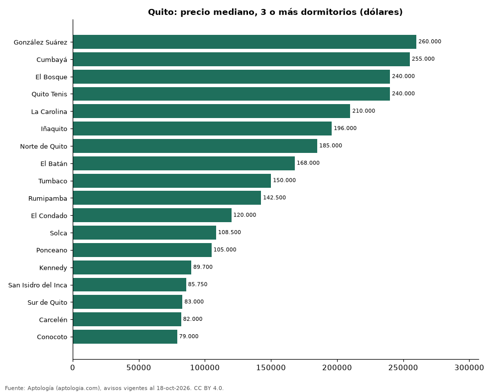

# Dónde cuesta más y menos comprar un departamento de 3 o más dormitorios en Quito: ranking de sectores (octubre 2026)

**En Quito, un departamento de 3 o más dormitorios cuesta USD 260.000 en la mediana en González Suárez, el sector más caro, y USD 79.000 en Conocoto, el más barato: 3,3 veces menos.** Comparamos 18 sectores con al menos 30 avisos de 3 o más dormitorios.

*Resumen: analizamos 1.098 departamentos en venta de 3 o más dormitorios en 18 sectores de Quito.*

**Actualizado:** 18 de octubre de 2026 (datos del 18 de octubre de 2026) · **Próxima actualización:** mensual.

## Resumen

| Indicador | Valor |
|---|---|
| Más caro | González Suárez: USD 260.000 |
| Más barato | Conocoto: USD 79.000 |
| Diferencia | 3,3 veces |
| Sectores | 18 |

## Precio de un departamento de 3 o más dormitorios por sector

| Sector | Precio (mediana) | Rango típico (P25–P75) | Área mediana (m²) | Avisos |
|---|---|---|---|---|
| González Suárez | USD 260.000 | USD 196.875 – USD 350.000 | 221 | 92 |
| Cumbayá | USD 255.000 | USD 190.000 – USD 314.238 | 170 | 91 |
| El Bosque | USD 240.000 | USD 197.400 – USD 292.750 | 334 | 48 |
| Quito Tenis | USD 240.000 | USD 199.622 – USD 298.750 | 272 | 110 |
| La Carolina | USD 210.000 | USD 179.625 – USD 287.316 | 170 | 82 |
| Iñaquito | USD 196.000 | USD 158.000 – USD 289.000 | 194 | 113 |
| Norte de Quito | USD 185.000 | USD 139.750 – USD 203.000 | 208 | 38 |
| El Batán | USD 168.000 | USD 136.500 – USD 200.000 | 176 | 51 |
| Tumbaco | USD 150.000 | USD 124.775 – USD 248.886 | 148 | 54 |
| Rumipamba | USD 142.500 | USD 123.750 – USD 203.675 | 159 | 32 |
| El Condado | USD 120.000 | USD 92.225 – USD 168.000 | 150 | 77 |
| Solca | USD 108.500 | USD 78.000 – USD 141.250 | 120 | 32 |
| Ponceano | USD 105.000 | USD 75.000 – USD 117.750 | 123 | 67 |
| Kennedy | USD 89.700 | USD 80.000 – USD 111.725 | 114 | 50 |
| San Isidro del Inca | USD 85.750 | USD 69.900 – USD 110.750 | 104 | 36 |
| Sur de Quito | USD 83.000 | USD 59.050 – USD 108.500 | 106 | 35 |
| Carcelén | USD 82.000 | USD 66.175 – USD 103.750 | 121 | 42 |
| Conocoto | USD 79.000 | USD 69.425 – USD 103.376 | 106 | 48 |

Medianas del precio pedido; solo sectores con 30 avisos o más.

## Preguntas frecuentes

**¿Cuánto cuesta comprar un departamento de 3 o más dormitorios en González Suárez?**
USD 260.000 en la mediana (octubre de 2026); la mitad central entre USD 196.875 y USD 350.000.

**¿Dónde es más barato comprar un departamento de 3 o más dormitorios en Quito?**
En Conocoto: USD 79.000 en la mediana.

## Metodología

- **Fuente:** exportes nocturnos de la base de datos de Aptología (aptologia.com) del 18 de octubre de 2026: avisos vigentes de vivienda en portales inmobiliarios de 13 países, recogidos por Aptología y vistos en línea entre el 11 y el 18 de octubre de 2026. Corte: 18 de octubre de 2026.
- **Depuración:** se eliminan duplicados exactos (misma ciudad, zona, tipo, precio, moneda, área, habitaciones y baños) y los precios fuera del percentil 1–99 de cada país, operación, moneda y tipo; el precio por m² usa solo avisos con área declarada entre 12 y 2.000 m² y también se recorta al P1–P99.
- **Qué se mide:** precios pedidos (publicados), no precios de cierre. En arriendo, el canon mensual sin administración, gastos comunes ni condominio.
- **Muestra mínima:** cada cifra publicada se apoya en al menos 30 avisos; las celdas con menos se omiten.
- **Monedas:** nunca se mezclan avisos de monedas distintas sin convertirlos. Conversión a dólares con la tasa de mercado de ExchangeRate-API (open.er-api.com, actualización del 18 Oct 2026): 1 USD = 3.182,80 COP, 1 USD = 18,47 M.N, 1 USD = 5,09 BRL, 1 USD = 3,44 PEN, 1 USD = 982,44 CLP, 1 USD = 1.514,57 ARS, 1 USD = 40,20 UYU, 1 USD = 5.705,37 PYG, 1 USD = 61,27 DOP, 1 USD = 0,89 EUR, 1 USD = 11,72 BOB; la UF chilena a 41.178,64 CLP (mindicador,cl. 18-oct-2026). Los avisos publicados en dólares se usan tal cual.
- **Monedas:** en cada ciudad y operación se usa solo la moneda mayoritaria de los avisos (los avisos en otra moneda se excluyen) y la mediana se convierte a dólares con la tasa citada; nunca se promedian avisos de monedas distintas.
- **Limitaciones:** la cobertura depende de los portales que recorre Aptología en cada país y es mayor en las ciudades grandes y en los segmentos medio-alto y alto; el área es la que declara el aviso, sin verificar; los nombres de zona vienen de los portales.
- **Privacidad:** solo se publican agregados; no se publica ningún dato personal, enlace a avisos ni nombre de anunciante.
- **Datos abiertos:** [datos.csv](datos.csv), licencia CC BY 4.0.

## Cómo citar

Pinzón Pineda, D. M. (2026). *Dónde cuesta más y menos comprar un departamento de 3 o más dormitorios en Quito: ranking de sectores (octubre 2026)*. Aptología (aptologia.com). https://github.com/elbroker/aptologia-datos/tree/main/estudios/venta-departamentos-de-3-o-mas-dormitorios-por-sector-quito-2026. Datos: datos.csv, licencia CC BY 4.0.
