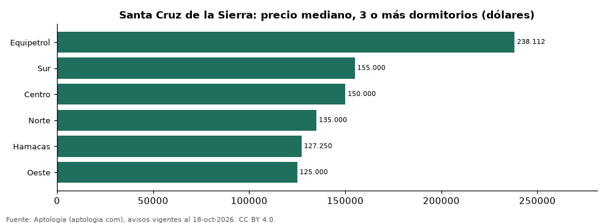

# Dónde cuesta más y menos comprar un departamento de 3 o más dormitorios en Santa Cruz de la Sierra: ranking de zonas (octubre 2026)

**En Santa Cruz de la Sierra, un departamento de 3 o más dormitorios cuesta USD 238.112 en la mediana en Equipetrol, la zona más cara, y USD 125.000 en Oeste, la más barata: 1,9 veces menos.** Comparamos 6 zonas con al menos 30 avisos de 3 o más dormitorios.

*Resumen: analizamos 512 departamentos en venta de 3 o más dormitorios en 6 zonas de Santa Cruz de la Sierra.*

**Actualizado:** 18 de octubre de 2026 (datos del 18 de octubre de 2026) · **Próxima actualización:** mensual.

## Resumen

| Indicador | Valor |
|---|---|
| Más caro | Equipetrol: USD 238.112 |
| Más barato | Oeste: USD 125.000 |
| Diferencia | 1,9 veces |
| Zonas | 6 |

## Precio de un departamento de 3 o más dormitorios por zona

| Zona | Precio (mediana) | Rango típico (P25–P75) | Área mediana (m²) | Avisos |
|---|---|---|---|---|
| Equipetrol | USD 238.112 | USD 175.000 – USD 365.000 | 177 | 93 |
| Sur | USD 155.000 | USD 102.500 – USD 240.000 | 168 | 55 |
| Centro | USD 150.000 | USD 112.500 – USD 170.000 | 148 | 47 |
| Norte | USD 135.000 | USD 105.000 – USD 168.250 | 129 | 196 |
| Hamacas | USD 127.250 | USD 119.000 – USD 148.750 | 126 | 30 |
| Oeste | USD 125.000 | USD 103.282 – USD 159.500 | 134 | 91 |

Medianas del precio pedido; solo zonas con 30 avisos o más.

## Preguntas frecuentes

**¿Cuánto cuesta comprar un departamento de 3 o más dormitorios en Equipetrol?**
USD 238.112 en la mediana (octubre de 2026); la mitad central entre USD 175.000 y USD 365.000.

**¿Dónde es más barato comprar un departamento de 3 o más dormitorios en Santa Cruz de la Sierra?**
En Oeste: USD 125.000 en la mediana.

## Metodología

- **Fuente:** exportes nocturnos de la base de datos de Aptología (aptologia.com) del 18 de octubre de 2026: avisos vigentes de vivienda en portales inmobiliarios de 13 países, recogidos por Aptología y vistos en línea entre el 11 y el 18 de octubre de 2026. Corte: 18 de octubre de 2026.
- **Depuración:** se eliminan duplicados exactos (misma ciudad, zona, tipo, precio, moneda, área, habitaciones y baños) y los precios fuera del percentil 1–99 de cada país, operación, moneda y tipo; el precio por m² usa solo avisos con área declarada entre 12 y 2.000 m² y también se recorta al P1–P99.
- **Qué se mide:** precios pedidos (publicados), no precios de cierre. En arriendo, el canon mensual sin administración, gastos comunes ni condominio.
- **Muestra mínima:** cada cifra publicada se apoya en al menos 30 avisos; las celdas con menos se omiten.
- **Monedas:** nunca se mezclan avisos de monedas distintas sin convertirlos. Conversión a dólares con la tasa de mercado de ExchangeRate-API (open.er-api.com, actualización del 18 Oct 2026): 1 USD = 3.182,80 COP, 1 USD = 18,47 M.N, 1 USD = 5,09 BRL, 1 USD = 3,44 PEN, 1 USD = 982,44 CLP, 1 USD = 1.514,57 ARS, 1 USD = 40,20 UYU, 1 USD = 5.705,37 PYG, 1 USD = 61,27 DOP, 1 USD = 0,89 EUR, 1 USD = 11,72 BOB; la UF chilena a 41.178,64 CLP (mindicador,cl. 18-oct-2026). Los avisos publicados en dólares se usan tal cual.
- **Monedas:** en cada ciudad y operación se usa solo la moneda mayoritaria de los avisos (los avisos en otra moneda se excluyen) y la mediana se convierte a dólares con la tasa citada; nunca se promedian avisos de monedas distintas.
- **Limitaciones:** la cobertura depende de los portales que recorre Aptología en cada país y es mayor en las ciudades grandes y en los segmentos medio-alto y alto; el área es la que declara el aviso, sin verificar; los nombres de zona vienen de los portales.
- **Privacidad:** solo se publican agregados; no se publica ningún dato personal, enlace a avisos ni nombre de anunciante.
- **Datos abiertos:** [datos.csv](datos.csv), licencia CC BY 4.0.

## Cómo citar

Pinzón Pineda, D. M. (2026). *Dónde cuesta más y menos comprar un departamento de 3 o más dormitorios en Santa Cruz de la Sierra: ranking de zonas (octubre 2026)*. Aptología (aptologia.com). https://github.com/elbroker/aptologia-datos/tree/main/estudios/venta-departamentos-de-3-o-mas-dormitorios-por-zona-santa-cruz-de-la-sierra-2026. Datos: datos.csv, licencia CC BY 4.0.
