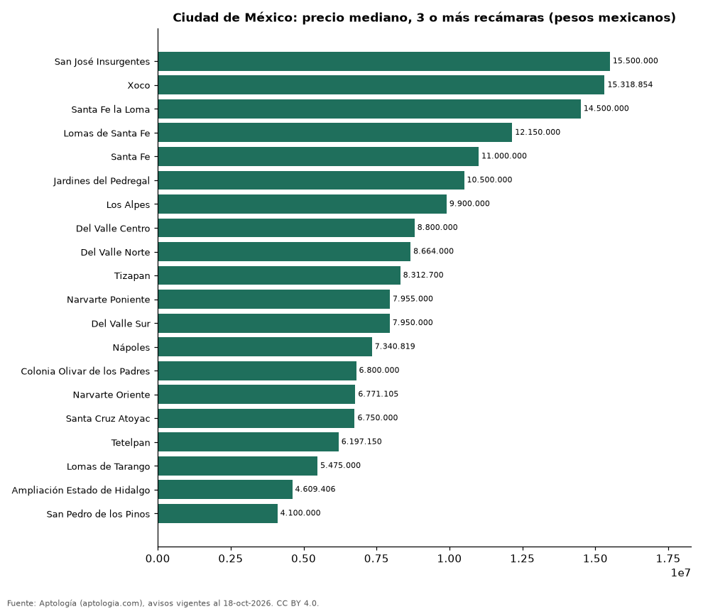

# Dónde cuesta más y menos comprar un departamento de 3 o más recámaras en Ciudad de México: ranking de colonias (octubre 2026)

**En Ciudad de México, un departamento de 3 o más recámaras cuesta 15.500.000 pesos mexicanos (USD 839.405) en la mediana en San José Insurgentes, la colonia más cara, y 4.100.000 pesos mexicanos (USD 222.036) en San Pedro de los Pinos, la más barata: 3,8 veces menos.** Comparamos 20 colonias con al menos 30 avisos de 3 o más recámaras.

*Resumen: analizamos 1.499 departamentos en venta de 3 o más recámaras en 20 colonias de Ciudad de México.*

**Actualizado:** 18 de octubre de 2026 (datos del 18 de octubre de 2026) · **Próxima actualización:** mensual.

## Resumen

| Indicador | Valor |
|---|---|
| Más caro | San José Insurgentes: 15.500.000 pesos mexicanos (USD 839.405) |
| Más barato | San Pedro de los Pinos: 4.100.000 pesos mexicanos (USD 222.036) |
| Diferencia | 3,8 veces |
| Colonias | 20 |

## Precio de un departamento de 3 o más recámaras por colonia

| Colonia | Precio (mediana) | Rango típico (P25–P75) | Área mediana (m²) | Avisos |
|---|---|---|---|---|
| San José Insurgentes | 15.500.000 pesos mexicanos (USD 839.405) | 9.650.000 pesos mexicanos (USD 522.598) – 18.000.000 pesos mexicanos (USD 974.793) | 236 | 37 |
| Xoco | 15.318.854 pesos mexicanos (USD 829.595) | 7.450.000 pesos mexicanos (USD 403.456) – 17.857.500 pesos mexicanos (USD 967.076) | 190 | 50 |
| Santa Fe la Loma | 14.500.000 pesos mexicanos (USD 785.250) | 13.125.000 pesos mexicanos (USD 710.787) – 18.575.000 pesos mexicanos (USD 1.005.933) | 286 | 34 |
| Lomas de Santa Fe | 12.150.000 pesos mexicanos (USD 657.986) | 7.500.000 pesos mexicanos (USD 406.164) – 18.500.000 pesos mexicanos (USD 1.001.871) | 195 | 38 |
| Santa Fe | 11.000.000 pesos mexicanos (USD 595.707) | 7.900.000 pesos mexicanos (USD 427.826) – 14.500.000 pesos mexicanos (USD 785.250) | 198 | 157 |
| Jardines del Pedregal | 10.500.000 pesos mexicanos (USD 568.629) | 7.725.000 pesos mexicanos (USD 418.349) – 14.500.000 pesos mexicanos (USD 785.250) | 201 | 62 |
| Los Alpes | 9.900.000 pesos mexicanos (USD 536.136) | 7.333.423 pesos mexicanos (USD 397.143) – 12.348.799 pesos mexicanos (USD 668.752) | 156 | 55 |
| Del Valle Centro | 8.800.000 pesos mexicanos (USD 476.566) | 6.950.000 pesos mexicanos (USD 376.379) – 10.990.000 pesos mexicanos (USD 595.166) | 147 | 221 |
| Del Valle Norte | 8.664.000 pesos mexicanos (USD 469.201) | 6.728.850 pesos mexicanos (USD 364.402) – 10.040.850 pesos mexicanos (USD 543.764) | 137 | 49 |
| Tizapan | 8.312.700 pesos mexicanos (USD 450.176) | 6.925.000 pesos mexicanos (USD 375.025) – 12.250.000 pesos mexicanos (USD 663.401) | 146 | 59 |
| Narvarte Poniente | 7.955.000 pesos mexicanos (USD 430.805) | 5.927.430 pesos mexicanos (USD 321.001) – 9.490.000 pesos mexicanos (USD 513.933) | 132 | 105 |
| Del Valle Sur | 7.950.000 pesos mexicanos (USD 430.534) | 6.350.000 pesos mexicanos (USD 343.885) – 10.900.000 pesos mexicanos (USD 590.292) | 146 | 51 |
| Nápoles | 7.340.819 pesos mexicanos (USD 397.543) | 5.295.000 pesos mexicanos (USD 286.752) – 8.999.904 pesos mexicanos (USD 487.392) | 137 | 205 |
| Colonia Olivar de los Padres | 6.800.000 pesos mexicanos (USD 368.255) | 5.300.000 pesos mexicanos (USD 287.023) – 8.600.000 pesos mexicanos (USD 465.735) | 144 | 89 |
| Narvarte Oriente | 6.771.105 pesos mexicanos (USD 366.690) | 5.460.000 pesos mexicanos (USD 295.687) – 8.200.000 pesos mexicanos (USD 444.073) | 115 | 33 |
| Santa Cruz Atoyac | 6.750.000 pesos mexicanos (USD 365.548) | 5.890.000 pesos mexicanos (USD 318.974) – 7.452.850 pesos mexicanos (USD 403.611) | 103 | 35 |
| Tetelpan | 6.197.150 pesos mexicanos (USD 335.608) | 5.300.000 pesos mexicanos (USD 287.023) – 7.800.000 pesos mexicanos (USD 422.410) | 132 | 72 |
| Lomas de Tarango | 5.475.000 pesos mexicanos (USD 296.500) | 4.439.298 pesos mexicanos (USD 240.411) – 7.222.500 pesos mexicanos (USD 391.136) | 104 | 30 |
| Ampliación Estado de Hidalgo | 4.609.406 pesos mexicanos (USD 249.623) | 3.495.001 pesos mexicanos (USD 189.272) – 6.480.871 pesos mexicanos (USD 350.973) | 107 | 58 |
| San Pedro de los Pinos | 4.100.000 pesos mexicanos (USD 222.036) | 3.400.000 pesos mexicanos (USD 184.128) – 5.175.000 pesos mexicanos (USD 280.253) | 96 | 59 |

Medianas del precio pedido; solo colonias con 30 avisos o más.

## Preguntas frecuentes

**¿Cuánto cuesta comprar un departamento de 3 o más recámaras en San José Insurgentes?**
15.500.000 pesos mexicanos (USD 839.405) en la mediana (octubre de 2026); la mitad central entre 9.650.000 pesos mexicanos (USD 522.598) y 18.000.000 pesos mexicanos (USD 974.793).

**¿Dónde es más barato comprar un departamento de 3 o más recámaras en Ciudad de México?**
En San Pedro de los Pinos: 4.100.000 pesos mexicanos (USD 222.036) en la mediana.

## Metodología

- **Fuente:** exportes nocturnos de la base de datos de Aptología (aptologia.com) del 18 de octubre de 2026: avisos vigentes de vivienda en portales inmobiliarios de 13 países, recogidos por Aptología y vistos en línea entre el 11 y el 18 de octubre de 2026. Corte: 18 de octubre de 2026.
- **Depuración:** se eliminan duplicados exactos (misma ciudad, zona, tipo, precio, moneda, área, habitaciones y baños) y los precios fuera del percentil 1–99 de cada país, operación, moneda y tipo; el precio por m² usa solo avisos con área declarada entre 12 y 2.000 m² y también se recorta al P1–P99.
- **Qué se mide:** precios pedidos (publicados), no precios de cierre. En arriendo, el canon mensual sin administración, gastos comunes ni condominio.
- **Muestra mínima:** cada cifra publicada se apoya en al menos 30 avisos; las celdas con menos se omiten.
- **Monedas:** nunca se mezclan avisos de monedas distintas sin convertirlos. Conversión a dólares con la tasa de mercado de ExchangeRate-API (open.er-api.com, actualización del 18 Oct 2026): 1 USD = 3.182,80 COP, 1 USD = 18,47 M.N, 1 USD = 5,09 BRL, 1 USD = 3,44 PEN, 1 USD = 982,44 CLP, 1 USD = 1.514,57 ARS, 1 USD = 40,20 UYU, 1 USD = 5.705,37 PYG, 1 USD = 61,27 DOP, 1 USD = 0,89 EUR, 1 USD = 11,72 BOB; la UF chilena a 41.178,64 CLP (mindicador,cl. 18-oct-2026). Los avisos publicados en dólares se usan tal cual.
- **Monedas:** en cada ciudad y operación se usa solo la moneda mayoritaria de los avisos (los avisos en otra moneda se excluyen) y la mediana se convierte a dólares con la tasa citada; nunca se promedian avisos de monedas distintas.
- **Limitaciones:** la cobertura depende de los portales que recorre Aptología en cada país y es mayor en las ciudades grandes y en los segmentos medio-alto y alto; el área es la que declara el aviso, sin verificar; los nombres de zona vienen de los portales.
- **Privacidad:** solo se publican agregados; no se publica ningún dato personal, enlace a avisos ni nombre de anunciante.
- **Datos abiertos:** [datos.csv](datos.csv), licencia CC BY 4.0.

## Cómo citar

Pinzón Pineda, D. M. (2026). *Dónde cuesta más y menos comprar un departamento de 3 o más recámaras en Ciudad de México: ranking de colonias (octubre 2026)*. Aptología (aptologia.com). https://github.com/elbroker/aptologia-datos/tree/main/estudios/venta-departamentos-de-3-o-mas-recamaras-por-colonia-ciudad-de-mexico-2026. Datos: datos.csv, licencia CC BY 4.0.
