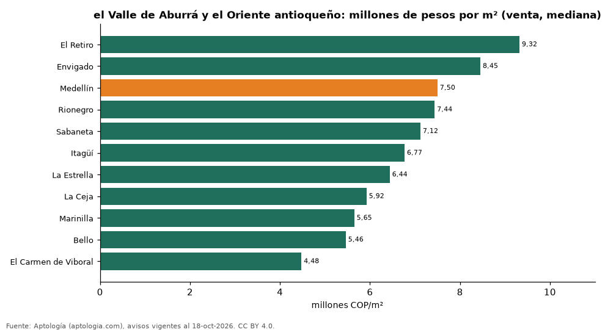

# Precio de la vivienda en el Valle de Aburrá y el Oriente antioqueño: Medellín y sus municipios vecinos (octubre 2026)

**En el Valle de Aburrá y el Oriente antioqueño, el metro cuadrado de apartamento más caro se pide en El Retiro (9,32 millones de pesos) y el más barato en El Carmen de Viboral (4,48 millones de pesos).** Medellín marca 7,50 millones de pesos por m² y un apartamento de 2 habitaciones se arrienda por 4.200.000 pesos al mes en la mediana.

*Resumen: comparamos 53.370 avisos de apartamentos en 11 municipios.*

**Actualizado:** 18 de octubre de 2026 (datos del 18 de octubre de 2026) · **Próxima actualización:** mensual.

## Resumen

| Indicador | Valor |
|---|---|
| Más caro (venta) | El Retiro: 9,32 millones de pesos/m² |
| Más barato (venta) | El Carmen de Viboral: 4,48 millones de pesos/m² |
| Medellín | 7,50 millones de pesos/m² |
| Arriendo 2 hab. en Medellín | 4.200.000 pesos |

## Municipios

| Municipio | Venta: pesos por m² | Arriendo 2 hab.: canon mensual | Avisos (venta / arriendo 2 hab.) |
|---|---|---|---|
| El Retiro | 9.321.839 | 4.300.000 | 618 / 346 |
| Envigado | 8.452.381 | 4.200.000 | 5.735 / 2.529 |
| Medellín | 7.500.000 | 4.200.000 | 20.515 / 6.601 |
| Rionegro | 7.437.500 | 2.600.000 | 3.023 / 1.750 |
| Sabaneta | 7.121.212 | 2.900.000 | 4.375 / 1.301 |
| Itagüí | 6.766.968 | 2.500.000 | 2.012 / 295 |
| La Estrella | 6.438.356 | 2.400.000 | 561 / 252 |
| La Ceja | 5.922.147 | 2.500.000 | 312 / 159 |
| Marinilla | 5.649.750 | 1.700.000 | 164 / 56 |
| Bello | 5.461.538 | 1.800.000 | 2.319 / 306 |
| El Carmen de Viboral | 4.475.422 | 1.400.000 | 90 / 51 |

Medianas; — indica menos de 30 avisos.

## Preguntas frecuentes

**¿Cuál es el municipio más caro en el Valle de Aburrá y el Oriente antioqueño?**
El Retiro, con 9.321.839 pesos por m² en apartamentos en venta.

**¿Es más barato vivir fuera de Medellín?**
En El Carmen de Viboral el m² se pide a 4.475.422 pesos, frente a 7.500.000 pesos en Medellín.

## Metodología

- **Fuente:** exportes nocturnos de la base de datos de Aptología (aptologia.com) del 18 de octubre de 2026: avisos vigentes de vivienda en portales inmobiliarios de 13 países, recogidos por Aptología y vistos en línea entre el 11 y el 18 de octubre de 2026. Corte: 18 de octubre de 2026.
- **Depuración:** se eliminan duplicados exactos (misma ciudad, zona, tipo, precio, moneda, área, habitaciones y baños) y los precios fuera del percentil 1–99 de cada país, operación, moneda y tipo; el precio por m² usa solo avisos con área declarada entre 12 y 2.000 m² y también se recorta al P1–P99.
- **Qué se mide:** precios pedidos (publicados), no precios de cierre. En arriendo, el canon mensual sin administración, gastos comunes ni condominio.
- **Muestra mínima:** cada cifra publicada se apoya en al menos 30 avisos; las celdas con menos se omiten.
- **Colombia:** Precios en pesos colombianos, sin conversión de moneda. Los indicadores de amoblado, mascotas, conjunto cerrado, balcón y aviso directo del dueño solo existen en arriendo y vienen de los portales.
- **Limitaciones:** la cobertura depende de los portales que recorre Aptología en cada país y es mayor en las ciudades grandes y en los segmentos medio-alto y alto; el área es la que declara el aviso, sin verificar; los nombres de zona vienen de los portales.
- **Privacidad:** solo se publican agregados; no se publica ningún dato personal, enlace a avisos ni nombre de anunciante.
- **Datos abiertos:** [datos.csv](datos.csv), licencia CC BY 4.0.

## Cómo citar

Pinzón Pineda, D. M. (2026). *Precio de la vivienda en el Valle de Aburrá y el Oriente antioqueño: Medellín y sus municipios vecinos (octubre 2026)*. Aptología (aptologia.com). https://github.com/elbroker/aptologia-datos/tree/main/estudios/vivienda-area-metropolitana-medellin-municipios-2026. Datos: datos.csv, licencia CC BY 4.0.
