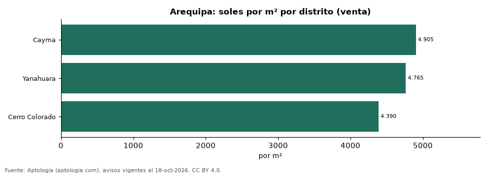

# Vivienda en Arequipa: precio por m², arriendo, habitaciones y rentabilidad (octubre 2026)

**El distrito con el metro cuadrado más caro de Arequipa es Cayma, con 4.905 soles (USD 1.428) en la mediana de departamentos en venta; el más barato de la muestra es Cerro Colorado, con 4.390 soles (USD 1.278).** La rentabilidad bruta implícita del arriendo es 5,7 % anual.

*Resumen: analizamos 570 avisos de departamentos en Arequipa (524 en venta y 46 en arriendo).*

**Actualizado:** 18 de octubre de 2026 (datos del 18 de octubre de 2026) · **Próxima actualización:** mensual.

## Resumen

| Indicador | Valor |
|---|---|
| Más caro (venta por m²) | Cayma: 4.905 soles (USD 1.428) |
| Más barato (venta por m²) | Cerro Colorado: 4.390 soles (USD 1.278) |
| Venta por m² (mediana) | 4.215 soles (USD 1.227) |
| Rentabilidad bruta implícita | 5,7 % |
| Avisos | 570 |

## Distritos (30 avisos o más)

| Distrito | Venta por m² (soles) | Arriendo mensual (soles) | Avisos (venta / arriendo) |
|---|---|---|---|
| Cayma | 4.905 | — | 118 / — |
| Yanahuara | 4.765 | — | 47 / — |
| Cerro Colorado | 4.390 | — | 108 / — |

Medianas de apartamentos; — indica menos de 30 avisos. El canon es mensual, sin administración ni gastos comunes.

## Precio por número de habitaciones

| Habitaciones | Precio de venta (mediana) | Arriendo mensual (mediana) | Avisos (venta / arriendo) |
|---|---|---|---|
| 2 | 387.180 soles (USD 112.699) | — | 64 / — |
| 3 o más | 533.532 soles (USD 155.299) | 2.900 soles (USD 844) | 414 / 35 |

## Preguntas frecuentes

**¿Cuál es el distrito más caro de Arequipa?**
Cayma, con 4.905 soles (USD 1.428) por m² en departamentos en venta (octubre de 2026).

**¿Dónde es más barato comprar apartamento en Arequipa?**
Entre los distritos con 30 avisos o más, en Cerro Colorado: 4.390 soles (USD 1.278) por m².

**¿Cuánto renta un departamento en Arequipa?**
La rentabilidad bruta implícita es 5,7 % anual (arriendo por m² × 12 ÷ precio de venta por m²), antes de gastos.

## Metodología

- **Fuente:** exportes nocturnos de la base de datos de Aptología (aptologia.com) del 18 de octubre de 2026: avisos vigentes de vivienda en portales inmobiliarios de 13 países, recogidos por Aptología y vistos en línea entre el 11 y el 18 de octubre de 2026. Corte: 18 de octubre de 2026.
- **Depuración:** se eliminan duplicados exactos (misma ciudad, zona, tipo, precio, moneda, área, habitaciones y baños) y los precios fuera del percentil 1–99 de cada país, operación, moneda y tipo; el precio por m² usa solo avisos con área declarada entre 12 y 2.000 m² y también se recorta al P1–P99.
- **Qué se mide:** precios pedidos (publicados), no precios de cierre. En arriendo, el canon mensual sin administración, gastos comunes ni condominio.
- **Muestra mínima:** cada cifra publicada se apoya en al menos 30 avisos; las celdas con menos se omiten.
- **Monedas:** nunca se mezclan avisos de monedas distintas sin convertirlos. Conversión a dólares con la tasa de mercado de ExchangeRate-API (open.er-api.com, actualización del 18 Oct 2026): 1 USD = 3.182,80 COP, 1 USD = 18,47 M.N, 1 USD = 5,09 BRL, 1 USD = 3,44 PEN, 1 USD = 982,44 CLP, 1 USD = 1.514,57 ARS, 1 USD = 40,20 UYU, 1 USD = 5.705,37 PYG, 1 USD = 61,27 DOP, 1 USD = 0,89 EUR, 1 USD = 11,72 BOB; la UF chilena a 41.178,64 CLP (mindicador,cl. 18-oct-2026). Los avisos publicados en dólares se usan tal cual.
- **Monedas:** venta en soles y arriendo en soles, la moneda mayoritaria de cada operación; los avisos en otra moneda se excluyen. Equivalencias en dólares con la tasa citada.
- **Limitaciones:** la cobertura depende de los portales que recorre Aptología en cada país y es mayor en las ciudades grandes y en los segmentos medio-alto y alto; el área es la que declara el aviso, sin verificar; los nombres de zona vienen de los portales.
- **Privacidad:** solo se publican agregados; no se publica ningún dato personal, enlace a avisos ni nombre de anunciante.
- **Datos abiertos:** [datos.csv](datos.csv), licencia CC BY 4.0.

## Cómo citar

Pinzón Pineda, D. M. (2026). *Vivienda en Arequipa: precio por m², arriendo, habitaciones y rentabilidad (octubre 2026)*. Aptología (aptologia.com). https://github.com/elbroker/aptologia-datos/tree/main/estudios/vivienda-arequipa-por-distrito-2026. Datos: datos.csv, licencia CC BY 4.0.
