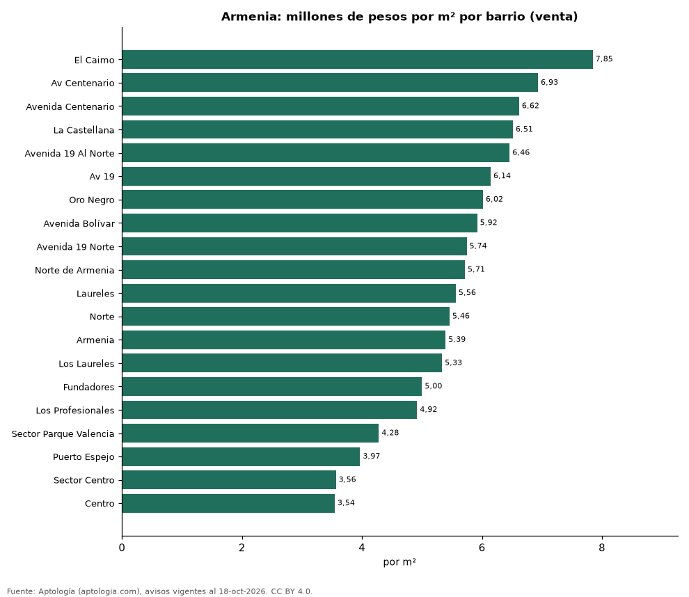
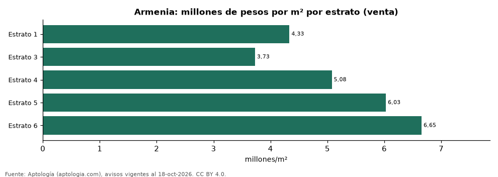

# Vivienda en Armenia: precio por m², arriendo, habitaciones, estrato y administración (octubre 2026)

**El barrio con el metro cuadrado más caro de Armenia es El Caimo, con 7,85 millones de pesos en la mediana de apartamentos en venta; el más barato de la muestra es Centro, con 3,54 millones de pesos.** Un apartamento de 2 habitaciones se arrienda por 2,25 millones de pesos al mes en la mediana y se vende por 350 millones de pesos. La rentabilidad bruta implícita del arriendo es 7,3 % anual. La administración equivale al 14,0 % del canon (350.000 pesos al mes en la mediana).

*Resumen: analizamos 2.659 avisos de apartamentos en Armenia (2.320 en venta y 339 en arriendo).*

**Actualizado:** 18 de octubre de 2026 (datos del 18 de octubre de 2026) · **Próxima actualización:** mensual.

## Resumen

| Indicador | Valor |
|---|---|
| Más caro (venta por m²) | El Caimo: 7,85 millones de pesos |
| Más barato (venta por m²) | Centro: 3,54 millones de pesos |
| Venta por m² (mediana) | 5,33 millones de pesos |
| Arriendo 2 habitaciones | 2,25 millones de pesos |
| Rentabilidad bruta implícita | 7,3 % |
| Administración / canon (mediana) | 14,0 % |
| Avisos | 2.659 |

## Barrios (30 avisos o más)

| Barrio | Venta por m² (millones de pesos) | Arriendo mensual (millones de pesos) | Avisos (venta / arriendo) |
|---|---|---|---|
| El Caimo | 7,85 | — | 34 / — |
| Av Centenario | 6,93 | — | 48 / — |
| Avenida Centenario | 6,62 | 3,00 | 213 / 30 |
| La Castellana | 6,51 | 2,56 | 128 / 33 |
| Avenida 19 Al Norte | 6,46 | — | 30 / — |
| Av 19 | 6,14 | — | 30 / — |
| Oro Negro | 6,02 | — | 87 / — |
| Avenida Bolívar | 5,92 | — | 42 / — |
| Avenida 19 Norte | 5,74 | — | 73 / — |
| Norte de Armenia | 5,71 | — | 73 / — |
| Laureles | 5,56 | — | 52 / — |
| Norte | 5,46 | — | 64 / — |
| Armenia | 5,39 | — | 71 / — |
| Los Laureles | 5,33 | — | 35 / — |
| Fundadores | 5,00 | — | 50 / — |
| Los Profesionales | 4,92 | — | 39 / — |
| Sector Parque Valencia | 4,28 | — | 36 / — |
| Puerto Espejo | 3,97 | — | 130 / — |
| Sector Centro | 3,56 | — | 31 / — |
| Centro | 3,54 | — | 42 / — |

Medianas de apartamentos; — indica menos de 30 avisos. El canon es mensual, sin administración ni gastos comunes.

## Precio por número de habitaciones

| Habitaciones | Precio de venta (mediana) | Arriendo mensual (mediana) | Avisos (venta / arriendo) |
|---|---|---|---|
| 1 | 329 millones de pesos | — | 85 / — |
| 2 | 350 millones de pesos | 2,25 millones de pesos | 778 / 149 |
| 3 o más | 430 millones de pesos | 2,70 millones de pesos | 1.451 / 173 |

## Por estrato

| Estrato | Venta por m² (millones) | Arriendo mensual (millones) | Avisos (venta / arriendo) |
|---|---|---|---|
| 1 | 4,33 | — | 33 / — |
| 3 | 3,73 | 1,20 | 445 / 44 |
| 4 | 5,08 | 2,20 | 449 / 61 |
| 5 | 6,03 | 2,60 | 1.091 / 177 |
| 6 | 6,65 | 3,39 | 225 / 42 |

Medianas; — indica menos de 30 avisos.

## Preguntas frecuentes

**¿Cuál es el barrio más caro de Armenia?**
El Caimo, con 7,85 millones de pesos por m² en apartamentos en venta (octubre de 2026).

**¿Dónde es más barato comprar apartamento en Armenia?**
Entre los barrios con 30 avisos o más, en Centro: 3,54 millones de pesos por m².

**¿Cuánto renta un apartamento en Armenia?**
La rentabilidad bruta implícita es 7,3 % anual (arriendo por m² × 12 ÷ precio de venta por m²), antes de gastos.

**¿Cuánto cuesta arrendar un apartamento de 2 habitaciones en Armenia?**
2,25 millones de pesos al mes en la mediana (octubre de 2026).

## Metodología

- **Fuente:** exportes nocturnos de la base de datos de Aptología (aptologia.com) del 18 de octubre de 2026: avisos vigentes de vivienda en portales inmobiliarios de 13 países, recogidos por Aptología y vistos en línea entre el 11 y el 18 de octubre de 2026. Corte: 18 de octubre de 2026.
- **Depuración:** se eliminan duplicados exactos (misma ciudad, zona, tipo, precio, moneda, área, habitaciones y baños) y los precios fuera del percentil 1–99 de cada país, operación, moneda y tipo; el precio por m² usa solo avisos con área declarada entre 12 y 2.000 m² y también se recorta al P1–P99.
- **Qué se mide:** precios pedidos (publicados), no precios de cierre. En arriendo, el canon mensual sin administración, gastos comunes ni condominio.
- **Muestra mínima:** cada cifra publicada se apoya en al menos 30 avisos; las celdas con menos se omiten.
- **Colombia:** Precios en pesos colombianos, sin conversión de moneda. Administración ÷ canon con razones entre 1 % y 80 %.
- **Limitaciones:** la cobertura depende de los portales que recorre Aptología en cada país y es mayor en las ciudades grandes y en los segmentos medio-alto y alto; el área es la que declara el aviso, sin verificar; los nombres de zona vienen de los portales.
- **Privacidad:** solo se publican agregados; no se publica ningún dato personal, enlace a avisos ni nombre de anunciante.
- **Datos abiertos:** [datos.csv](datos.csv), licencia CC BY 4.0.

## Cómo citar

Pinzón Pineda, D. M. (2026). *Vivienda en Armenia: precio por m², arriendo, habitaciones, estrato y administración (octubre 2026)*. Aptología (aptologia.com). https://github.com/elbroker/aptologia-datos/tree/main/estudios/vivienda-armenia-venta-arriendo-estrato-2026. Datos: datos.csv, licencia CC BY 4.0.
