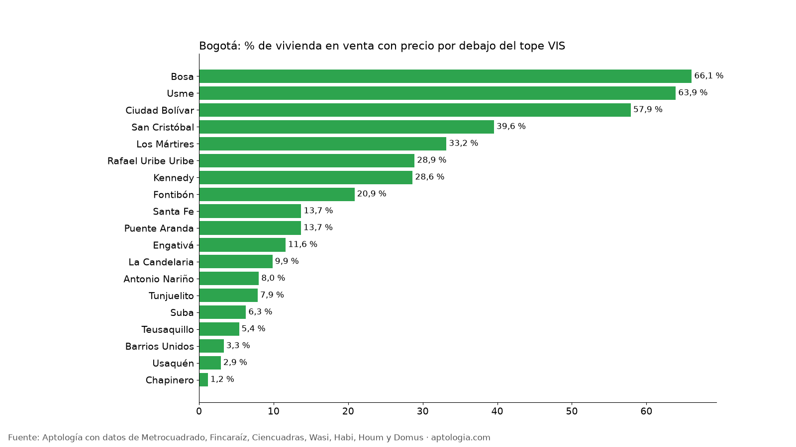

# Vivienda bajo el tope VIS en Bogotá: cuánta oferta en venta cuesta menos de 150 salarios mínimos (octubre 2026)

**Solo el 9,6 % de la vivienda usada y nueva publicada en venta en Bogotá pide un precio igual o menor al tope VIS de 2026 ($263 millones, 150 salarios mínimos); bajo el tope VIP ($158 millones) está el 0,7 %.** La localidad con más oferta a ese precio es Bosa, donde el 66,1 % de los avisos queda por debajo del tope.

*Resumen: comparamos el precio de 57.725 viviendas en venta únicas en Bogotá con los topes VIS y VIP de 2026.*

**Actualizado:** 18 de octubre de 2026 (datos del 18 de octubre de 2026) · **Próxima actualización:** mensual.

## Resumen

| Indicador | Valor |
|---|---|
| Tope VIS 2026 (150 SMMLV) | $262.635.750 |
| Tope VIP 2026 (90 SMMLV) | $157.581.450 |
| Viviendas en venta analizadas | 57.725 |
| Con precio ≤ tope VIS | 5.549 (9,6 %) |
| Con precio ≤ tope VIP | 0,7 % |
| Área mediana de los apartamentos bajo el tope VIS | 43 m² |
| Estrato más común bajo el tope VIS | 3 |

## Por localidad (80 avisos o más)

| Localidad | % bajo VIS | % bajo VIP | Avisos bajo VIS | Precio mediano | Avisos |
|---|---|---|---|---|---|
| Bosa | 66,1 % | 9,9 % | 678 | $208 millones | 1.026 |
| Usme | 63,9 % | 32,2 % | 250 | $210 millones | 391 |
| Ciudad Bolívar | 57,9 % | 2,6 % | 359 | $250 millones | 620 |
| San Cristóbal | 39,6 % | 7,8 % | 214 | $315 millones | 541 |
| Los Mártires | 33,2 % | 1,3 % | 212 | $338 millones | 639 |
| Rafael Uribe Uribe | 28,9 % | 2,1 % | 207 | $405 millones | 716 |
| Kennedy | 28,6 % | 1,6 % | 772 | $400 millones | 2.695 |
| Fontibón | 20,9 % | 0,4 % | 495 | $519 millones | 2.373 |
| Santa Fe | 13,7 % | 0,7 % | 168 | $468 millones | 1.226 |
| Puente Aranda | 13,7 % | 0,0 % | 143 | $630 millones | 1.046 |
| Engativá | 11,6 % | 0,1 % | 299 | $495 millones | 2.575 |
| La Candelaria | 9,9 % | 0,0 % | 20 | $560 millones | 203 |
| Antonio Nariño | 8,0 % | 0,0 % | 37 | $640 millones | 461 |
| Tunjuelito | 7,9 % | 0,5 % | 17 | $600 millones | 216 |
| Suba | 6,3 % | 0,1 % | 777 | $1,05 mil millones | 12.346 |
| Teusaquillo | 5,4 % | 0,0 % | 140 | $800 millones | 2.606 |
| Barrios Unidos | 3,3 % | 0,0 % | 72 | $850 millones | 2.173 |
| Usaquén | 2,9 % | 0,0 % | 466 | $950 millones | 15.929 |
| Chapinero | 1,2 % | 0,0 % | 100 | $1,65 mil millones | 8.423 |

## Por estrato

| Estrato | % bajo VIS | % bajo VIP | Precio mediano | Avisos |
|---|---|---|---|---|
| 1 | 40,6 % | 10,3 % | $360 millones | 406 |
| 2 | 50,3 % | 8,2 % | $260 millones | 3.374 |
| 3 | 24,5 % | 0,5 % | $380 millones | 12.379 |
| 4 | 3,4 % | 0,0 % | $650 millones | 12.198 |
| 5 | 0,4 % | 0,0 % | $1,10 mil millones | 10.273 |
| 6 | 0,2 % | 0,0 % | $1,65 mil millones | 18.273 |

**Cómo usarlo para decidir:** los subsidios y el ahorro programado de vivienda de interés social aplican a vivienda nueva que cumpla las condiciones del programa; esta tabla muestra cuánta oferta publicada (sobre todo usada) cae por debajo de esos precios, como referencia de lo que se consigue con ese presupuesto. Confirma con la constructora o la caja de compensación si un inmueble concreto es VIS.

## Preguntas frecuentes

**¿Cuál es el tope de la vivienda VIS en 2026?**
150 salarios mínimos mensuales: $262.635.750 con el salario mínimo de 2026 ($1.750.905). El tope VIP es de 90 salarios: $157.581.450.

**¿Cuánta vivienda en venta en Bogotá cuesta menos que el tope VIS?**
El 9,6 % de los avisos de vivienda en venta analizados (5.549 de 57.725).

**¿En qué localidad de Bogotá hay más vivienda por debajo del tope VIS?**
En Bosa: el 66,1 % de su oferta en venta pide $263 millones o menos.

## Metodología

- **Fuente:** avisos vivos de vivienda recogidos por la ingesta de Aptología en Metrocuadrado, Fincaraíz, Ciencuadras, Wasi, Habi, Houm y Domus, del 11 al 18 de octubre de 2026. Corte: 18 de octubre de 2026.
- **Depuración:** un mismo inmueble publicado varias veces se cuenta una sola vez (agrupación por portal y, entre portales, por precio, área, habitaciones y coordenadas). Se descartan precios y áreas fuera de rango y, en arriendo, se resta la administración cuando el portal la incluye en el canon.
- **Qué se mide:** precios pedidos (publicados), no precios de cierre.
- **Topes:** VIS = 150 SMMLV = $262.635.750; VIP = 90 SMMLV = $157.581.450, con el salario mínimo de 2026 ($1.750.905). Se comparan con el precio pedido; no se verifica si el inmueble está certificado como VIS.
- **Limitaciones:** son precios pedidos en portales, que pueden diferir del valor final de arriendo o venta. La cobertura es mayor en el norte de Bogotá y en estratos 4 a 6, porque ahí se concentra la oferta publicada. Los barrios y la localidad vienen de lo que escribe cada portal; cuando falta la localidad se asigna por los avisos vecinos más cercanos.
- **Datos abiertos:** [datos.csv](datos.csv), licencia CC BY 4.0.

## Cómo citar

Pinzón Pineda, D. M. (2026). *Vivienda bajo el tope VIS en Bogotá: cuánta oferta en venta cuesta menos de 150 salarios mínimos (octubre 2026)*. Aptología. https://www.aptologia.com/estudios/vivienda-bajo-tope-vis-bogota-2026. Datos: datos.csv, licencia CC BY 4.0.
