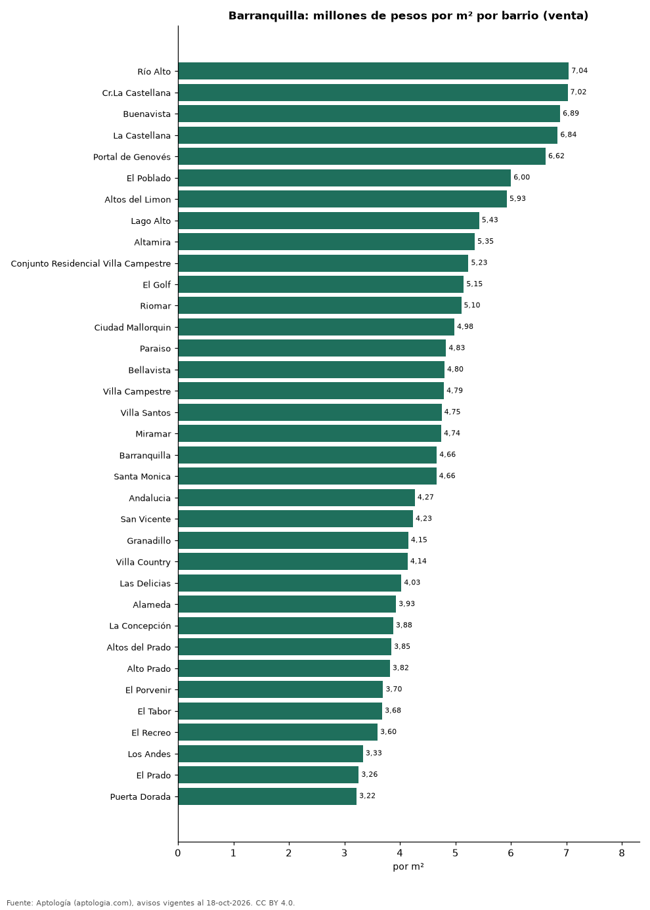
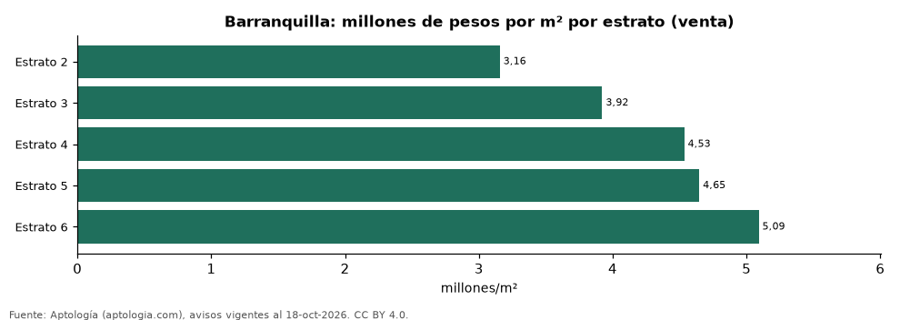

# Vivienda en Barranquilla: precio por m², arriendo, habitaciones, estrato y administración (octubre 2026)

**El barrio con el metro cuadrado más caro de Barranquilla es Río Alto, con 7,04 millones de pesos en la mediana de apartamentos en venta; el más barato de la muestra es Puerta Dorada, con 3,22 millones de pesos.** Un apartamento de 2 habitaciones se arrienda por 2,30 millones de pesos al mes en la mediana y se vende por 340 millones de pesos. La rentabilidad bruta implícita del arriendo es 8,9 % anual. La administración equivale al 16,7 % del canon (457.750 pesos al mes en la mediana).

*Resumen: analizamos 11.729 avisos de apartamentos en Barranquilla (7.903 en venta y 3.826 en arriendo).*

**Actualizado:** 18 de octubre de 2026 (datos del 18 de octubre de 2026) · **Próxima actualización:** mensual.

## Resumen

| Indicador | Valor |
|---|---|
| Más caro (venta por m²) | Río Alto: 7,04 millones de pesos |
| Más barato (venta por m²) | Puerta Dorada: 3,22 millones de pesos |
| Venta por m² (mediana) | 4,53 millones de pesos |
| Arriendo 2 habitaciones | 2,30 millones de pesos |
| Rentabilidad bruta implícita | 8,9 % |
| Administración / canon (mediana) | 16,7 % |
| Avisos | 11.729 |

## Barrios (30 avisos o más)

| Barrio | Venta por m² (millones de pesos) | Arriendo mensual (millones de pesos) | Avisos (venta / arriendo) |
|---|---|---|---|
| Río Alto | 7,04 | 3,50 | 134 / 92 |
| Cr.La Castellana | 7,02 | 4,98 | 50 / 46 |
| Buenavista | 6,89 | 5,50 | 222 / 84 |
| La Castellana | 6,84 | 5,00 | 67 / 56 |
| Portal de Genovés | 6,62 | — | 62 / — |
| El Poblado | 6,00 | — | 75 / — |
| Altos del Limon | 5,93 | 3,45 | 99 / 67 |
| Lago Alto | 5,43 | 3,80 | 81 / 43 |
| Altamira | 5,35 | 2,80 | 39 / 32 |
| Conjunto Residencial Villa Campestre | 5,23 | 2,38 | 72 / 46 |
| El Golf | 5,15 | 4,90 | 150 / 47 |
| Riomar | 5,10 | 4,10 | 340 / 207 |
| Ciudad Mallorquin | 4,98 | 1,75 | 121 / 142 |
| Paraiso | 4,83 | 2,30 | 175 / 92 |
| Bellavista | 4,80 | — | 61 / — |
| Villa Campestre | 4,79 | 3,12 | 173 / 110 |
| Villa Santos | 4,75 | 3,15 | 379 / 201 |
| Miramar | 4,74 | 2,20 | 344 / 185 |
| Barranquilla | 4,66 | 4,45 | 83 / 49 |
| Santa Monica | 4,66 | — | 39 / — |
| Villa Carolina | 4,65 | 2,70 | 134 / 74 |
| La Campiña | 4,57 | 2,65 | 76 / 39 |
| Betania | 4,52 | — | 53 / — |
| Los Alpes | 4,45 | — | 54 / — |
| Altos de Riomar | 4,36 | 3,73 | 513 / 210 |
| Nuevo Horizonte | 4,35 | — | 76 / — |
| Ciudad Jardín | 4,32 | 2,31 | 288 / 96 |
| Boston | 4,32 | 1,88 | 132 / 50 |
| Alameda del Río | 4,27 | 1,39 | 356 / 252 |
| Andalucia | 4,27 | 2,60 | 110 / 51 |
| San Vicente | 4,23 | 2,50 | 112 / 87 |
| Granadillo | 4,15 | — | 61 / — |
| Villa Country | 4,14 | 3,56 | 165 / 82 |
| Las Delicias | 4,03 | — | 68 / — |
| Alameda | 3,93 | — | 85 / — |
| La Concepción | 3,88 | — | 64 / — |
| Altos del Prado | 3,85 | 4,00 | 461 / 199 |
| Alto Prado | 3,82 | 3,75 | 421 / 169 |
| El Porvenir | 3,70 | 1,80 | 75 / 68 |
| El Tabor | 3,68 | 2,90 | 83 / 59 |
| El Recreo | 3,60 | — | 71 / — |
| Los Andes | 3,33 | — | 31 / — |
| El Prado | 3,26 | 1,95 | 176 / 50 |
| Puerta Dorada | 3,22 | — | 55 / — |
| El Castillo | — | 4,70 | — / 68 |

Medianas de apartamentos; — indica menos de 30 avisos. El canon es mensual, sin administración ni gastos comunes.

## Precio por número de habitaciones

| Habitaciones | Precio de venta (mediana) | Arriendo mensual (mediana) | Avisos (venta / arriendo) |
|---|---|---|---|
| 1 | 340 millones de pesos | 2,31 millones de pesos | 245 / 339 |
| 2 | 340 millones de pesos | 2,30 millones de pesos | 1.855 / 1.442 |
| 3 o más | 510 millones de pesos | 3,43 millones de pesos | 5.796 / 2.036 |

## Por estrato

| Estrato | Venta por m² (millones) | Arriendo mensual (millones) | Avisos (venta / arriendo) |
|---|---|---|---|
| 2 | 3,16 | 1,03 | 138 / 48 |
| 3 | 3,92 | 1,50 | 884 / 580 |
| 4 | 4,53 | 2,40 | 2.252 / 1.084 |
| 5 | 4,65 | 3,20 | 1.974 / 1.134 |
| 6 | 5,09 | 4,50 | 2.119 / 957 |

Medianas; — indica menos de 30 avisos.

## Preguntas frecuentes

**¿Cuál es el barrio más caro de Barranquilla?**
Río Alto, con 7,04 millones de pesos por m² en apartamentos en venta (octubre de 2026).

**¿Dónde es más barato comprar apartamento en Barranquilla?**
Entre los barrios con 30 avisos o más, en Puerta Dorada: 3,22 millones de pesos por m².

**¿Cuánto renta un apartamento en Barranquilla?**
La rentabilidad bruta implícita es 8,9 % anual (arriendo por m² × 12 ÷ precio de venta por m²), antes de gastos.

**¿Cuánto cuesta arrendar un apartamento de 2 habitaciones en Barranquilla?**
2,30 millones de pesos al mes en la mediana (octubre de 2026).

## Metodología

- **Fuente:** exportes nocturnos de la base de datos de Aptología (aptologia.com) del 18 de octubre de 2026: avisos vigentes de vivienda en portales inmobiliarios de 13 países, recogidos por Aptología y vistos en línea entre el 11 y el 18 de octubre de 2026. Corte: 18 de octubre de 2026.
- **Depuración:** se eliminan duplicados exactos (misma ciudad, zona, tipo, precio, moneda, área, habitaciones y baños) y los precios fuera del percentil 1–99 de cada país, operación, moneda y tipo; el precio por m² usa solo avisos con área declarada entre 12 y 2.000 m² y también se recorta al P1–P99.
- **Qué se mide:** precios pedidos (publicados), no precios de cierre. En arriendo, el canon mensual sin administración, gastos comunes ni condominio.
- **Muestra mínima:** cada cifra publicada se apoya en al menos 30 avisos; las celdas con menos se omiten.
- **Colombia:** Precios en pesos colombianos, sin conversión de moneda. Administración ÷ canon con razones entre 1 % y 80 %.
- **Limitaciones:** la cobertura depende de los portales que recorre Aptología en cada país y es mayor en las ciudades grandes y en los segmentos medio-alto y alto; el área es la que declara el aviso, sin verificar; los nombres de zona vienen de los portales.
- **Privacidad:** solo se publican agregados; no se publica ningún dato personal, enlace a avisos ni nombre de anunciante.
- **Datos abiertos:** [datos.csv](datos.csv), licencia CC BY 4.0.

## Cómo citar

Pinzón Pineda, D. M. (2026). *Vivienda en Barranquilla: precio por m², arriendo, habitaciones, estrato y administración (octubre 2026)*. Aptología (aptologia.com). https://github.com/elbroker/aptologia-datos/tree/main/estudios/vivienda-barranquilla-venta-arriendo-rentabilidad-2026. Datos: datos.csv, licencia CC BY 4.0.
