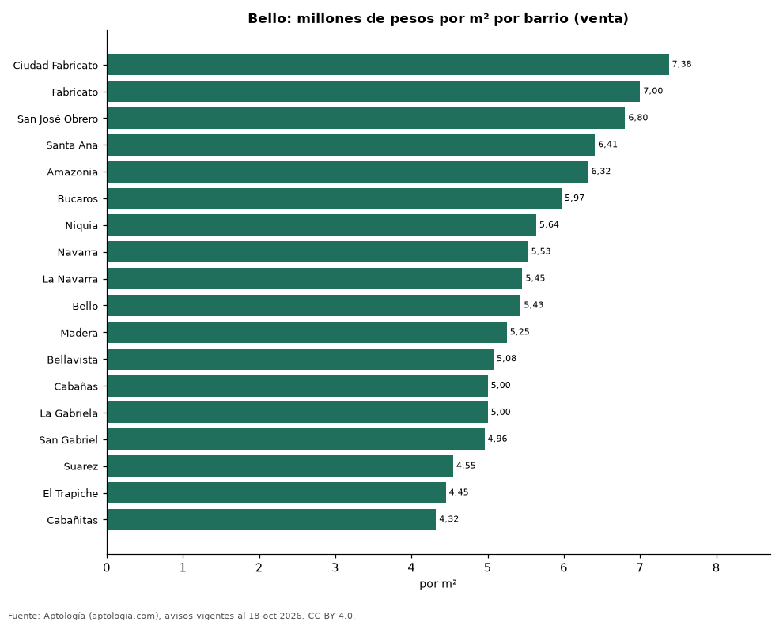
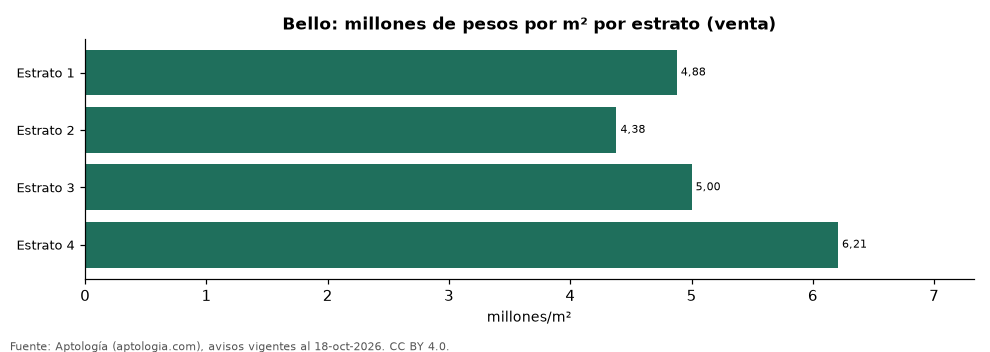

# Vivienda en Bello: precio por m², arriendo, habitaciones, estrato y administración (octubre 2026)

**El barrio con el metro cuadrado más caro de Bello es Ciudad Fabricato, con 7,38 millones de pesos en la mediana de apartamentos en venta; el más barato de la muestra es Cabañitas, con 4,32 millones de pesos.** Un apartamento de 2 habitaciones se arrienda por 1,80 millones de pesos al mes en la mediana y se vende por 320 millones de pesos. La rentabilidad bruta implícita del arriendo es 7,3 % anual.

*Resumen: analizamos 3.437 avisos de apartamentos en Bello (2.347 en venta y 1.090 en arriendo).*

**Actualizado:** 18 de octubre de 2026 (datos del 18 de octubre de 2026) · **Próxima actualización:** mensual.

## Resumen

| Indicador | Valor |
|---|---|
| Más caro (venta por m²) | Ciudad Fabricato: 7,38 millones de pesos |
| Más barato (venta por m²) | Cabañitas: 4,32 millones de pesos |
| Venta por m² (mediana) | 5,46 millones de pesos |
| Arriendo 2 habitaciones | 1,80 millones de pesos |
| Rentabilidad bruta implícita | 7,3 % |
| Avisos | 3.437 |

## Barrios (30 avisos o más)

| Barrio | Venta por m² (millones de pesos) | Arriendo mensual (millones de pesos) | Avisos (venta / arriendo) |
|---|---|---|---|
| Ciudad Fabricato | 7,38 | — | 40 / — |
| Fabricato | 7,00 | — | 75 / — |
| San José Obrero | 6,80 | — | 39 / — |
| Santa Ana | 6,41 | 2,27 | 195 / 106 |
| Amazonia | 6,32 | 2,40 | 71 / 55 |
| Bucaros | 5,97 | 1,93 | 68 / 76 |
| Niquia | 5,64 | 2,00 | 292 / 109 |
| Navarra | 5,53 | — | 72 / — |
| La Navarra | 5,45 | 1,80 | 69 / 45 |
| Bello | 5,43 | 2,00 | 90 / 62 |
| Madera | 5,25 | — | 83 / — |
| Bellavista | 5,08 | 2,00 | 39 / 32 |
| Cabañas | 5,00 | 2,29 | 113 / 50 |
| La Gabriela | 5,00 | 1,90 | 53 / 41 |
| San Gabriel | 4,96 | — | 42 / — |
| Suarez | 4,55 | — | 31 / — |
| El Trapiche | 4,45 | — | 48 / — |
| Cabañitas | 4,32 | — | 39 / — |

Medianas de apartamentos; — indica menos de 30 avisos. El canon es mensual, sin administración ni gastos comunes.

## Precio por número de habitaciones

| Habitaciones | Precio de venta (mediana) | Arriendo mensual (mediana) | Avisos (venta / arriendo) |
|---|---|---|---|
| 2 | 320 millones de pesos | 1,80 millones de pesos | 646 / 306 |
| 3 o más | 350 millones de pesos | 2,20 millones de pesos | 1.668 / 768 |

## Por estrato

| Estrato | Venta por m² (millones) | Arriendo mensual (millones) | Avisos (venta / arriendo) |
|---|---|---|---|
| 1 | 4,88 | — | 35 / — |
| 2 | 4,38 | — | 86 / — |
| 3 | 5,00 | 1,82 | 1.087 / 569 |
| 4 | 6,21 | 2,35 | 955 / 479 |

Medianas; — indica menos de 30 avisos.

## Preguntas frecuentes

**¿Cuál es el barrio más caro de Bello?**
Ciudad Fabricato, con 7,38 millones de pesos por m² en apartamentos en venta (octubre de 2026).

**¿Dónde es más barato comprar apartamento en Bello?**
Entre los barrios con 30 avisos o más, en Cabañitas: 4,32 millones de pesos por m².

**¿Cuánto renta un apartamento en Bello?**
La rentabilidad bruta implícita es 7,3 % anual (arriendo por m² × 12 ÷ precio de venta por m²), antes de gastos.

**¿Cuánto cuesta arrendar un apartamento de 2 habitaciones en Bello?**
1,80 millones de pesos al mes en la mediana (octubre de 2026).

## Metodología

- **Fuente:** exportes nocturnos de la base de datos de Aptología (aptologia.com) del 18 de octubre de 2026: avisos vigentes de vivienda en portales inmobiliarios de 13 países, recogidos por Aptología y vistos en línea entre el 11 y el 18 de octubre de 2026. Corte: 18 de octubre de 2026.
- **Depuración:** se eliminan duplicados exactos (misma ciudad, zona, tipo, precio, moneda, área, habitaciones y baños) y los precios fuera del percentil 1–99 de cada país, operación, moneda y tipo; el precio por m² usa solo avisos con área declarada entre 12 y 2.000 m² y también se recorta al P1–P99.
- **Qué se mide:** precios pedidos (publicados), no precios de cierre. En arriendo, el canon mensual sin administración, gastos comunes ni condominio.
- **Muestra mínima:** cada cifra publicada se apoya en al menos 30 avisos; las celdas con menos se omiten.
- **Colombia:** Precios en pesos colombianos, sin conversión de moneda. Administración ÷ canon con razones entre 1 % y 80 %.
- **Limitaciones:** la cobertura depende de los portales que recorre Aptología en cada país y es mayor en las ciudades grandes y en los segmentos medio-alto y alto; el área es la que declara el aviso, sin verificar; los nombres de zona vienen de los portales.
- **Privacidad:** solo se publican agregados; no se publica ningún dato personal, enlace a avisos ni nombre de anunciante.
- **Datos abiertos:** [datos.csv](datos.csv), licencia CC BY 4.0.

## Cómo citar

Pinzón Pineda, D. M. (2026). *Vivienda en Bello: precio por m², arriendo, habitaciones, estrato y administración (octubre 2026)*. Aptología (aptologia.com). https://github.com/elbroker/aptologia-datos/tree/main/estudios/vivienda-bello-venta-arriendo-estrato-2026. Datos: datos.csv, licencia CC BY 4.0.
