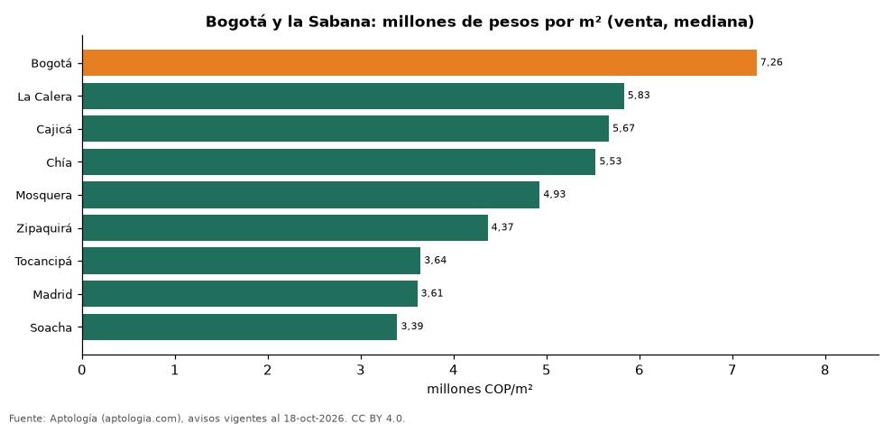

# Precio de la vivienda en Bogotá y la Sabana: Bogotá y sus municipios vecinos (octubre 2026)

**En Bogotá y la Sabana, el metro cuadrado de apartamento más caro se pide en Bogotá (7,26 millones de pesos) y el más barato en Soacha (3,39 millones de pesos).** En Bogotá, un apartamento de 2 habitaciones se arrienda por 2.646.500 pesos al mes en la mediana.

*Resumen: comparamos 42.514 avisos de apartamentos en 9 municipios.*

**Actualizado:** 18 de octubre de 2026 (datos del 18 de octubre de 2026) · **Próxima actualización:** mensual.

## Resumen

| Indicador | Valor |
|---|---|
| Más caro (venta) | Bogotá: 7,26 millones de pesos/m² |
| Más barato (venta) | Soacha: 3,39 millones de pesos/m² |
| Bogotá | 7,26 millones de pesos/m² |
| Arriendo 2 hab. en Bogotá | 2.646.500 pesos |

## Municipios

| Municipio | Venta: pesos por m² | Arriendo 2 hab.: canon mensual | Avisos (venta / arriendo 2 hab.) |
|---|---|---|---|
| Bogotá | 7.261.905 | 2.646.500 | 31.265 / 4.530 |
| La Calera | 5.833.333 | — | 139 / s. d. |
| Cajicá | 5.671.642 | 1.900.000 | 1.517 / 206 |
| Chía | 5.529.412 | 1.550.000 | 1.507 / 233 |
| Mosquera | 4.926.471 | 1.250.000 | 817 / 43 |
| Zipaquirá | 4.366.197 | — | 819 / s. d. |
| Tocancipá | 3.644.068 | — | 264 / s. d. |
| Madrid | 3.607.843 | 1.200.000 | 475 / 60 |
| Soacha | 3.393.617 | 950.000 | 566 / 73 |

Medianas; — indica menos de 30 avisos.

## Preguntas frecuentes

**¿Cuál es el municipio más caro en Bogotá y la Sabana?**
Bogotá, con 7.261.905 pesos por m² en apartamentos en venta.

**¿Es más barato vivir fuera de Bogotá?**
En Soacha el m² se pide a 3.393.617 pesos, frente a 7.261.905 pesos en Bogotá.

## Metodología

- **Fuente:** exportes nocturnos de la base de datos de Aptología (aptologia.com) del 18 de octubre de 2026: avisos vigentes de vivienda en portales inmobiliarios de 13 países, recogidos por Aptología y vistos en línea entre el 11 y el 18 de octubre de 2026. Corte: 18 de octubre de 2026.
- **Depuración:** se eliminan duplicados exactos (misma ciudad, zona, tipo, precio, moneda, área, habitaciones y baños) y los precios fuera del percentil 1–99 de cada país, operación, moneda y tipo; el precio por m² usa solo avisos con área declarada entre 12 y 2.000 m² y también se recorta al P1–P99.
- **Qué se mide:** precios pedidos (publicados), no precios de cierre. En arriendo, el canon mensual sin administración, gastos comunes ni condominio.
- **Muestra mínima:** cada cifra publicada se apoya en al menos 30 avisos; las celdas con menos se omiten.
- **Colombia:** Precios en pesos colombianos, sin conversión de moneda. Los indicadores de amoblado, mascotas, conjunto cerrado, balcón y aviso directo del dueño solo existen en arriendo y vienen de los portales.
- **Limitaciones:** la cobertura depende de los portales que recorre Aptología en cada país y es mayor en las ciudades grandes y en los segmentos medio-alto y alto; el área es la que declara el aviso, sin verificar; los nombres de zona vienen de los portales.
- **Privacidad:** solo se publican agregados; no se publica ningún dato personal, enlace a avisos ni nombre de anunciante.
- **Datos abiertos:** [datos.csv](datos.csv), licencia CC BY 4.0.

## Cómo citar

Pinzón Pineda, D. M. (2026). *Precio de la vivienda en Bogotá y la Sabana: Bogotá y sus municipios vecinos (octubre 2026)*. Aptología (aptologia.com). https://github.com/elbroker/aptologia-datos/tree/main/estudios/vivienda-bogota-y-sabana-municipios-2026. Datos: datos.csv, licencia CC BY 4.0.
