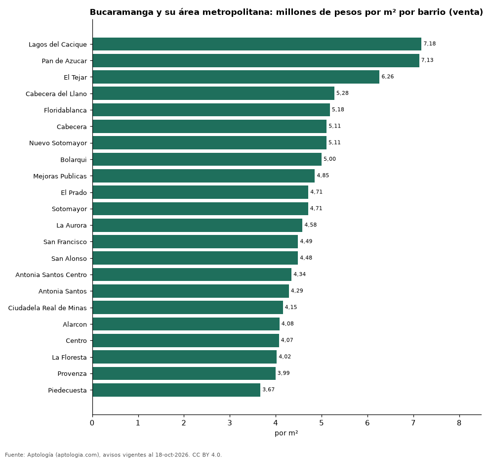
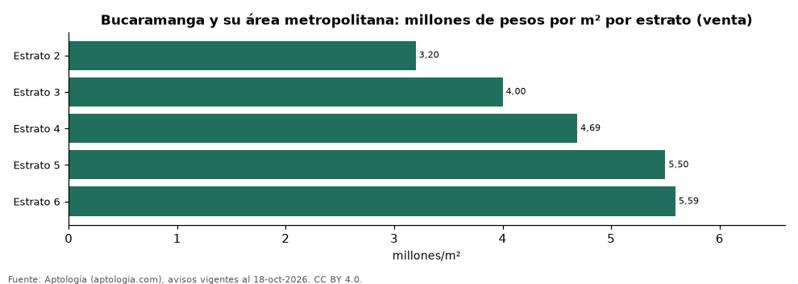

# Vivienda en Bucaramanga y su área metropolitana: precio por m², arriendo, habitaciones, estrato y administración (octubre 2026)

**El barrio con el metro cuadrado más caro de Bucaramanga y su área metropolitana es Lagos del Cacique, con 7,18 millones de pesos en la mediana de apartamentos en venta; el más barato de la muestra es Piedecuesta, con 3,67 millones de pesos.** Un apartamento de 2 habitaciones se arrienda por 1,93 millones de pesos al mes en la mediana y se vende por 319 millones de pesos. La rentabilidad bruta implícita del arriendo es 7,4 % anual. La administración equivale al 17,9 % del canon (416.000 pesos al mes en la mediana).

*Resumen: analizamos 4.578 avisos de apartamentos en Bucaramanga y su área metropolitana (3.706 en venta y 872 en arriendo).*

**Actualizado:** 18 de octubre de 2026 (datos del 18 de octubre de 2026) · **Próxima actualización:** mensual.

## Resumen

| Indicador | Valor |
|---|---|
| Más caro (venta por m²) | Lagos del Cacique: 7,18 millones de pesos |
| Más barato (venta por m²) | Piedecuesta: 3,67 millones de pesos |
| Venta por m² (mediana) | 4,76 millones de pesos |
| Arriendo 2 habitaciones | 1,93 millones de pesos |
| Rentabilidad bruta implícita | 7,4 % |
| Administración / canon (mediana) | 17,9 % |
| Avisos | 4.578 |

## Barrios (30 avisos o más)

| Barrio | Venta por m² (millones de pesos) | Arriendo mensual (millones de pesos) | Avisos (venta / arriendo) |
|---|---|---|---|
| Lagos del Cacique | 7,18 | — | 30 / — |
| Pan de Azucar | 7,13 | — | 39 / — |
| El Tejar | 6,26 | — | 79 / — |
| Cabecera del Llano | 5,28 | 3,58 | 353 / 66 |
| Floridablanca | 5,18 | 2,40 | 927 / 367 |
| Cabecera | 5,11 | — | 31 / — |
| Nuevo Sotomayor | 5,11 | — | 63 / — |
| Bolarqui | 5,00 | — | 36 / — |
| Mejoras Publicas | 4,85 | — | 94 / — |
| El Prado | 4,71 | — | 53 / — |
| Sotomayor | 4,71 | — | 213 / — |
| La Aurora | 4,58 | — | 61 / — |
| San Francisco | 4,49 | — | 99 / — |
| San Alonso | 4,48 | — | 65 / — |
| Antonia Santos Centro | 4,34 | — | 63 / — |
| Antonia Santos | 4,29 | — | 41 / — |
| Ciudadela Real de Minas | 4,15 | — | 64 / — |
| Alarcon | 4,08 | — | 34 / — |
| Centro | 4,07 | — | 41 / — |
| La Floresta | 4,02 | — | 48 / — |
| Provenza | 3,99 | — | 58 / — |
| Piedecuesta | 3,67 | 1,30 | 248 / 68 |

Medianas de apartamentos; — indica menos de 30 avisos. El canon es mensual, sin administración ni gastos comunes.

## Precio por número de habitaciones

| Habitaciones | Precio de venta (mediana) | Arriendo mensual (mediana) | Avisos (venta / arriendo) |
|---|---|---|---|
| 2 | 319 millones de pesos | 1,93 millones de pesos | 525 / 194 |
| 3 o más | 440 millones de pesos | 2,47 millones de pesos | 3.148 / 665 |

## Por estrato

| Estrato | Venta por m² (millones) | Arriendo mensual (millones) | Avisos (venta / arriendo) |
|---|---|---|---|
| 2 | 3,20 | 1,10 | 46 / 39 |
| 3 | 4,00 | 1,40 | 667 / 164 |
| 4 | 4,69 | 2,29 | 1.558 / 320 |
| 5 | 5,50 | 2,85 | 771 / 234 |
| 6 | 5,59 | 3,50 | 537 / 100 |

Medianas; — indica menos de 30 avisos.

## Preguntas frecuentes

**¿Cuál es el barrio más caro de Bucaramanga y su área metropolitana?**
Lagos del Cacique, con 7,18 millones de pesos por m² en apartamentos en venta (octubre de 2026).

**¿Dónde es más barato comprar apartamento en Bucaramanga y su área metropolitana?**
Entre los barrios con 30 avisos o más, en Piedecuesta: 3,67 millones de pesos por m².

**¿Cuánto renta un apartamento en Bucaramanga y su área metropolitana?**
La rentabilidad bruta implícita es 7,4 % anual (arriendo por m² × 12 ÷ precio de venta por m²), antes de gastos.

**¿Cuánto cuesta arrendar un apartamento de 2 habitaciones en Bucaramanga y su área metropolitana?**
1,93 millones de pesos al mes en la mediana (octubre de 2026).

## Metodología

- **Fuente:** exportes nocturnos de la base de datos de Aptología (aptologia.com) del 18 de octubre de 2026: avisos vigentes de vivienda en portales inmobiliarios de 13 países, recogidos por Aptología y vistos en línea entre el 11 y el 18 de octubre de 2026. Corte: 18 de octubre de 2026.
- **Depuración:** se eliminan duplicados exactos (misma ciudad, zona, tipo, precio, moneda, área, habitaciones y baños) y los precios fuera del percentil 1–99 de cada país, operación, moneda y tipo; el precio por m² usa solo avisos con área declarada entre 12 y 2.000 m² y también se recorta al P1–P99.
- **Qué se mide:** precios pedidos (publicados), no precios de cierre. En arriendo, el canon mensual sin administración, gastos comunes ni condominio.
- **Muestra mínima:** cada cifra publicada se apoya en al menos 30 avisos; las celdas con menos se omiten.
- **Colombia:** Precios en pesos colombianos, sin conversión de moneda. Administración ÷ canon con razones entre 1 % y 80 %.
- **Área:** Bucaramanga, Floridablanca, Girón, Piedecuesta; los municipios distintos de Bucaramanga aparecen como una zona propia.
- **Limitaciones:** la cobertura depende de los portales que recorre Aptología en cada país y es mayor en las ciudades grandes y en los segmentos medio-alto y alto; el área es la que declara el aviso, sin verificar; los nombres de zona vienen de los portales.
- **Privacidad:** solo se publican agregados; no se publica ningún dato personal, enlace a avisos ni nombre de anunciante.
- **Datos abiertos:** [datos.csv](datos.csv), licencia CC BY 4.0.

## Cómo citar

Pinzón Pineda, D. M. (2026). *Vivienda en Bucaramanga y su área metropolitana: precio por m², arriendo, habitaciones, estrato y administración (octubre 2026)*. Aptología (aptologia.com). https://github.com/elbroker/aptologia-datos/tree/main/estudios/vivienda-bucaramanga-area-metropolitana-venta-2026. Datos: datos.csv, licencia CC BY 4.0.
