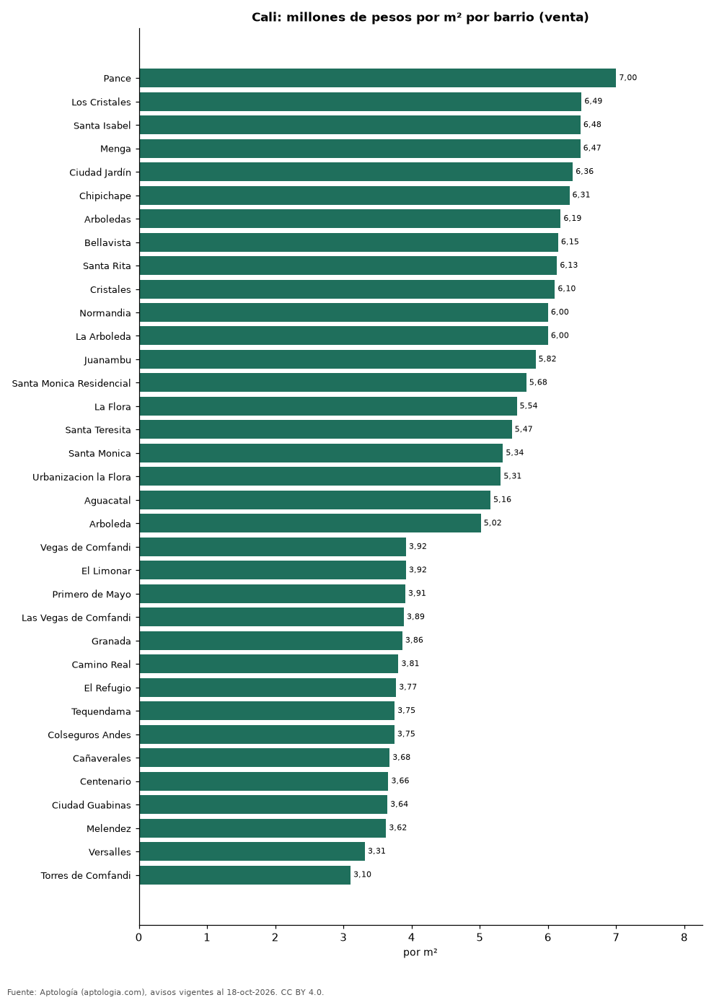
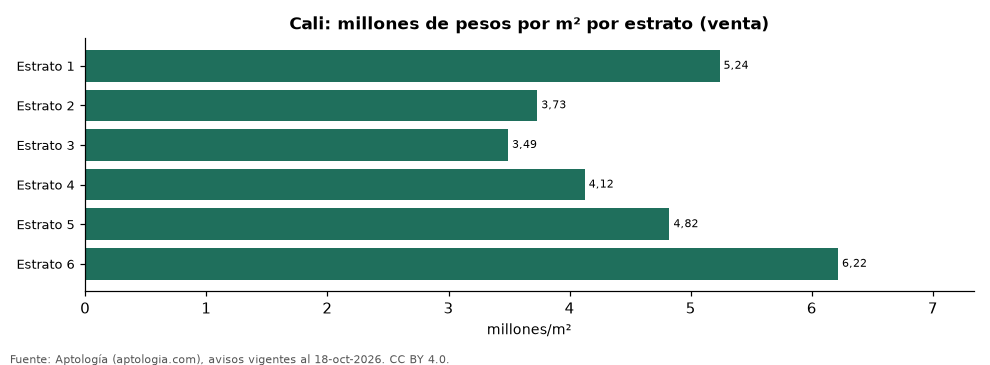

# Vivienda en Cali: precio por m², arriendo, habitaciones, estrato y administración (octubre 2026)

**El barrio con el metro cuadrado más caro de Cali es Pance, con 7,00 millones de pesos en la mediana de apartamentos en venta; el más barato de la muestra es Torres de Comfandi, con 3,10 millones de pesos.** Un apartamento de 2 habitaciones se arrienda por 1,55 millones de pesos al mes en la mediana y se vende por 280 millones de pesos. La rentabilidad bruta implícita del arriendo es 7,7 % anual. La administración equivale al 17,3 % del canon (469.500 pesos al mes en la mediana).

*Resumen: analizamos 11.119 avisos de apartamentos en Cali (9.505 en venta y 1.614 en arriendo).*

**Actualizado:** 18 de octubre de 2026 (datos del 18 de octubre de 2026) · **Próxima actualización:** mensual.

## Resumen

| Indicador | Valor |
|---|---|
| Más caro (venta por m²) | Pance: 7,00 millones de pesos |
| Más barato (venta por m²) | Torres de Comfandi: 3,10 millones de pesos |
| Venta por m² (mediana) | 4,65 millones de pesos |
| Arriendo 2 habitaciones | 1,55 millones de pesos |
| Rentabilidad bruta implícita | 7,7 % |
| Administración / canon (mediana) | 17,3 % |
| Avisos | 11.119 |

## Barrios (30 avisos o más)

| Barrio | Venta por m² (millones de pesos) | Arriendo mensual (millones de pesos) | Avisos (venta / arriendo) |
|---|---|---|---|
| Pance | 7,00 | 5,30 | 483 / 92 |
| Los Cristales | 6,49 | — | 46 / — |
| Santa Isabel | 6,48 | — | 92 / — |
| Menga | 6,47 | — | 92 / — |
| Ciudad Jardín | 6,36 | 4,50 | 397 / 56 |
| Chipichape | 6,31 | — | 63 / — |
| Arboledas | 6,19 | — | 71 / — |
| Bellavista | 6,15 | 5,40 | 223 / 46 |
| Santa Rita | 6,13 | — | 80 / — |
| Cristales | 6,10 | — | 194 / — |
| Normandia | 6,00 | 9,25 | 229 / 38 |
| La Arboleda | 6,00 | — | 79 / — |
| Juanambu | 5,82 | — | 100 / — |
| Santa Monica Residencial | 5,68 | — | 38 / — |
| La Flora | 5,54 | — | 138 / — |
| Santa Teresita | 5,47 | 7,50 | 364 / 63 |
| Santa Monica | 5,34 | — | 129 / — |
| Urbanizacion la Flora | 5,31 | — | 74 / — |
| Aguacatal | 5,16 | — | 125 / — |
| Arboleda | 5,02 | — | 40 / — |
| Cuarto de Legua | 4,95 | — | 44 / — |
| La Hacienda | 4,92 | — | 102 / — |
| Cuarto de Legua - Guadalupe | 4,87 | — | 44 / — |
| Multicentro | 4,83 | — | 35 / — |
| San Fernando | 4,76 | — | 31 / — |
| Valle del Lili | 4,66 | 1,70 | 797 / 136 |
| Valle de Lili | 4,55 | — | 164 / — |
| El Ingenio | 4,44 | — | 200 / — |
| El Peñon | 4,43 | — | 46 / — |
| Bochalema | 4,42 | 1,60 | 556 / 85 |
| Ciudad Melendez | 4,35 | 1,67 | 262 / 41 |
| La Selva | 4,34 | — | 55 / — |
| Prados del Norte | 4,34 | — | 88 / — |
| Quintas de Don Simón | 4,33 | — | 75 / — |
| San Fernando Viejo | 4,25 | — | 30 / — |
| San Pedro | 4,24 | — | 34 / — |
| Cachipay | 4,17 | 1,48 | 94 / 32 |
| Villa Fátima | 4,17 | — | 41 / — |
| Hacienda Kachipay | 4,15 | — | 61 / — |
| Caney | 4,08 | — | 124 / — |
| Brisas de los Alamos | 4,07 | — | 61 / — |
| Ciudad Capri | 4,07 | — | 47 / — |
| Miraflores | 4,06 | — | 37 / — |
| Kachipay | 4,06 | — | 65 / — |
| Los Cambulos | 4,04 | — | 32 / — |
| Ciudad 2000 | 4,03 | — | 40 / — |
| Ciudad Pacífica | 4,02 | — | 141 / — |
| Ciudad Pacifica | 4,00 | — | 89 / — |
| Santa Anita | 3,98 | — | 76 / — |
| El Caney | 3,98 | — | 37 / — |
| Nueva Tequendama | 3,95 | — | 32 / — |
| Vegas de Comfandi | 3,92 | — | 41 / — |
| El Limonar | 3,92 | — | 63 / — |
| Primero de Mayo | 3,91 | — | 51 / — |
| Las Vegas de Comfandi | 3,89 | — | 46 / — |
| Granada | 3,86 | — | 71 / — |
| Camino Real | 3,81 | — | 41 / — |
| El Refugio | 3,77 | — | 75 / — |
| Tequendama | 3,75 | — | 32 / — |
| Colseguros Andes | 3,75 | — | 32 / — |
| Cañaverales | 3,68 | — | 50 / — |
| Centenario | 3,66 | — | 57 / — |
| Ciudad Guabinas | 3,64 | — | 38 / — |
| Melendez | 3,62 | — | 54 / — |
| Versalles | 3,31 | — | 85 / — |
| Torres de Comfandi | 3,10 | — | 37 / — |

Medianas de apartamentos; — indica menos de 30 avisos. El canon es mensual, sin administración ni gastos comunes.

## Precio por número de habitaciones

| Habitaciones | Precio de venta (mediana) | Arriendo mensual (mediana) | Avisos (venta / arriendo) |
|---|---|---|---|
| 1 | 350 millones de pesos | 2,20 millones de pesos | 307 / 179 |
| 2 | 280 millones de pesos | 1,55 millones de pesos | 2.485 / 633 |
| 3 o más | 500 millones de pesos | 3,60 millones de pesos | 6.694 / 800 |

## Por estrato

| Estrato | Venta por m² (millones) | Arriendo mensual (millones) | Avisos (venta / arriendo) |
|---|---|---|---|
| 1 | 5,24 | — | 31 / — |
| 2 | 3,73 | — | 86 / — |
| 3 | 3,49 | 1,12 | 798 / 263 |
| 4 | 4,12 | 1,60 | 3.031 / 580 |
| 5 | 4,82 | 3,10 | 2.665 / 321 |
| 6 | 6,22 | 6,50 | 2.736 / 415 |

Medianas; — indica menos de 30 avisos.

## Preguntas frecuentes

**¿Cuál es el barrio más caro de Cali?**
Pance, con 7,00 millones de pesos por m² en apartamentos en venta (octubre de 2026).

**¿Dónde es más barato comprar apartamento en Cali?**
Entre los barrios con 30 avisos o más, en Torres de Comfandi: 3,10 millones de pesos por m².

**¿Cuánto renta un apartamento en Cali?**
La rentabilidad bruta implícita es 7,7 % anual (arriendo por m² × 12 ÷ precio de venta por m²), antes de gastos.

**¿Cuánto cuesta arrendar un apartamento de 2 habitaciones en Cali?**
1,55 millones de pesos al mes en la mediana (octubre de 2026).

## Metodología

- **Fuente:** exportes nocturnos de la base de datos de Aptología (aptologia.com) del 18 de octubre de 2026: avisos vigentes de vivienda en portales inmobiliarios de 13 países, recogidos por Aptología y vistos en línea entre el 11 y el 18 de octubre de 2026. Corte: 18 de octubre de 2026.
- **Depuración:** se eliminan duplicados exactos (misma ciudad, zona, tipo, precio, moneda, área, habitaciones y baños) y los precios fuera del percentil 1–99 de cada país, operación, moneda y tipo; el precio por m² usa solo avisos con área declarada entre 12 y 2.000 m² y también se recorta al P1–P99.
- **Qué se mide:** precios pedidos (publicados), no precios de cierre. En arriendo, el canon mensual sin administración, gastos comunes ni condominio.
- **Muestra mínima:** cada cifra publicada se apoya en al menos 30 avisos; las celdas con menos se omiten.
- **Colombia:** Precios en pesos colombianos, sin conversión de moneda. Administración ÷ canon con razones entre 1 % y 80 %.
- **Limitaciones:** la cobertura depende de los portales que recorre Aptología en cada país y es mayor en las ciudades grandes y en los segmentos medio-alto y alto; el área es la que declara el aviso, sin verificar; los nombres de zona vienen de los portales.
- **Privacidad:** solo se publican agregados; no se publica ningún dato personal, enlace a avisos ni nombre de anunciante.
- **Datos abiertos:** [datos.csv](datos.csv), licencia CC BY 4.0.

## Cómo citar

Pinzón Pineda, D. M. (2026). *Vivienda en Cali: precio por m², arriendo, habitaciones, estrato y administración (octubre 2026)*. Aptología (aptologia.com). https://github.com/elbroker/aptologia-datos/tree/main/estudios/vivienda-cali-venta-arriendo-rentabilidad-2026. Datos: datos.csv, licencia CC BY 4.0.
