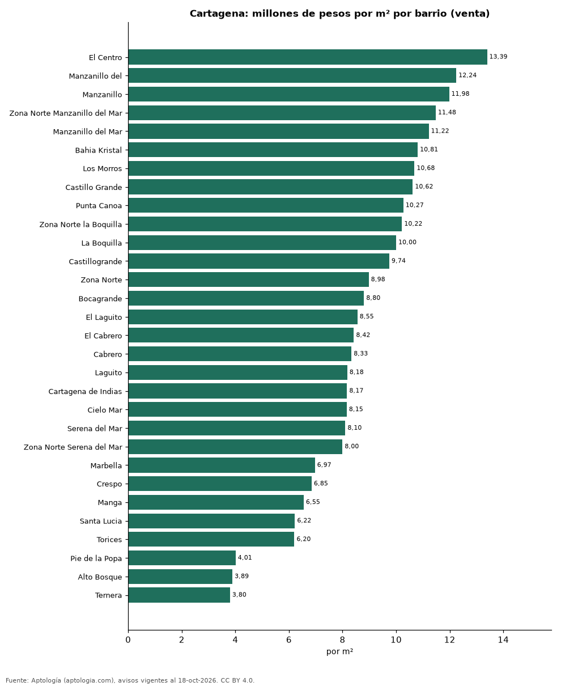
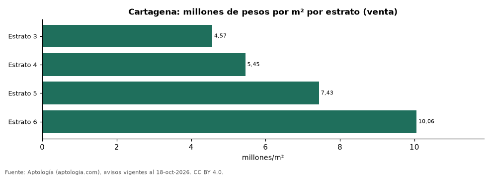

# Vivienda en Cartagena: precio por m², arriendo, habitaciones, estrato y administración (octubre 2026)

**El barrio con el metro cuadrado más caro de Cartagena es El Centro, con 13,39 millones de pesos en la mediana de apartamentos en venta; el más barato de la muestra es Ternera, con 3,80 millones de pesos.** Un apartamento de 2 habitaciones se arrienda por 3,40 millones de pesos al mes en la mediana y se vende por 750 millones de pesos. La rentabilidad bruta implícita del arriendo es 6,7 % anual. La administración equivale al 16,2 % del canon (647.000 pesos al mes en la mediana).

*Resumen: analizamos 8.161 avisos de apartamentos en Cartagena (6.126 en venta y 2.035 en arriendo).*

**Actualizado:** 18 de octubre de 2026 (datos del 18 de octubre de 2026) · **Próxima actualización:** mensual.

## Resumen

| Indicador | Valor |
|---|---|
| Más caro (venta por m²) | El Centro: 13,39 millones de pesos |
| Más barato (venta por m²) | Ternera: 3,80 millones de pesos |
| Venta por m² (mediana) | 7,86 millones de pesos |
| Arriendo 2 habitaciones | 3,40 millones de pesos |
| Rentabilidad bruta implícita | 6,7 % |
| Administración / canon (mediana) | 16,2 % |
| Avisos | 8.161 |

## Barrios (30 avisos o más)

| Barrio | Venta por m² (millones de pesos) | Arriendo mensual (millones de pesos) | Avisos (venta / arriendo) |
|---|---|---|---|
| El Centro | 13,39 | — | 33 / — |
| Manzanillo del | 12,24 | — | 31 / — |
| Manzanillo | 11,98 | 2,85 | 124 / 65 |
| Zona Norte Manzanillo del Mar | 11,48 | — | 32 / — |
| Manzanillo del Mar | 11,22 | 2,70 | 69 / 56 |
| Bahia Kristal | 10,81 | — | 34 / — |
| Los Morros | 10,68 | — | 31 / — |
| Castillo Grande | 10,62 | — | 44 / — |
| Punta Canoa | 10,27 | — | 30 / — |
| Zona Norte la Boquilla | 10,22 | — | 32 / — |
| La Boquilla | 10,00 | 4,50 | 384 / 153 |
| Castillogrande | 9,74 | 7,50 | 265 / 76 |
| Zona Norte | 8,98 | 3,79 | 122 / 36 |
| Bocagrande | 8,80 | 5,00 | 686 / 188 |
| El Laguito | 8,55 | — | 267 / — |
| El Cabrero | 8,42 | 4,00 | 117 / 75 |
| Cabrero | 8,33 | 4,40 | 50 / 38 |
| Laguito | 8,18 | — | 32 / — |
| Cartagena de Indias | 8,17 | 3,50 | 288 / 36 |
| Cielo Mar | 8,15 | 4,80 | 148 / 49 |
| Serena del Mar | 8,10 | 3,17 | 517 / 356 |
| Zona Norte Serena del Mar | 8,00 | — | 62 / — |
| Marbella | 6,97 | 3,80 | 176 / 100 |
| Crespo | 6,85 | 4,00 | 280 / 115 |
| Manga | 6,55 | 5,00 | 393 / 161 |
| Santa Lucia | 6,22 | — | 32 / — |
| Torices | 6,20 | 2,60 | 110 / 52 |
| Pie de la Popa | 4,01 | — | 102 / — |
| Alto Bosque | 3,89 | — | 35 / — |
| Ternera | 3,80 | — | 40 / — |

Medianas de apartamentos; — indica menos de 30 avisos. El canon es mensual, sin administración ni gastos comunes.

## Precio por número de habitaciones

| Habitaciones | Precio de venta (mediana) | Arriendo mensual (mediana) | Avisos (venta / arriendo) |
|---|---|---|---|
| 1 | 670 millones de pesos | 3,00 millones de pesos | 910 / 318 |
| 2 | 750 millones de pesos | 3,40 millones de pesos | 2.412 / 983 |
| 3 o más | 898 millones de pesos | 4,80 millones de pesos | 2.786 / 731 |

## Por estrato

| Estrato | Venta por m² (millones) | Arriendo mensual (millones) | Avisos (venta / arriendo) |
|---|---|---|---|
| 3 | 4,57 | 2,00 | 475 / 226 |
| 4 | 5,45 | 2,78 | 783 / 387 |
| 5 | 7,43 | 4,00 | 1.874 / 801 |
| 6 | 10,06 | 5,50 | 2.477 / 608 |

Medianas; — indica menos de 30 avisos.

## Preguntas frecuentes

**¿Cuál es el barrio más caro de Cartagena?**
El Centro, con 13,39 millones de pesos por m² en apartamentos en venta (octubre de 2026).

**¿Dónde es más barato comprar apartamento en Cartagena?**
Entre los barrios con 30 avisos o más, en Ternera: 3,80 millones de pesos por m².

**¿Cuánto renta un apartamento en Cartagena?**
La rentabilidad bruta implícita es 6,7 % anual (arriendo por m² × 12 ÷ precio de venta por m²), antes de gastos.

**¿Cuánto cuesta arrendar un apartamento de 2 habitaciones en Cartagena?**
3,40 millones de pesos al mes en la mediana (octubre de 2026).

## Metodología

- **Fuente:** exportes nocturnos de la base de datos de Aptología (aptologia.com) del 18 de octubre de 2026: avisos vigentes de vivienda en portales inmobiliarios de 13 países, recogidos por Aptología y vistos en línea entre el 11 y el 18 de octubre de 2026. Corte: 18 de octubre de 2026.
- **Depuración:** se eliminan duplicados exactos (misma ciudad, zona, tipo, precio, moneda, área, habitaciones y baños) y los precios fuera del percentil 1–99 de cada país, operación, moneda y tipo; el precio por m² usa solo avisos con área declarada entre 12 y 2.000 m² y también se recorta al P1–P99.
- **Qué se mide:** precios pedidos (publicados), no precios de cierre. En arriendo, el canon mensual sin administración, gastos comunes ni condominio.
- **Muestra mínima:** cada cifra publicada se apoya en al menos 30 avisos; las celdas con menos se omiten.
- **Colombia:** Precios en pesos colombianos, sin conversión de moneda. Administración ÷ canon con razones entre 1 % y 80 %.
- **Limitaciones:** la cobertura depende de los portales que recorre Aptología en cada país y es mayor en las ciudades grandes y en los segmentos medio-alto y alto; el área es la que declara el aviso, sin verificar; los nombres de zona vienen de los portales.
- **Privacidad:** solo se publican agregados; no se publica ningún dato personal, enlace a avisos ni nombre de anunciante.
- **Datos abiertos:** [datos.csv](datos.csv), licencia CC BY 4.0.

## Cómo citar

Pinzón Pineda, D. M. (2026). *Vivienda en Cartagena: precio por m², arriendo, habitaciones, estrato y administración (octubre 2026)*. Aptología (aptologia.com). https://github.com/elbroker/aptologia-datos/tree/main/estudios/vivienda-cartagena-venta-arriendo-rentabilidad-2026. Datos: datos.csv, licencia CC BY 4.0.
