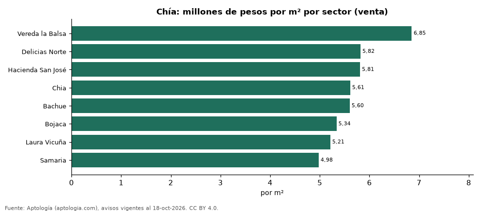
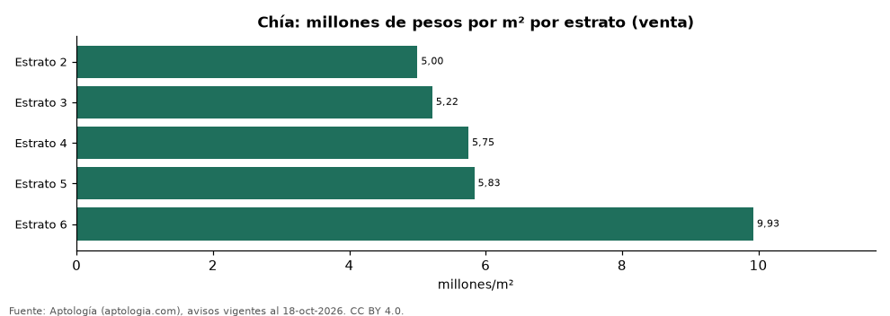

# Vivienda en Chía: precio por m², arriendo, habitaciones, estrato y administración (octubre 2026)

**El sector con el metro cuadrado más caro de Chía es Vereda la Balsa, con 6,85 millones de pesos en la mediana de apartamentos en venta; el más barato de la muestra es Samaria, con 4,98 millones de pesos.** Un apartamento de 2 habitaciones se arrienda por 1,55 millones de pesos al mes en la mediana y se vende por 290 millones de pesos. La rentabilidad bruta implícita del arriendo es 7,2 % anual. La administración equivale al 16,2 % del canon (295.600 pesos al mes en la mediana).

*Resumen: analizamos 2.006 avisos de apartamentos en Chía (1.512 en venta y 494 en arriendo).*

**Actualizado:** 18 de octubre de 2026 (datos del 18 de octubre de 2026) · **Próxima actualización:** mensual.

## Resumen

| Indicador | Valor |
|---|---|
| Más caro (venta por m²) | Vereda la Balsa: 6,85 millones de pesos |
| Más barato (venta por m²) | Samaria: 4,98 millones de pesos |
| Venta por m² (mediana) | 5,53 millones de pesos |
| Arriendo 2 habitaciones | 1,55 millones de pesos |
| Rentabilidad bruta implícita | 7,2 % |
| Administración / canon (mediana) | 16,2 % |
| Avisos | 2.006 |

## Sectores (30 avisos o más)

| Sector | Venta por m² (millones de pesos) | Arriendo mensual (millones de pesos) | Avisos (venta / arriendo) |
|---|---|---|---|
| Vereda la Balsa | 6,85 | — | 46 / — |
| Delicias Norte | 5,82 | — | 54 / — |
| Hacienda San José | 5,81 | — | 36 / — |
| Chia | 5,61 | 1,55 | 205 / 55 |
| Bachue | 5,60 | — | 32 / — |
| Bojaca | 5,34 | — | 48 / — |
| Laura Vicuña | 5,21 | — | 48 / — |
| Samaria | 4,98 | — | 57 / — |

Medianas de apartamentos; — indica menos de 30 avisos. El canon es mensual, sin administración ni gastos comunes.

## Precio por número de habitaciones

| Habitaciones | Precio de venta (mediana) | Arriendo mensual (mediana) | Avisos (venta / arriendo) |
|---|---|---|---|
| 1 | 300 millones de pesos | 1,70 millones de pesos | 194 / 112 |
| 2 | 290 millones de pesos | 1,55 millones de pesos | 641 / 233 |
| 3 o más | 450 millones de pesos | 2,80 millones de pesos | 676 / 147 |

## Por estrato

| Estrato | Venta por m² (millones) | Arriendo mensual (millones) | Avisos (venta / arriendo) |
|---|---|---|---|
| 2 | 5,00 | — | 50 / — |
| 3 | 5,22 | 1,50 | 650 / 233 |
| 4 | 5,75 | 2,50 | 606 / 167 |
| 5 | 5,83 | 2,55 | 115 / 42 |
| 6 | 9,93 | — | 48 / — |

Medianas; — indica menos de 30 avisos.

## Preguntas frecuentes

**¿Cuál es el sector más caro de Chía?**
Vereda la Balsa, con 6,85 millones de pesos por m² en apartamentos en venta (octubre de 2026).

**¿Dónde es más barato comprar apartamento en Chía?**
Entre los sectores con 30 avisos o más, en Samaria: 4,98 millones de pesos por m².

**¿Cuánto renta un apartamento en Chía?**
La rentabilidad bruta implícita es 7,2 % anual (arriendo por m² × 12 ÷ precio de venta por m²), antes de gastos.

**¿Cuánto cuesta arrendar un apartamento de 2 habitaciones en Chía?**
1,55 millones de pesos al mes en la mediana (octubre de 2026).

## Metodología

- **Fuente:** exportes nocturnos de la base de datos de Aptología (aptologia.com) del 18 de octubre de 2026: avisos vigentes de vivienda en portales inmobiliarios de 13 países, recogidos por Aptología y vistos en línea entre el 11 y el 18 de octubre de 2026. Corte: 18 de octubre de 2026.
- **Depuración:** se eliminan duplicados exactos (misma ciudad, zona, tipo, precio, moneda, área, habitaciones y baños) y los precios fuera del percentil 1–99 de cada país, operación, moneda y tipo; el precio por m² usa solo avisos con área declarada entre 12 y 2.000 m² y también se recorta al P1–P99.
- **Qué se mide:** precios pedidos (publicados), no precios de cierre. En arriendo, el canon mensual sin administración, gastos comunes ni condominio.
- **Muestra mínima:** cada cifra publicada se apoya en al menos 30 avisos; las celdas con menos se omiten.
- **Colombia:** Precios en pesos colombianos, sin conversión de moneda. Administración ÷ canon con razones entre 1 % y 80 %.
- **Limitaciones:** la cobertura depende de los portales que recorre Aptología en cada país y es mayor en las ciudades grandes y en los segmentos medio-alto y alto; el área es la que declara el aviso, sin verificar; los nombres de zona vienen de los portales.
- **Privacidad:** solo se publican agregados; no se publica ningún dato personal, enlace a avisos ni nombre de anunciante.
- **Datos abiertos:** [datos.csv](datos.csv), licencia CC BY 4.0.

## Cómo citar

Pinzón Pineda, D. M. (2026). *Vivienda en Chía: precio por m², arriendo, habitaciones, estrato y administración (octubre 2026)*. Aptología (aptologia.com). https://github.com/elbroker/aptologia-datos/tree/main/estudios/vivienda-chia-venta-arriendo-estrato-2026. Datos: datos.csv, licencia CC BY 4.0.
