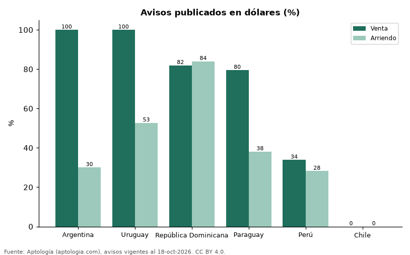

# ¿En dólares o en moneda local? Qué parte de la vivienda se publica en USD en Argentina, Uruguay, Paraguay, Perú, Chile y República Dominicana (octubre 2026)

**En Argentina el 100,0 % de las viviendas en venta se publica en dólares, pero en alquiler solo el 30,1 %; en Uruguay, el 100,0 % y el 52,7 %; en Perú, el 33,9 % y el 28,2 %.** Cuando se comparan apartamentos de la misma operación y país, los avisos en dólares piden entre +24,7 % y +369,0 % frente a los publicados en moneda local, porque se concentran en segmentos distintos.

*Resumen: clasificamos por moneda 126.937 avisos de vivienda de seis países donde conviven la moneda local (o la UF) y el dólar.*

**Actualizado:** 18 de octubre de 2026 (datos del 18 de octubre de 2026) · **Próxima actualización:** mensual.

## Resumen

| Indicador | Valor |
|---|---|
| Argentina: venta / arriendo en USD | 100,0 % / 30,1 % |
| Uruguay: venta / arriendo en USD | 100,0 % / 52,7 % |
| República Dominicana: venta / arriendo en USD | 81,9 % / 84,0 % |
| Paraguay: venta / arriendo en USD | 79,5 % / 38,1 % |
| Perú: venta / arriendo en USD | 33,9 % / 28,2 % |
| Chile: venta / arriendo en USD | 0,0 % / 0,0 % |

## Avisos publicados en dólares

| País | Venta en dólares | Arriendo en dólares |
|---|---|---|
| Argentina | 100,0 % | 30,1 % |
| Uruguay | 100,0 % | 52,7 % |
| República Dominicana | 81,9 % | 84,0 % |
| Paraguay | 79,5 % | 38,1 % |
| Perú | 33,9 % | 28,2 % |
| Chile | 0,0 % | 0,0 % |

Porcentaje de avisos de vivienda (todos los tipos) en USD. En Chile la alternativa es la UF. Ecuador, Venezuela y Bolivia publican en dólares y no se incluyen.

## Apartamentos en dólares frente a moneda local

| País | Operación | Moneda local | Mediana en USD | Mediana en moneda local (convertida) | Diferencia | Avisos (USD / local) |
|---|---|---|---|---|---|---|
| Argentina | arriendo | ARS | USD 1.690 | USD 561 | +201,1 % | 1.600 / 3.762 |
| República Dominicana | arriendo | DOP | USD 1.350 | USD 588 | +129,8 % | 3.534 / 681 |
| República Dominicana | venta | DOP | USD 235.000 | USD 130.576 | +80,0 % | 7.776 / 1.693 |
| Perú | arriendo | PEN | USD 1.250 | USD 873 | +43,1 % | 1.219 / 3.098 |
| Perú | venta | PEN | USD 250.000 | USD 174.783 | +43,0 % | 3.422 / 6.876 |
| Paraguay | arriendo | PYG | USD 1.360 | USD 876 | +55,2 % | 1.782 / 3.047 |
| Paraguay | venta | PYG | USD 138.432 | USD 111.031 | +24,7 % | 5.979 / 488 |
| Uruguay | arriendo | UYU | USD 3.500 | USD 746 | +369,0 % | 3.216 / 3.213 |

Las medianas se calculan por separado en cada moneda y la local se convierte a dólares con la tasa citada; no se mezclan.

## Preguntas frecuentes

**¿En Argentina se alquila en dólares?**
Poco: el 30,1 % de los avisos de alquiler está en dólares, frente al 100,0 % en venta.

**¿Se vende en dólares en Perú?**
En parte: el 33,9 % de los avisos de venta.

## Metodología

- **Fuente:** exportes nocturnos de la base de datos de Aptología (aptologia.com) del 18 de octubre de 2026: avisos vigentes de vivienda en portales inmobiliarios de 13 países, recogidos por Aptología y vistos en línea entre el 11 y el 18 de octubre de 2026. Corte: 18 de octubre de 2026.
- **Depuración:** se eliminan duplicados exactos (misma ciudad, zona, tipo, precio, moneda, área, habitaciones y baños) y los precios fuera del percentil 1–99 de cada país, operación, moneda y tipo; el precio por m² usa solo avisos con área declarada entre 12 y 2.000 m² y también se recorta al P1–P99.
- **Qué se mide:** precios pedidos (publicados), no precios de cierre. En arriendo, el canon mensual sin administración, gastos comunes ni condominio.
- **Muestra mínima:** cada cifra publicada se apoya en al menos 30 avisos; las celdas con menos se omiten.
- **Monedas:** nunca se mezclan avisos de monedas distintas sin convertirlos. Conversión a dólares con la tasa de mercado de ExchangeRate-API (open.er-api.com, actualización del 18 Oct 2026): 1 USD = 3.182,80 COP, 1 USD = 18,47 M.N, 1 USD = 5,09 BRL, 1 USD = 3,44 PEN, 1 USD = 982,44 CLP, 1 USD = 1.514,57 ARS, 1 USD = 40,20 UYU, 1 USD = 5.705,37 PYG, 1 USD = 61,27 DOP, 1 USD = 0,89 EUR, 1 USD = 11,72 BOB; la UF chilena a 41.178,64 CLP (mindicador,cl. 18-oct-2026). Los avisos publicados en dólares se usan tal cual.
- **Monedas:** en cada ciudad y operación se usa solo la moneda mayoritaria de los avisos (los avisos en otra moneda se excluyen) y la mediana se convierte a dólares con la tasa citada; nunca se promedian avisos de monedas distintas.
- **Limitaciones:** la cobertura depende de los portales que recorre Aptología en cada país y es mayor en las ciudades grandes y en los segmentos medio-alto y alto; el área es la que declara el aviso, sin verificar; los nombres de zona vienen de los portales.
- **Privacidad:** solo se publican agregados; no se publica ningún dato personal, enlace a avisos ni nombre de anunciante.
- **Datos abiertos:** [datos.csv](datos.csv), licencia CC BY 4.0.

## Cómo citar

Pinzón Pineda, D. M. (2026). *¿En dólares o en moneda local? Qué parte de la vivienda se publica en USD en Argentina, Uruguay, Paraguay, Perú, Chile y República Dominicana (octubre 2026)*. Aptología (aptologia.com). https://github.com/elbroker/aptologia-datos/tree/main/estudios/vivienda-en-dolares-o-en-moneda-local-latinoamerica-2026. Datos: datos.csv, licencia CC BY 4.0.
