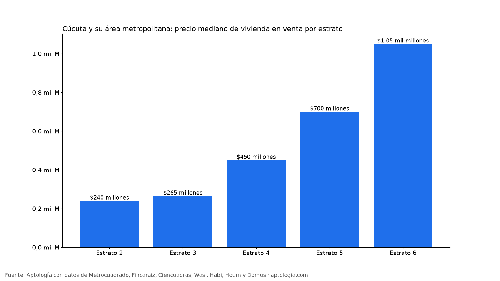

# Precio de vivienda en venta en Cúcuta y su área metropolitana: casas y apartamentos por tipo, estrato y barrio (octubre 2026)

**Una vivienda en venta en Cúcuta y su área metropolitana pide en la mediana $360 millones ($3.066.667 por m²); un apartamento, $270 millones, y una casa, $450 millones.** Comprar un apartamento para arrendar rinde en bruto cerca de 7,3 % al año.

*Resumen: analizamos 965 viviendas en venta y 251 en arriendo, únicas, en Cúcuta y su área metropolitana.*

**Actualizado:** 18 de octubre de 2026 (datos del 18 de octubre de 2026) · **Próxima actualización:** mensual.

## Resumen

| Indicador | Valor |
|---|---|
| Precio mediano de venta | $360 millones |
| Precio por m² | $3.066.667 |
| Apartamento (mediana) | $270 millones |
| Casa (mediana) | $450 millones |
| Arriendo mediano de un apartamento | $1.200.000 |
| Rentabilidad bruta indicativa | 7,3 % |
| Viviendas en venta analizadas | 965 |
| Viviendas en arriendo analizadas | 251 |

## Por tipo y municipio (20 avisos o más)

| Municipio | Tipo | Precio mediano | Por m² | Área mediana | Avisos |
|---|---|---|---|---|---|
| Cúcuta | Apartamento | $270 millones | $3.131.649 | 80 m² | 248 |
| Cúcuta | Casa | $465 millones | $2.857.143 | 197 m² | 430 |
| Los Patios | Apartamento | $330 millones | $3.846.154 | 75 m² | 49 |
| Los Patios | Casa | $530 millones | $3.020.134 | 195 m² | 79 |
| Villa Del Rosario | Casa | $328 millones | $3.392.857 | 117 m² | 132 |

## Por estrato

| Estrato | Precio mediano | Por m² | Avisos |
|---|---|---|---|
| 2 | $240 millones | $2.387.285 | 121 |
| 3 | $265 millones | $2.903.226 | 382 |
| 4 | $450 millones | $3.080.952 | 292 |
| 5 | $700 millones | $3.947.483 | 135 |
| 6 | $1,05 mil millones | $4.088.050 | 27 |

## Barrios de Cúcuta con 10 avisos o más

| Barrio | Precio por m² | Precio mediano | Avisos |
|---|---|---|---|
| Prados Del Este | $4.038.462 | $280 millones | 37 |
| Caobos | $3.333.333 | $500 millones | 33 |
| Ceiba Ii | $3.333.333 | $450 millones | 25 |
| Niza | $3.333.333 | $315 millones | 14 |
| Garcia Herreros | $3.333.333 | $175 millones | 18 |
| San Luis | $3.318.452 | $235 millones | 27 |
| La Riviera | $3.273.832 | $470 millones | 26 |
| Bocono | $3.260.870 | $515 millones | 26 |
| Colsag | $2.947.559 | $410 millones | 20 |
| Barrio Blanco | $2.919.838 | $425 millones | 32 |
| Lleras Restrepo | $2.889.932 | $540 millones | 20 |
| Av. Libertadores | $2.883.436 | $350 millones | 19 |
| La Playa | $2.857.726 | $315 millones | 22 |
| Sayago | $2.850.372 | $520 millones | 10 |
| La Ceiba | $2.817.460 | $655 millones | 14 |
| Quinta Bosch | $2.812.500 | $550 millones | 21 |
| Quinta Oriental | $2.463.592 | $525 millones | 20 |
| El Llano | $2.222.222 | $500 millones | 11 |
| La Cabrera | $2.169.837 | $280 millones | 10 |
| Popular | $2.092.050 | $575 millones | 10 |

## Arriendo (20 avisos o más)

| Tipo | Arriendo mediano | Por m² | Avisos |
|---|---|---|---|
| Apartamento | $1.200.000 | $19.600 | 149 |
| Casa | $1.675.000 | $13.022 | 76 |
| Apartaestudio | $775.000 | $17.042 | 26 |

**Cómo usarlo para decidir:** compara el precio por m² del aviso con la mediana de su tipo y estrato; si está muy por encima, hay espacio para negociar. Son precios pedidos en portales: en Cúcuta y su área metropolitana buena parte de las transacciones no pasa por portales, así que úsalo como referencia y no como avalúo.

## Preguntas frecuentes

**¿Cuánto cuesta una vivienda en Cúcuta y su área metropolitana?**
La mediana del precio pedido es $360 millones ($3.066.667 por m²), con datos del 18 de octubre de 2026.

**¿Cuánto cuesta un apartamento en Cúcuta y su área metropolitana?**
La mediana es $270 millones.

**¿Cuánto cuesta una casa en Cúcuta y su área metropolitana?**
La mediana es $450 millones.

## Metodología

- **Fuente:** avisos vivos de vivienda recogidos por la ingesta de Aptología en Metrocuadrado, Fincaraíz, Ciencuadras, Wasi, Habi, Houm y Domus, del 11 al 18 de octubre de 2026. Corte: 18 de octubre de 2026.
- **Depuración:** un mismo inmueble publicado varias veces se cuenta una sola vez (agrupación por portal y, entre portales, por precio, área, habitaciones y coordenadas). Se descartan precios y áreas fuera de rango y, en arriendo, se resta la administración cuando el portal la incluye en el canon.
- **Qué se mide:** precios pedidos (publicados), no precios de cierre.
- **Cobertura:** Cúcuta y su área metropolitana tiene menos avisos que Bogotá; las cifras por estrato y barrio tienen más margen de error. Solo grupos con 20 avisos o más (barrios con 10 o más). El estudio completo supera los 80 avisos.
- **Limitaciones:** son precios pedidos en portales, que pueden diferir del valor final de arriendo o venta. La cobertura es mayor en el norte de Bogotá y en estratos 4 a 6, porque ahí se concentra la oferta publicada. Los barrios y la localidad vienen de lo que escribe cada portal; cuando falta la localidad se asigna por los avisos vecinos más cercanos.
- **Datos abiertos:** [datos.csv](datos.csv), licencia CC BY 4.0.

## Cómo citar

Pinzón Pineda, D. M. (2026). *Precio de vivienda en venta en Cúcuta y su área metropolitana: casas y apartamentos por tipo, estrato y barrio (octubre 2026)*. Aptología. https://www.aptologia.com/estudios/vivienda-en-venta-cucuta-area-metropolitana-2026. Datos: datos.csv, licencia CC BY 4.0.
