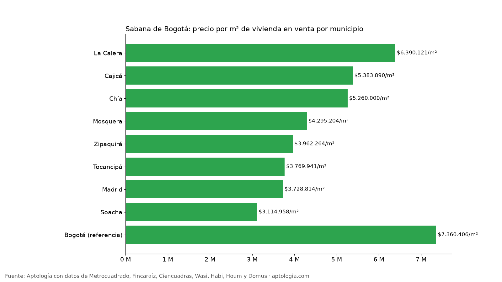

# Vivienda en venta en la Sabana de Bogotá: precio por m² en Soacha, Chía, Madrid, Cajicá, Zipaquirá y más (octubre 2026)

**En la Sabana de Bogotá, el metro cuadrado de vivienda en venta va de $3.114.958 en Soacha a $6.390.121 en La Calera, frente a $7.360.406 de un apartamento en Bogotá.** Un apartamento en venta en Soacha pide en la mediana $155 millones.

*Resumen: analizamos 736 casas y apartamentos en venta únicos en 8 municipios de la Sabana de Bogotá.*

**Actualizado:** 18 de octubre de 2026 (datos del 18 de octubre de 2026) · **Próxima actualización:** mensual.

## Vivienda en venta por municipio (40 avisos o más)

| Municipio | Precio por m² | Precio mediano | Apartamento | Casa | Área mediana | Avisos |
|---|---|---|---|---|---|---|
| La Calera | $6.390.121 | $2,23 mil millones | — | $2,40 mil millones | 350 m² | 78 |
| Cajicá | $5.383.890 | $342 millones | $322 millones | — | 62 m² | 59 |
| Chía | $5.260.000 | $525 millones | $264 millones | $1,30 mil millones | 115 m² | 97 |
| Mosquera | $4.295.204 | $307 millones | $260 millones | — | 67 m² | 40 |
| Zipaquirá | $3.962.264 | $228 millones | $226 millones | — | 59 m² | 61 |
| Tocancipá | $3.769.941 | $212 millones | $212 millones | — | 58 m² | 60 |
| Madrid | $3.728.814 | $205 millones | $205 millones | — | 56 m² | 95 |
| Soacha | $3.114.958 | $156 millones | $155 millones | — | 50 m² | 194 |

Referencia Bogotá: apartamento en venta, mediana $750 millones y $7.360.406 por m².

**Cómo usarlo para decidir:** vivir en la Sabana puede bajar el precio por m², pero suma tiempo y costo de transporte diario a Bogotá. Calcula cuánto te cuesta al mes desplazarte y compáralo con el ahorro en cuota o arriendo. Chía, Cajicá y La Calera tienen oferta de casas campestres que sube las medianas.

## Preguntas frecuentes

**¿Dónde es más barato comprar vivienda cerca de Bogotá?**
Entre los municipios de la Sabana con 40 avisos o más, en Soacha: $3.114.958 por m² (datos del 18 de octubre de 2026).

**¿Cuánto cuesta un apartamento en Chía?**
La mediana del precio pedido es $264 millones.

**¿Es más barato vivir en Soacha que en Bogotá?**
Sí: el metro cuadrado en venta en Soacha es $3.114.958, frente a $7.360.406 en Bogotá.

## Metodología

- **Fuente:** avisos vivos de vivienda recogidos por la ingesta de Aptología en Metrocuadrado, Fincaraíz, Ciencuadras, Wasi, Habi, Houm y Domus, del 11 al 18 de octubre de 2026. Corte: 18 de octubre de 2026.
- **Depuración:** un mismo inmueble publicado varias veces se cuenta una sola vez (agrupación por portal y, entre portales, por precio, área, habitaciones y coordenadas). Se descartan precios y áreas fuera de rango y, en arriendo, se resta la administración cuando el portal la incluye en el canon.
- **Qué se mide:** precios pedidos (publicados), no precios de cierre.
- **Municipio:** el que informa el portal; se excluyen avisos marcados solo como "Cundinamarca". Solo municipios con 40 avisos o más; apartamento y casa solo con 20 o más. El estudio completo supera los 80 avisos.
- **Cobertura:** menor que en Bogotá; las cifras por municipio tienen más margen de error.
- **Limitaciones:** son precios pedidos en portales, que pueden diferir del valor final de arriendo o venta. La cobertura es mayor en el norte de Bogotá y en estratos 4 a 6, porque ahí se concentra la oferta publicada. Los barrios y la localidad vienen de lo que escribe cada portal; cuando falta la localidad se asigna por los avisos vecinos más cercanos.
- **Datos abiertos:** [datos.csv](datos.csv), licencia CC BY 4.0.

## Cómo citar

Pinzón Pineda, D. M. (2026). *Vivienda en venta en la Sabana de Bogotá: precio por m² en Soacha, Chía, Madrid, Cajicá, Zipaquirá y más (octubre 2026)*. Aptología. https://www.aptologia.com/estudios/vivienda-en-venta-sabana-de-bogota-2026. Datos: datos.csv, licencia CC BY 4.0.
