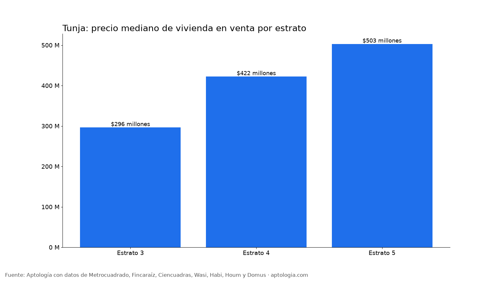

# Precio de vivienda en venta en Tunja: casas y apartamentos por tipo, estrato y barrio (octubre 2026)

**Una vivienda en venta en Tunja pide en la mediana $388 millones ($3.994.223 por m²); un apartamento, $340 millones, y una casa, $550 millones.**

*Resumen: analizamos 186 viviendas en venta y 22 en arriendo, únicas, en Tunja.*

**Actualizado:** 18 de octubre de 2026 (datos del 18 de octubre de 2026) · **Próxima actualización:** mensual.

## Resumen

| Indicador | Valor |
|---|---|
| Precio mediano de venta | $388 millones |
| Precio por m² | $3.994.223 |
| Apartamento (mediana) | $340 millones |
| Casa (mediana) | $550 millones |
| Arriendo mediano de un apartamento | — |
| Rentabilidad bruta indicativa | — |
| Viviendas en venta analizadas | 186 |
| Viviendas en arriendo analizadas | 22 |

## Por tipo y municipio (20 avisos o más)

| Municipio | Tipo | Precio mediano | Por m² | Área mediana | Avisos |
|---|---|---|---|---|---|
| Tunja | Apartamento | $340 millones | $4.534.884 | 72 m² | 85 |
| Tunja | Casa | $550 millones | $3.009.259 | 201 m² | 83 |

## Por estrato

| Estrato | Precio mediano | Por m² | Avisos |
|---|---|---|---|
| 3 | $296 millones | $3.153.134 | 64 |
| 4 | $422 millones | $4.106.838 | 46 |
| 5 | $503 millones | $4.606.075 | 58 |

**Cómo usarlo para decidir:** compara el precio por m² del aviso con la mediana de su tipo y estrato; si está muy por encima, hay espacio para negociar. Son precios pedidos en portales: en Tunja buena parte de las transacciones no pasa por portales, así que úsalo como referencia y no como avalúo.

## Preguntas frecuentes

**¿Cuánto cuesta una vivienda en Tunja?**
La mediana del precio pedido es $388 millones ($3.994.223 por m²), con datos del 18 de octubre de 2026.

**¿Cuánto cuesta un apartamento en Tunja?**
La mediana es $340 millones.

**¿Cuánto cuesta una casa en Tunja?**
La mediana es $550 millones.

## Metodología

- **Fuente:** avisos vivos de vivienda recogidos por la ingesta de Aptología en Metrocuadrado, Fincaraíz, Ciencuadras, Wasi, Habi, Houm y Domus, del 11 al 18 de octubre de 2026. Corte: 18 de octubre de 2026.
- **Depuración:** un mismo inmueble publicado varias veces se cuenta una sola vez (agrupación por portal y, entre portales, por precio, área, habitaciones y coordenadas). Se descartan precios y áreas fuera de rango y, en arriendo, se resta la administración cuando el portal la incluye en el canon.
- **Qué se mide:** precios pedidos (publicados), no precios de cierre.
- **Cobertura:** Tunja tiene menos avisos que Bogotá; las cifras por estrato y barrio tienen más margen de error. Solo grupos con 20 avisos o más (barrios con 10 o más). El estudio completo supera los 80 avisos.
- **Limitaciones:** son precios pedidos en portales, que pueden diferir del valor final de arriendo o venta. La cobertura es mayor en el norte de Bogotá y en estratos 4 a 6, porque ahí se concentra la oferta publicada. Los barrios y la localidad vienen de lo que escribe cada portal; cuando falta la localidad se asigna por los avisos vecinos más cercanos.
- **Datos abiertos:** [datos.csv](datos.csv), licencia CC BY 4.0.

## Cómo citar

Pinzón Pineda, D. M. (2026). *Precio de vivienda en venta en Tunja: casas y apartamentos por tipo, estrato y barrio (octubre 2026)*. Aptología. https://www.aptologia.com/estudios/vivienda-en-venta-tunja-2026. Datos: datos.csv, licencia CC BY 4.0.
