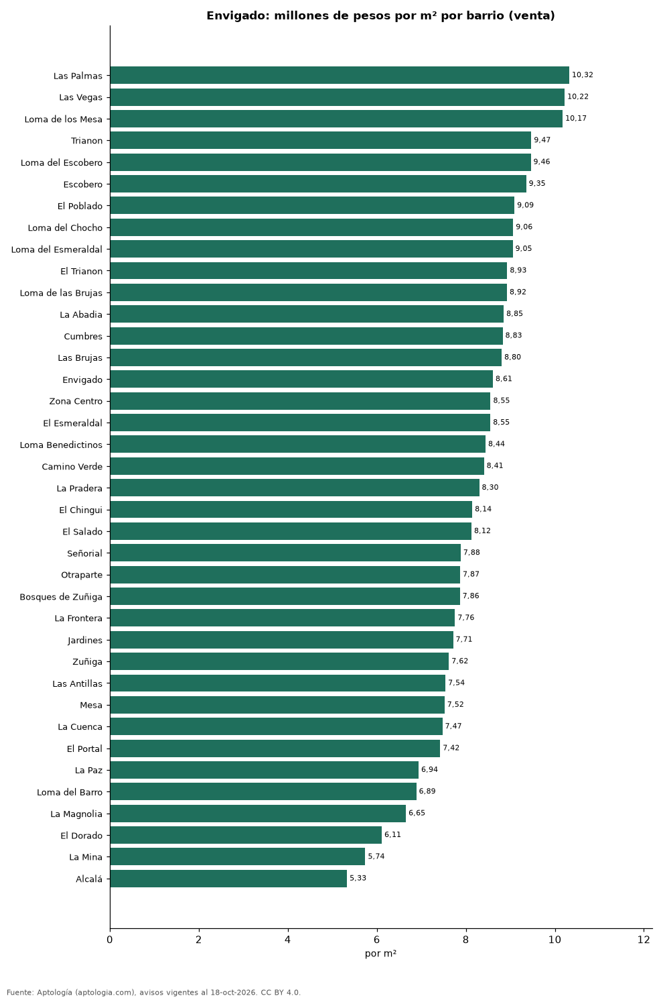
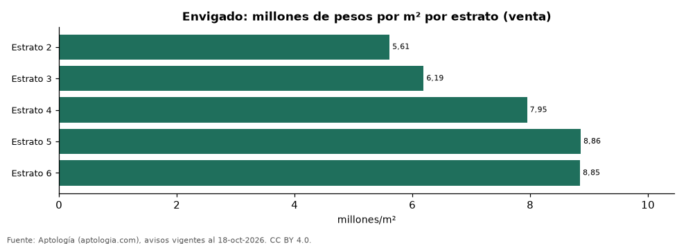

# Vivienda en Envigado: precio por m², arriendo, habitaciones, estrato y administración (octubre 2026)

**El barrio con el metro cuadrado más caro de Envigado es Las Palmas, con 10,32 millones de pesos en la mediana de apartamentos en venta; el más barato de la muestra es Alcalá, con 5,33 millones de pesos.** Un apartamento de 2 habitaciones se arrienda por 4,20 millones de pesos al mes en la mediana y se vende por 750 millones de pesos. La rentabilidad bruta implícita del arriendo es 6,9 % anual. La administración equivale al 11,1 % del canon (513.000 pesos al mes en la mediana).

*Resumen: analizamos 13.142 avisos de apartamentos en Envigado (5.788 en venta y 7.354 en arriendo).*

**Actualizado:** 18 de octubre de 2026 (datos del 18 de octubre de 2026) · **Próxima actualización:** mensual.

## Resumen

| Indicador | Valor |
|---|---|
| Más caro (venta por m²) | Las Palmas: 10,32 millones de pesos |
| Más barato (venta por m²) | Alcalá: 5,33 millones de pesos |
| Venta por m² (mediana) | 8,45 millones de pesos |
| Arriendo 2 habitaciones | 4,20 millones de pesos |
| Rentabilidad bruta implícita | 6,9 % |
| Administración / canon (mediana) | 11,1 % |
| Avisos | 13.142 |

## Barrios (30 avisos o más)

| Barrio | Venta por m² (millones de pesos) | Arriendo mensual (millones de pesos) | Avisos (venta / arriendo) |
|---|---|---|---|
| Las Palmas | 10,32 | 6,65 | 47 / 48 |
| Las Vegas | 10,22 | 4,20 | 126 / 169 |
| Loma de los Mesa | 10,17 | — | 65 / — |
| Trianon | 9,47 | — | 33 / — |
| Loma del Escobero | 9,46 | 4,60 | 193 / 349 |
| Escobero | 9,35 | 4,50 | 144 / 197 |
| El Poblado | 9,09 | 4,95 | 39 / 78 |
| Loma del Chocho | 9,06 | 4,65 | 157 / 219 |
| Loma del Esmeraldal | 9,05 | 4,55 | 253 / 409 |
| El Trianon | 8,93 | 3,48 | 116 / 92 |
| Loma de las Brujas | 8,92 | 5,50 | 385 / 342 |
| La Abadia | 8,85 | 4,30 | 70 / 132 |
| Cumbres | 8,83 | 4,50 | 292 / 468 |
| Las Brujas | 8,80 | 5,50 | 76 / 103 |
| Envigado | 8,61 | 4,65 | 418 / 1.254 |
| Zona Centro | 8,55 | 3,50 | 92 / 31 |
| El Esmeraldal | 8,55 | 4,50 | 136 / 167 |
| Loma Benedictinos | 8,44 | 5,00 | 113 / 223 |
| Camino Verde | 8,41 | 3,65 | 333 / 336 |
| La Pradera | 8,30 | 4,50 | 51 / 86 |
| El Chingui | 8,14 | 3,50 | 117 / 88 |
| El Salado | 8,12 | 3,55 | 48 / 41 |
| Señorial | 7,88 | 3,20 | 103 / 90 |
| Otraparte | 7,87 | 4,35 | 107 / 217 |
| Bosques de Zuñiga | 7,86 | 5,00 | 50 / 42 |
| La Frontera | 7,76 | 5,15 | 50 / 48 |
| Jardines | 7,71 | 4,80 | 36 / 72 |
| Zuñiga | 7,62 | 4,95 | 197 / 222 |
| Las Antillas | 7,54 | 3,20 | 121 / 92 |
| Mesa | 7,52 | 4,20 | 142 / 158 |
| La Cuenca | 7,47 | 3,00 | 86 / 79 |
| El Portal | 7,42 | 4,20 | 109 / 87 |
| La Paz | 6,94 | 3,35 | 59 / 39 |
| Loma del Barro | 6,89 | 3,00 | 73 / 60 |
| La Magnolia | 6,65 | — | 44 / — |
| El Dorado | 6,11 | 2,80 | 62 / 48 |
| La Mina | 5,74 | 2,58 | 64 / 56 |
| Alcalá | 5,33 | 3,00 | 32 / 41 |
| Alto de Misael | — | 4,00 | — / 35 |
| El Escobero | — | 4,50 | — / 40 |
| La Inmaculada | — | 4,50 | — / 44 |
| Los Almendros | — | 3,10 | — / 36 |
| Villagrande | — | 4,25 | — / 54 |

Medianas de apartamentos; — indica menos de 30 avisos. El canon es mensual, sin administración ni gastos comunes.

## Precio por número de habitaciones

| Habitaciones | Precio de venta (mediana) | Arriendo mensual (mediana) | Avisos (venta / arriendo) |
|---|---|---|---|
| 1 | 762 millones de pesos | 4,10 millones de pesos | 218 / 268 |
| 2 | 750 millones de pesos | 4,20 millones de pesos | 1.413 / 2.529 |
| 3 o más | 850 millones de pesos | 4,55 millones de pesos | 4.146 / 4.545 |

## Por estrato

| Estrato | Venta por m² (millones) | Arriendo mensual (millones) | Avisos (venta / arriendo) |
|---|---|---|---|
| 2 | 5,61 | 2,38 | 67 / 48 |
| 3 | 6,19 | 2,95 | 396 / 423 |
| 4 | 7,95 | 3,65 | 1.496 / 1.618 |
| 5 | 8,86 | 4,60 | 3.024 / 4.519 |
| 6 | 8,85 | 5,50 | 485 / 692 |

Medianas; — indica menos de 30 avisos.

## Preguntas frecuentes

**¿Cuál es el barrio más caro de Envigado?**
Las Palmas, con 10,32 millones de pesos por m² en apartamentos en venta (octubre de 2026).

**¿Dónde es más barato comprar apartamento en Envigado?**
Entre los barrios con 30 avisos o más, en Alcalá: 5,33 millones de pesos por m².

**¿Cuánto renta un apartamento en Envigado?**
La rentabilidad bruta implícita es 6,9 % anual (arriendo por m² × 12 ÷ precio de venta por m²), antes de gastos.

**¿Cuánto cuesta arrendar un apartamento de 2 habitaciones en Envigado?**
4,20 millones de pesos al mes en la mediana (octubre de 2026).

## Metodología

- **Fuente:** exportes nocturnos de la base de datos de Aptología (aptologia.com) del 18 de octubre de 2026: avisos vigentes de vivienda en portales inmobiliarios de 13 países, recogidos por Aptología y vistos en línea entre el 11 y el 18 de octubre de 2026. Corte: 18 de octubre de 2026.
- **Depuración:** se eliminan duplicados exactos (misma ciudad, zona, tipo, precio, moneda, área, habitaciones y baños) y los precios fuera del percentil 1–99 de cada país, operación, moneda y tipo; el precio por m² usa solo avisos con área declarada entre 12 y 2.000 m² y también se recorta al P1–P99.
- **Qué se mide:** precios pedidos (publicados), no precios de cierre. En arriendo, el canon mensual sin administración, gastos comunes ni condominio.
- **Muestra mínima:** cada cifra publicada se apoya en al menos 30 avisos; las celdas con menos se omiten.
- **Colombia:** Precios en pesos colombianos, sin conversión de moneda. Administración ÷ canon con razones entre 1 % y 80 %.
- **Limitaciones:** la cobertura depende de los portales que recorre Aptología en cada país y es mayor en las ciudades grandes y en los segmentos medio-alto y alto; el área es la que declara el aviso, sin verificar; los nombres de zona vienen de los portales.
- **Privacidad:** solo se publican agregados; no se publica ningún dato personal, enlace a avisos ni nombre de anunciante.
- **Datos abiertos:** [datos.csv](datos.csv), licencia CC BY 4.0.

## Cómo citar

Pinzón Pineda, D. M. (2026). *Vivienda en Envigado: precio por m², arriendo, habitaciones, estrato y administración (octubre 2026)*. Aptología (aptologia.com). https://github.com/elbroker/aptologia-datos/tree/main/estudios/vivienda-envigado-venta-arriendo-rentabilidad-2026. Datos: datos.csv, licencia CC BY 4.0.
